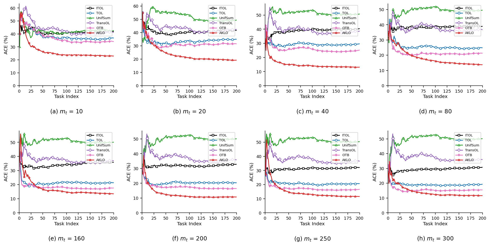
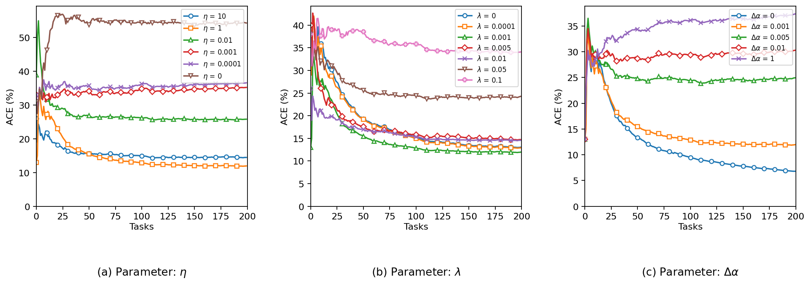
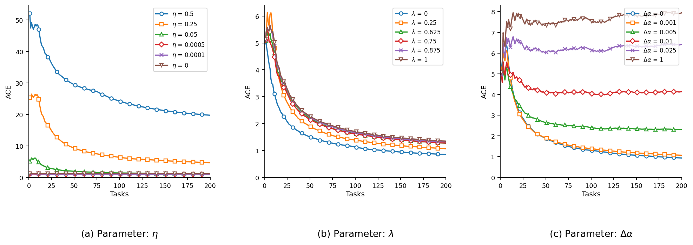
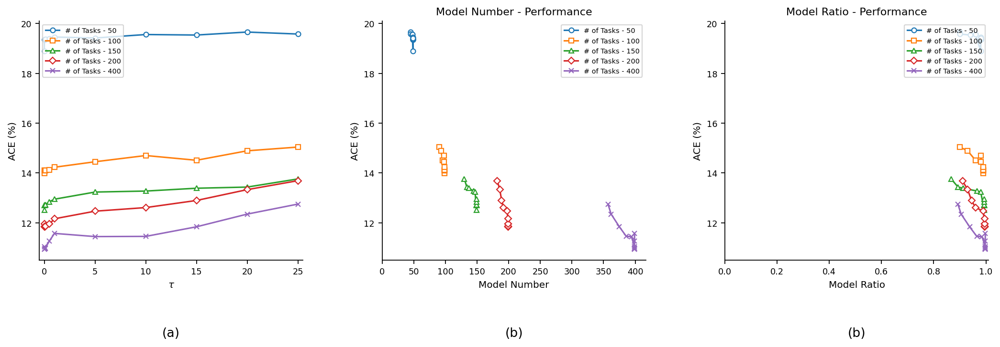
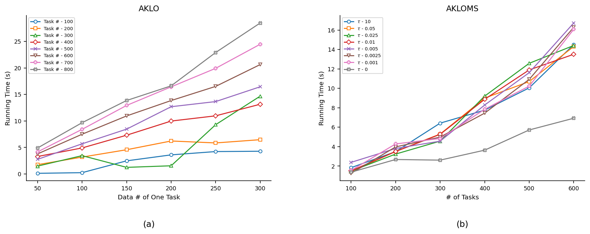

# AKLO reproduction report

Generated from the JSON files in `results/`. Classification ACE is a
percentage; regression ACE is on the target scale. W&B links are
included when the run was tracked online.

## E1: main comparison (paper Table 1)

| Method | Syn1 | Syn2 | Landmine | Spam | Syn3 | Syn4 | London |
| --- | --- | --- | --- | --- | --- | --- | --- |
| ITOL | [37.32](https://forge.coreweave.com/wandb/AI-Athena-Lab/AKLO-lifelong-online-learning/runs/y13cvc2i) | [38.12](https://forge.coreweave.com/wandb/AI-Athena-Lab/AKLO-lifelong-online-learning/runs/sjqc7zq8) | [38.39](https://forge.coreweave.com/wandb/AI-Athena-Lab/AKLO-lifelong-online-learning/runs/3yp2a67x) | [25.63](https://forge.coreweave.com/wandb/AI-Athena-Lab/AKLO-lifelong-online-learning/runs/9g42hpby) | [7.94](https://forge.coreweave.com/wandb/AI-Athena-Lab/AKLO-lifelong-online-learning/runs/ls764uk9) | [5.18](https://forge.coreweave.com/wandb/AI-Athena-Lab/AKLO-lifelong-online-learning/runs/43z8885r) | [14.80](https://forge.coreweave.com/wandb/AI-Athena-Lab/AKLO-lifelong-online-learning/runs/cam1xnw6) |
| TOL | [23.62](https://forge.coreweave.com/wandb/AI-Athena-Lab/AKLO-lifelong-online-learning/runs/asaf0vbr) | [37.78](https://forge.coreweave.com/wandb/AI-Athena-Lab/AKLO-lifelong-online-learning/runs/l0fj5k96) | [38.30](https://forge.coreweave.com/wandb/AI-Athena-Lab/AKLO-lifelong-online-learning/runs/wk23p95u) | [20.47](https://forge.coreweave.com/wandb/AI-Athena-Lab/AKLO-lifelong-online-learning/runs/icy5j4de) | [7.94](https://forge.coreweave.com/wandb/AI-Athena-Lab/AKLO-lifelong-online-learning/runs/jqqpxl2y) | [5.18](https://forge.coreweave.com/wandb/AI-Athena-Lab/AKLO-lifelong-online-learning/runs/vvckxuoz) | [12.61](https://forge.coreweave.com/wandb/AI-Athena-Lab/AKLO-lifelong-online-learning/runs/x30uqd9i) |
| UnifSum | [49.93](https://forge.coreweave.com/wandb/AI-Athena-Lab/AKLO-lifelong-online-learning/runs/6cbca3qn) | [51.38](https://forge.coreweave.com/wandb/AI-Athena-Lab/AKLO-lifelong-online-learning/runs/nqx9a7wa) | [39.20](https://forge.coreweave.com/wandb/AI-Athena-Lab/AKLO-lifelong-online-learning/runs/gi7os8oj) | [24.70](https://forge.coreweave.com/wandb/AI-Athena-Lab/AKLO-lifelong-online-learning/runs/qtes0e7n) | [1.60](https://forge.coreweave.com/wandb/AI-Athena-Lab/AKLO-lifelong-online-learning/runs/16e8k0q0) | [1.40](https://forge.coreweave.com/wandb/AI-Athena-Lab/AKLO-lifelong-online-learning/runs/hqd7ze14) | [15.02](https://forge.coreweave.com/wandb/AI-Athena-Lab/AKLO-lifelong-online-learning/runs/gt2eqx3d) |
| TransOL | [37.10](https://forge.coreweave.com/wandb/AI-Athena-Lab/AKLO-lifelong-online-learning/runs/x5pxxxxj) | [44.05](https://forge.coreweave.com/wandb/AI-Athena-Lab/AKLO-lifelong-online-learning/runs/v2wbfxr3) | [38.21](https://forge.coreweave.com/wandb/AI-Athena-Lab/AKLO-lifelong-online-learning/runs/fc18stmj) | [21.20](https://forge.coreweave.com/wandb/AI-Athena-Lab/AKLO-lifelong-online-learning/runs/jzxbrhnu) | [5.35](https://forge.coreweave.com/wandb/AI-Athena-Lab/AKLO-lifelong-online-learning/runs/gbfmq2i3) | [3.69](https://forge.coreweave.com/wandb/AI-Athena-Lab/AKLO-lifelong-online-learning/runs/q81cb2tv) | [13.19](https://forge.coreweave.com/wandb/AI-Athena-Lab/AKLO-lifelong-online-learning/runs/gbauolsp) |
| OTB | [19.52](https://forge.coreweave.com/wandb/AI-Athena-Lab/AKLO-lifelong-online-learning/runs/s08ez2i0) | [37.53](https://forge.coreweave.com/wandb/AI-Athena-Lab/AKLO-lifelong-online-learning/runs/l2w8ktjr) | [33.95](https://forge.coreweave.com/wandb/AI-Athena-Lab/AKLO-lifelong-online-learning/runs/zl8epa1u) | [17.50](https://forge.coreweave.com/wandb/AI-Athena-Lab/AKLO-lifelong-online-learning/runs/d81jwdb9) | – | – | – |
| AKLO | [11.95](https://forge.coreweave.com/wandb/AI-Athena-Lab/AKLO-lifelong-online-learning/runs/kx6bqnkp) | [10.32](https://forge.coreweave.com/wandb/AI-Athena-Lab/AKLO-lifelong-online-learning/runs/bxtxygw0) | [29.95](https://forge.coreweave.com/wandb/AI-Athena-Lab/AKLO-lifelong-online-learning/runs/cd5tvh9w) | [19.50](https://forge.coreweave.com/wandb/AI-Athena-Lab/AKLO-lifelong-online-learning/runs/5guq1ur7) | [1.06](https://forge.coreweave.com/wandb/AI-Athena-Lab/AKLO-lifelong-online-learning/runs/qconblr2) | [1.10](https://forge.coreweave.com/wandb/AI-Athena-Lab/AKLO-lifelong-online-learning/runs/uderunnz) | [11.94](https://forge.coreweave.com/wandb/AI-Athena-Lab/AKLO-lifelong-online-learning/runs/pngn5o6m) |

### Paper vs reproduction

| Dataset | Method | Paper | Reproduction |
| --- | --- | --- | --- |
| syn1 | ITOL | 36.18 | [37.32](https://forge.coreweave.com/wandb/AI-Athena-Lab/AKLO-lifelong-online-learning/runs/y13cvc2i) |
| syn1 | TOL | 21.16 | [23.62](https://forge.coreweave.com/wandb/AI-Athena-Lab/AKLO-lifelong-online-learning/runs/asaf0vbr) |
| syn1 | UnifSum | 49.63 | [49.93](https://forge.coreweave.com/wandb/AI-Athena-Lab/AKLO-lifelong-online-learning/runs/6cbca3qn) |
| syn1 | TransOL | 36.40 | [37.10](https://forge.coreweave.com/wandb/AI-Athena-Lab/AKLO-lifelong-online-learning/runs/x5pxxxxj) |
| syn1 | OTB | 30.19 | [19.52](https://forge.coreweave.com/wandb/AI-Athena-Lab/AKLO-lifelong-online-learning/runs/s08ez2i0) |
| syn1 | AKLO | 10.10 | [11.95](https://forge.coreweave.com/wandb/AI-Athena-Lab/AKLO-lifelong-online-learning/runs/kx6bqnkp) |
| syn2 | ITOL | 33.70 | [38.12](https://forge.coreweave.com/wandb/AI-Athena-Lab/AKLO-lifelong-online-learning/runs/sjqc7zq8) |
| syn2 | TOL | 33.34 | [37.78](https://forge.coreweave.com/wandb/AI-Athena-Lab/AKLO-lifelong-online-learning/runs/l0fj5k96) |
| syn2 | UnifSum | 43.07 | [51.38](https://forge.coreweave.com/wandb/AI-Athena-Lab/AKLO-lifelong-online-learning/runs/nqx9a7wa) |
| syn2 | TransOL | 32.97 | [44.05](https://forge.coreweave.com/wandb/AI-Athena-Lab/AKLO-lifelong-online-learning/runs/v2wbfxr3) |
| syn2 | OTB | 34.90 | [37.53](https://forge.coreweave.com/wandb/AI-Athena-Lab/AKLO-lifelong-online-learning/runs/l2w8ktjr) |
| syn2 | AKLO | 10.16 | [10.32](https://forge.coreweave.com/wandb/AI-Athena-Lab/AKLO-lifelong-online-learning/runs/bxtxygw0) |
| landmine | ITOL | 13.86 | [38.39](https://forge.coreweave.com/wandb/AI-Athena-Lab/AKLO-lifelong-online-learning/runs/3yp2a67x) |
| landmine | TOL | 11.54 | [38.30](https://forge.coreweave.com/wandb/AI-Athena-Lab/AKLO-lifelong-online-learning/runs/wk23p95u) |
| landmine | UnifSum | 7.97 | [39.20](https://forge.coreweave.com/wandb/AI-Athena-Lab/AKLO-lifelong-online-learning/runs/gi7os8oj) |
| landmine | TransOL | 8.05 | [38.21](https://forge.coreweave.com/wandb/AI-Athena-Lab/AKLO-lifelong-online-learning/runs/fc18stmj) |
| landmine | OTB | 10.94 | [33.95](https://forge.coreweave.com/wandb/AI-Athena-Lab/AKLO-lifelong-online-learning/runs/zl8epa1u) |
| landmine | AKLO | 7.30 | [29.95](https://forge.coreweave.com/wandb/AI-Athena-Lab/AKLO-lifelong-online-learning/runs/cd5tvh9w) |
| spam | ITOL | 25.00 | [25.63](https://forge.coreweave.com/wandb/AI-Athena-Lab/AKLO-lifelong-online-learning/runs/9g42hpby) |
| spam | TOL | 19.51 | [20.47](https://forge.coreweave.com/wandb/AI-Athena-Lab/AKLO-lifelong-online-learning/runs/icy5j4de) |
| spam | UnifSum | 19.50 | [24.70](https://forge.coreweave.com/wandb/AI-Athena-Lab/AKLO-lifelong-online-learning/runs/qtes0e7n) |
| spam | TransOL | 24.50 | [21.20](https://forge.coreweave.com/wandb/AI-Athena-Lab/AKLO-lifelong-online-learning/runs/jzxbrhnu) |
| spam | OTB | 24.10 | [17.50](https://forge.coreweave.com/wandb/AI-Athena-Lab/AKLO-lifelong-online-learning/runs/d81jwdb9) |
| spam | AKLO | 17.36 | [19.50](https://forge.coreweave.com/wandb/AI-Athena-Lab/AKLO-lifelong-online-learning/runs/5guq1ur7) |
| syn3 | ITOL | 14.54 | [7.94](https://forge.coreweave.com/wandb/AI-Athena-Lab/AKLO-lifelong-online-learning/runs/ls764uk9) |
| syn3 | TOL | 7.63 | [7.94](https://forge.coreweave.com/wandb/AI-Athena-Lab/AKLO-lifelong-online-learning/runs/jqqpxl2y) |
| syn3 | UnifSum | 27.69 | [1.60](https://forge.coreweave.com/wandb/AI-Athena-Lab/AKLO-lifelong-online-learning/runs/16e8k0q0) |
| syn3 | TransOL | 61.61 | [5.35](https://forge.coreweave.com/wandb/AI-Athena-Lab/AKLO-lifelong-online-learning/runs/gbfmq2i3) |
| syn3 | AKLO | 4.06 | [1.06](https://forge.coreweave.com/wandb/AI-Athena-Lab/AKLO-lifelong-online-learning/runs/qconblr2) |
| syn4 | ITOL | 8.02 | [5.18](https://forge.coreweave.com/wandb/AI-Athena-Lab/AKLO-lifelong-online-learning/runs/43z8885r) |
| syn4 | TOL | 9.96 | [5.18](https://forge.coreweave.com/wandb/AI-Athena-Lab/AKLO-lifelong-online-learning/runs/vvckxuoz) |
| syn4 | UnifSum | 51.23 | [1.40](https://forge.coreweave.com/wandb/AI-Athena-Lab/AKLO-lifelong-online-learning/runs/hqd7ze14) |
| syn4 | TransOL | 54.55 | [3.69](https://forge.coreweave.com/wandb/AI-Athena-Lab/AKLO-lifelong-online-learning/runs/q81cb2tv) |
| syn4 | AKLO | 2.98 | [1.10](https://forge.coreweave.com/wandb/AI-Athena-Lab/AKLO-lifelong-online-learning/runs/uderunnz) |
| london | ITOL | 20.76 | [14.80](https://forge.coreweave.com/wandb/AI-Athena-Lab/AKLO-lifelong-online-learning/runs/cam1xnw6) |
| london | TOL | 20.91 | [12.61](https://forge.coreweave.com/wandb/AI-Athena-Lab/AKLO-lifelong-online-learning/runs/x30uqd9i) |
| london | UnifSum | 10.94 | [15.02](https://forge.coreweave.com/wandb/AI-Athena-Lab/AKLO-lifelong-online-learning/runs/gt2eqx3d) |
| london | TransOL | 79.58 | [13.19](https://forge.coreweave.com/wandb/AI-Athena-Lab/AKLO-lifelong-online-learning/runs/gbauolsp) |
| london | AKLO | 10.05 | [11.94](https://forge.coreweave.com/wandb/AI-Athena-Lab/AKLO-lifelong-online-learning/runs/pngn5o6m) |

## E2: number of observations per task (paper Figure 3)

| m_t | ITOL | TOL | UnifSum | TransOL | OTB | AKLO |
| --- | --- | --- | --- | --- | --- | --- |
| 10 | [41.85](https://forge.coreweave.com/wandb/AI-Athena-Lab/AKLO-lifelong-online-learning/runs/so3ovu92) | [36.90](https://forge.coreweave.com/wandb/AI-Athena-Lab/AKLO-lifelong-online-learning/runs/1r3kvnuv) | [42.65](https://forge.coreweave.com/wandb/AI-Athena-Lab/AKLO-lifelong-online-learning/runs/f6lz4fgl) | [41.35](https://forge.coreweave.com/wandb/AI-Athena-Lab/AKLO-lifelong-online-learning/runs/6ouyec0o) | [34.10](https://forge.coreweave.com/wandb/AI-Athena-Lab/AKLO-lifelong-online-learning/runs/pb5j1tq5) | [22.90](https://forge.coreweave.com/wandb/AI-Athena-Lab/AKLO-lifelong-online-learning/runs/ufimbj2n) |
| 20 | [41.67](https://forge.coreweave.com/wandb/AI-Athena-Lab/AKLO-lifelong-online-learning/runs/h3lmkjwq) | [34.98](https://forge.coreweave.com/wandb/AI-Athena-Lab/AKLO-lifelong-online-learning/runs/lfl3a9dg) | [49.50](https://forge.coreweave.com/wandb/AI-Athena-Lab/AKLO-lifelong-online-learning/runs/7rquut0a) | [42.38](https://forge.coreweave.com/wandb/AI-Athena-Lab/AKLO-lifelong-online-learning/runs/vbonbri5) | [31.55](https://forge.coreweave.com/wandb/AI-Athena-Lab/AKLO-lifelong-online-learning/runs/hxlhes34) | [19.25](https://forge.coreweave.com/wandb/AI-Athena-Lab/AKLO-lifelong-online-learning/runs/12q10zh7) |
| 40 | [40.40](https://forge.coreweave.com/wandb/AI-Athena-Lab/AKLO-lifelong-online-learning/runs/m2ldmurj) | [29.64](https://forge.coreweave.com/wandb/AI-Athena-Lab/AKLO-lifelong-online-learning/runs/ftt13afb) | [50.78](https://forge.coreweave.com/wandb/AI-Athena-Lab/AKLO-lifelong-online-learning/runs/3majbtbp) | [38.61](https://forge.coreweave.com/wandb/AI-Athena-Lab/AKLO-lifelong-online-learning/runs/n776t2dp) | [25.21](https://forge.coreweave.com/wandb/AI-Athena-Lab/AKLO-lifelong-online-learning/runs/uqgzdc6m) | [13.11](https://forge.coreweave.com/wandb/AI-Athena-Lab/AKLO-lifelong-online-learning/runs/g033qn4b) |
| 80 | [38.96](https://forge.coreweave.com/wandb/AI-Athena-Lab/AKLO-lifelong-online-learning/runs/denef87s) | [24.90](https://forge.coreweave.com/wandb/AI-Athena-Lab/AKLO-lifelong-online-learning/runs/i3k5d1ny) | [49.57](https://forge.coreweave.com/wandb/AI-Athena-Lab/AKLO-lifelong-online-learning/runs/4qfsd0yy) | [36.77](https://forge.coreweave.com/wandb/AI-Athena-Lab/AKLO-lifelong-online-learning/runs/d4ptm0zv) | [21.31](https://forge.coreweave.com/wandb/AI-Athena-Lab/AKLO-lifelong-online-learning/runs/akq2aqbs) | [13.78](https://forge.coreweave.com/wandb/AI-Athena-Lab/AKLO-lifelong-online-learning/runs/phwqmy7b) |
| 160 | [35.85](https://forge.coreweave.com/wandb/AI-Athena-Lab/AKLO-lifelong-online-learning/runs/5cobkqqe) | [21.40](https://forge.coreweave.com/wandb/AI-Athena-Lab/AKLO-lifelong-online-learning/runs/7cgz72i0) | [50.11](https://forge.coreweave.com/wandb/AI-Athena-Lab/AKLO-lifelong-online-learning/runs/qama8yow) | [36.95](https://forge.coreweave.com/wandb/AI-Athena-Lab/AKLO-lifelong-online-learning/runs/mhe7i43p) | [17.59](https://forge.coreweave.com/wandb/AI-Athena-Lab/AKLO-lifelong-online-learning/runs/h6gx2tt9) | [13.47](https://forge.coreweave.com/wandb/AI-Athena-Lab/AKLO-lifelong-online-learning/runs/j8afes28) |
| 200 | [32.85](https://forge.coreweave.com/wandb/AI-Athena-Lab/AKLO-lifelong-online-learning/runs/xjbwl4ot) | [20.42](https://forge.coreweave.com/wandb/AI-Athena-Lab/AKLO-lifelong-online-learning/runs/8vuv350g) | [50.09](https://forge.coreweave.com/wandb/AI-Athena-Lab/AKLO-lifelong-online-learning/runs/nu4tr04e) | [35.82](https://forge.coreweave.com/wandb/AI-Athena-Lab/AKLO-lifelong-online-learning/runs/yao85urg) | [16.48](https://forge.coreweave.com/wandb/AI-Athena-Lab/AKLO-lifelong-online-learning/runs/env4g96b) | [10.70](https://forge.coreweave.com/wandb/AI-Athena-Lab/AKLO-lifelong-online-learning/runs/wc3bjja7) |
| 250 | [32.12](https://forge.coreweave.com/wandb/AI-Athena-Lab/AKLO-lifelong-online-learning/runs/az4gkxs6) | [20.68](https://forge.coreweave.com/wandb/AI-Athena-Lab/AKLO-lifelong-online-learning/runs/zo8cww3u) | [50.43](https://forge.coreweave.com/wandb/AI-Athena-Lab/AKLO-lifelong-online-learning/runs/x0nh6n0j) | [36.59](https://forge.coreweave.com/wandb/AI-Athena-Lab/AKLO-lifelong-online-learning/runs/ch3rxf4w) | [16.63](https://forge.coreweave.com/wandb/AI-Athena-Lab/AKLO-lifelong-online-learning/runs/igfuaxbk) | [11.58](https://forge.coreweave.com/wandb/AI-Athena-Lab/AKLO-lifelong-online-learning/runs/4melbbr7) |
| 300 | [30.79](https://forge.coreweave.com/wandb/AI-Athena-Lab/AKLO-lifelong-online-learning/runs/bimk88py) | [19.35](https://forge.coreweave.com/wandb/AI-Athena-Lab/AKLO-lifelong-online-learning/runs/8e6ifsow) | [50.15](https://forge.coreweave.com/wandb/AI-Athena-Lab/AKLO-lifelong-online-learning/runs/x28itc2z) | [35.93](https://forge.coreweave.com/wandb/AI-Athena-Lab/AKLO-lifelong-online-learning/runs/hv78bcsk) | [15.48](https://forge.coreweave.com/wandb/AI-Athena-Lab/AKLO-lifelong-online-learning/runs/0ityqqc8) | [11.63](https://forge.coreweave.com/wandb/AI-Athena-Lab/AKLO-lifelong-online-learning/runs/6jhk07qe) |

## E3: catastrophic forgetting (paper Table 2)

Training follows E1 exactly. After the last task, the method's final
predictor is evaluated on the test set of every task `1..T`, matching
the paper's description: the whole test set constituted of samples from
previous tasks is fed to the model after training. The synthetic
datasets use 50 tasks (25 D1 + 25 D2) with 100 training and 100 separate
test samples per task. Landmine uses 150 training rows per task and all
remaining rows as test; Spam uses 200 training rows per user and all
remaining rows as test. London keeps an 80/20 split per school. Each
experiment is repeated with 10 seeds; the data and split are fixed and
only the task/example order changes. The primary metric is the
task-averaged test ACE, with the pooled test ACE as a secondary metric.
Classification ACE is multiplied by 100; regression ACE is on the target
scale. OTB is not defined for regression, so those cells are empty.

| Method | Syn1 | Syn2 | Landmine | Spam | Syn3 | Syn4 | London |
| --- | --- | --- | --- | --- | --- | --- | --- |
| ITOL | [35.87 ± 2.50](https://forge.coreweave.com/wandb/AI-Athena-Lab/AKLO-lifelong-online-learning/runs/2ldn281e) | [33.91 ± 1.89](https://forge.coreweave.com/wandb/AI-Athena-Lab/AKLO-lifelong-online-learning/runs/mgd3yd8l) | [37.95 ± 1.43](https://forge.coreweave.com/wandb/AI-Athena-Lab/AKLO-lifelong-online-learning/runs/sbkttlob) | [20.00 ± 1.75](https://forge.coreweave.com/wandb/AI-Athena-Lab/AKLO-lifelong-online-learning/runs/z0pz2g4u) | [6.90 ± 0.66](https://forge.coreweave.com/wandb/AI-Athena-Lab/AKLO-lifelong-online-learning/runs/b9br71pe) | [4.83 ± 0.36](https://forge.coreweave.com/wandb/AI-Athena-Lab/AKLO-lifelong-online-learning/runs/qa9ud4x5) | [12.77 ± 0.03](https://forge.coreweave.com/wandb/AI-Athena-Lab/AKLO-lifelong-online-learning/runs/5acuc8j8) |
| TOL | [38.32 ± 10.02](https://forge.coreweave.com/wandb/AI-Athena-Lab/AKLO-lifelong-online-learning/runs/fjdh2036) | [49.87 ± 0.60](https://forge.coreweave.com/wandb/AI-Athena-Lab/AKLO-lifelong-online-learning/runs/83kewsve) | [46.79 ± 13.53](https://forge.coreweave.com/wandb/AI-Athena-Lab/AKLO-lifelong-online-learning/runs/gnxb5ual) | [22.93 ± 7.81](https://forge.coreweave.com/wandb/AI-Athena-Lab/AKLO-lifelong-online-learning/runs/2iffvpyt) | [6.76 ± 4.16](https://forge.coreweave.com/wandb/AI-Athena-Lab/AKLO-lifelong-online-learning/runs/1qrhhn0t) | [4.28 ± 2.99](https://forge.coreweave.com/wandb/AI-Athena-Lab/AKLO-lifelong-online-learning/runs/30wuj9vi) | [13.86 ± 0.95](https://forge.coreweave.com/wandb/AI-Athena-Lab/AKLO-lifelong-online-learning/runs/yppoobqn) |
| UnifSum | [50.01 ± 0.20](https://forge.coreweave.com/wandb/AI-Athena-Lab/AKLO-lifelong-online-learning/runs/pdwch9mn) | [49.90 ± 0.49](https://forge.coreweave.com/wandb/AI-Athena-Lab/AKLO-lifelong-online-learning/runs/zjrk3wpm) | [55.44 ± 2.09](https://forge.coreweave.com/wandb/AI-Athena-Lab/AKLO-lifelong-online-learning/runs/35hejayb) | [20.81 ± 4.85](https://forge.coreweave.com/wandb/AI-Athena-Lab/AKLO-lifelong-online-learning/runs/hir20qi1) | [1.77 ± 0.56](https://forge.coreweave.com/wandb/AI-Athena-Lab/AKLO-lifelong-online-learning/runs/8r2k2038) | [1.29 ± 0.15](https://forge.coreweave.com/wandb/AI-Athena-Lab/AKLO-lifelong-online-learning/runs/zp31q9l5) | [14.75 ± 0.03](https://forge.coreweave.com/wandb/AI-Athena-Lab/AKLO-lifelong-online-learning/runs/ex6go45h) |
| TransOL | [38.32 ± 10.02](https://forge.coreweave.com/wandb/AI-Athena-Lab/AKLO-lifelong-online-learning/runs/9lpoanal) | [49.87 ± 0.60](https://forge.coreweave.com/wandb/AI-Athena-Lab/AKLO-lifelong-online-learning/runs/n9tatt2a) | [46.79 ± 13.53](https://forge.coreweave.com/wandb/AI-Athena-Lab/AKLO-lifelong-online-learning/runs/9tjynr5o) | [22.93 ± 7.81](https://forge.coreweave.com/wandb/AI-Athena-Lab/AKLO-lifelong-online-learning/runs/4v541weq) | [6.76 ± 4.16](https://forge.coreweave.com/wandb/AI-Athena-Lab/AKLO-lifelong-online-learning/runs/kit2ne04) | [4.28 ± 2.99](https://forge.coreweave.com/wandb/AI-Athena-Lab/AKLO-lifelong-online-learning/runs/c9dn4o60) | [13.86 ± 0.95](https://forge.coreweave.com/wandb/AI-Athena-Lab/AKLO-lifelong-online-learning/runs/0iqkrug3) |
| OTB | [37.48 ± 8.62](https://forge.coreweave.com/wandb/AI-Athena-Lab/AKLO-lifelong-online-learning/runs/e8gfdccb) | [50.01 ± 0.59](https://forge.coreweave.com/wandb/AI-Athena-Lab/AKLO-lifelong-online-learning/runs/d0zidjj4) | [38.14 ± 11.43](https://forge.coreweave.com/wandb/AI-Athena-Lab/AKLO-lifelong-online-learning/runs/szvajaha) | [15.37 ± 4.16](https://forge.coreweave.com/wandb/AI-Athena-Lab/AKLO-lifelong-online-learning/runs/pziwemqp) | – | – | – |
| AKLO | [37.73 ± 6.63](https://forge.coreweave.com/wandb/AI-Athena-Lab/AKLO-lifelong-online-learning/runs/f3eydwka) | [49.85 ± 0.26](https://forge.coreweave.com/wandb/AI-Athena-Lab/AKLO-lifelong-online-learning/runs/kiq4mn90) | [37.36 ± 15.04](https://forge.coreweave.com/wandb/AI-Athena-Lab/AKLO-lifelong-online-learning/runs/tzykd4zk) | [22.58 ± 6.81](https://forge.coreweave.com/wandb/AI-Athena-Lab/AKLO-lifelong-online-learning/runs/4hy2t0h8) | [2.69 ± 0.81](https://forge.coreweave.com/wandb/AI-Athena-Lab/AKLO-lifelong-online-learning/runs/98r5l6d1) | [1.40 ± 0.15](https://forge.coreweave.com/wandb/AI-Athena-Lab/AKLO-lifelong-online-learning/runs/p949vw6l) | [13.16 ± 0.71](https://forge.coreweave.com/wandb/AI-Athena-Lab/AKLO-lifelong-online-learning/runs/to7hvm7r) |

### Secondary metric: pooled test ACE

| Method | Syn1 | Syn2 | Landmine | Spam | Syn3 | Syn4 | London |
| --- | --- | --- | --- | --- | --- | --- | --- |
| ITOL | [35.87 ± 2.50](https://forge.coreweave.com/wandb/AI-Athena-Lab/AKLO-lifelong-online-learning/runs/2ldn281e) | [33.91 ± 1.89](https://forge.coreweave.com/wandb/AI-Athena-Lab/AKLO-lifelong-online-learning/runs/mgd3yd8l) | [39.28 ± 1.51](https://forge.coreweave.com/wandb/AI-Athena-Lab/AKLO-lifelong-online-learning/runs/sbkttlob) | [20.00 ± 1.75](https://forge.coreweave.com/wandb/AI-Athena-Lab/AKLO-lifelong-online-learning/runs/z0pz2g4u) | [6.90 ± 0.66](https://forge.coreweave.com/wandb/AI-Athena-Lab/AKLO-lifelong-online-learning/runs/b9br71pe) | [4.83 ± 0.36](https://forge.coreweave.com/wandb/AI-Athena-Lab/AKLO-lifelong-online-learning/runs/qa9ud4x5) | [12.43 ± 0.04](https://forge.coreweave.com/wandb/AI-Athena-Lab/AKLO-lifelong-online-learning/runs/5acuc8j8) |
| TOL | [38.32 ± 10.02](https://forge.coreweave.com/wandb/AI-Athena-Lab/AKLO-lifelong-online-learning/runs/fjdh2036) | [49.87 ± 0.60](https://forge.coreweave.com/wandb/AI-Athena-Lab/AKLO-lifelong-online-learning/runs/83kewsve) | [46.62 ± 12.56](https://forge.coreweave.com/wandb/AI-Athena-Lab/AKLO-lifelong-online-learning/runs/gnxb5ual) | [22.93 ± 7.81](https://forge.coreweave.com/wandb/AI-Athena-Lab/AKLO-lifelong-online-learning/runs/2iffvpyt) | [6.76 ± 4.16](https://forge.coreweave.com/wandb/AI-Athena-Lab/AKLO-lifelong-online-learning/runs/1qrhhn0t) | [4.28 ± 2.99](https://forge.coreweave.com/wandb/AI-Athena-Lab/AKLO-lifelong-online-learning/runs/30wuj9vi) | [14.03 ± 0.96](https://forge.coreweave.com/wandb/AI-Athena-Lab/AKLO-lifelong-online-learning/runs/yppoobqn) |
| UnifSum | [50.01 ± 0.20](https://forge.coreweave.com/wandb/AI-Athena-Lab/AKLO-lifelong-online-learning/runs/pdwch9mn) | [49.90 ± 0.49](https://forge.coreweave.com/wandb/AI-Athena-Lab/AKLO-lifelong-online-learning/runs/zjrk3wpm) | [54.35 ± 2.12](https://forge.coreweave.com/wandb/AI-Athena-Lab/AKLO-lifelong-online-learning/runs/35hejayb) | [20.81 ± 4.85](https://forge.coreweave.com/wandb/AI-Athena-Lab/AKLO-lifelong-online-learning/runs/hir20qi1) | [1.77 ± 0.56](https://forge.coreweave.com/wandb/AI-Athena-Lab/AKLO-lifelong-online-learning/runs/8r2k2038) | [1.29 ± 0.15](https://forge.coreweave.com/wandb/AI-Athena-Lab/AKLO-lifelong-online-learning/runs/zp31q9l5) | [14.94 ± 0.03](https://forge.coreweave.com/wandb/AI-Athena-Lab/AKLO-lifelong-online-learning/runs/ex6go45h) |
| TransOL | [38.32 ± 10.02](https://forge.coreweave.com/wandb/AI-Athena-Lab/AKLO-lifelong-online-learning/runs/9lpoanal) | [49.87 ± 0.60](https://forge.coreweave.com/wandb/AI-Athena-Lab/AKLO-lifelong-online-learning/runs/n9tatt2a) | [46.62 ± 12.56](https://forge.coreweave.com/wandb/AI-Athena-Lab/AKLO-lifelong-online-learning/runs/9tjynr5o) | [22.93 ± 7.81](https://forge.coreweave.com/wandb/AI-Athena-Lab/AKLO-lifelong-online-learning/runs/4v541weq) | [6.76 ± 4.16](https://forge.coreweave.com/wandb/AI-Athena-Lab/AKLO-lifelong-online-learning/runs/kit2ne04) | [4.28 ± 2.99](https://forge.coreweave.com/wandb/AI-Athena-Lab/AKLO-lifelong-online-learning/runs/c9dn4o60) | [14.03 ± 0.96](https://forge.coreweave.com/wandb/AI-Athena-Lab/AKLO-lifelong-online-learning/runs/0iqkrug3) |
| OTB | [37.48 ± 8.62](https://forge.coreweave.com/wandb/AI-Athena-Lab/AKLO-lifelong-online-learning/runs/e8gfdccb) | [50.01 ± 0.59](https://forge.coreweave.com/wandb/AI-Athena-Lab/AKLO-lifelong-online-learning/runs/d0zidjj4) | [38.39 ± 10.86](https://forge.coreweave.com/wandb/AI-Athena-Lab/AKLO-lifelong-online-learning/runs/szvajaha) | [15.37 ± 4.16](https://forge.coreweave.com/wandb/AI-Athena-Lab/AKLO-lifelong-online-learning/runs/pziwemqp) | – | – | – |
| AKLO | [37.73 ± 6.63](https://forge.coreweave.com/wandb/AI-Athena-Lab/AKLO-lifelong-online-learning/runs/f3eydwka) | [49.85 ± 0.26](https://forge.coreweave.com/wandb/AI-Athena-Lab/AKLO-lifelong-online-learning/runs/kiq4mn90) | [37.30 ± 14.12](https://forge.coreweave.com/wandb/AI-Athena-Lab/AKLO-lifelong-online-learning/runs/tzykd4zk) | [22.58 ± 6.81](https://forge.coreweave.com/wandb/AI-Athena-Lab/AKLO-lifelong-online-learning/runs/4hy2t0h8) | [2.69 ± 0.81](https://forge.coreweave.com/wandb/AI-Athena-Lab/AKLO-lifelong-online-learning/runs/98r5l6d1) | [1.40 ± 0.15](https://forge.coreweave.com/wandb/AI-Athena-Lab/AKLO-lifelong-online-learning/runs/p949vw6l) | [13.31 ± 0.70](https://forge.coreweave.com/wandb/AI-Athena-Lab/AKLO-lifelong-online-learning/runs/to7hvm7r) |

### Paper vs reproduction

| Dataset | Method | Paper Table 2 | Our test ACE |
| --- | --- | --- | --- |
| Syn1 | ITOL | 36.36 | [35.87 ± 2.50](https://forge.coreweave.com/wandb/AI-Athena-Lab/AKLO-lifelong-online-learning/runs/2ldn281e) |
| Syn1 | TOL | 21.54 | [38.32 ± 10.02](https://forge.coreweave.com/wandb/AI-Athena-Lab/AKLO-lifelong-online-learning/runs/fjdh2036) |
| Syn1 | UnifSum | 49.96 | [50.01 ± 0.20](https://forge.coreweave.com/wandb/AI-Athena-Lab/AKLO-lifelong-online-learning/runs/pdwch9mn) |
| Syn1 | TransOL | 35.99 | [38.32 ± 10.02](https://forge.coreweave.com/wandb/AI-Athena-Lab/AKLO-lifelong-online-learning/runs/9lpoanal) |
| Syn1 | OTB | 30.24 | [37.48 ± 8.62](https://forge.coreweave.com/wandb/AI-Athena-Lab/AKLO-lifelong-online-learning/runs/e8gfdccb) |
| Syn1 | AKLO | 8.78 | [37.73 ± 6.63](https://forge.coreweave.com/wandb/AI-Athena-Lab/AKLO-lifelong-online-learning/runs/f3eydwka) |
| Syn2 | ITOL | 33.51 | [33.91 ± 1.89](https://forge.coreweave.com/wandb/AI-Athena-Lab/AKLO-lifelong-online-learning/runs/mgd3yd8l) |
| Syn2 | TOL | 33.65 | [49.87 ± 0.60](https://forge.coreweave.com/wandb/AI-Athena-Lab/AKLO-lifelong-online-learning/runs/83kewsve) |
| Syn2 | UnifSum | 41.32 | [49.90 ± 0.49](https://forge.coreweave.com/wandb/AI-Athena-Lab/AKLO-lifelong-online-learning/runs/zjrk3wpm) |
| Syn2 | TransOL | 32.56 | [49.87 ± 0.60](https://forge.coreweave.com/wandb/AI-Athena-Lab/AKLO-lifelong-online-learning/runs/n9tatt2a) |
| Syn2 | OTB | 35.06 | [50.01 ± 0.59](https://forge.coreweave.com/wandb/AI-Athena-Lab/AKLO-lifelong-online-learning/runs/d0zidjj4) |
| Syn2 | AKLO | 8.34 | [49.85 ± 0.26](https://forge.coreweave.com/wandb/AI-Athena-Lab/AKLO-lifelong-online-learning/runs/kiq4mn90) |
| Landmine | ITOL | 14.00 | [37.95 ± 1.43](https://forge.coreweave.com/wandb/AI-Athena-Lab/AKLO-lifelong-online-learning/runs/sbkttlob) |
| Landmine | TOL | 11.59 | [46.79 ± 13.53](https://forge.coreweave.com/wandb/AI-Athena-Lab/AKLO-lifelong-online-learning/runs/gnxb5ual) |
| Landmine | UnifSum | 6.86 | [55.44 ± 2.09](https://forge.coreweave.com/wandb/AI-Athena-Lab/AKLO-lifelong-online-learning/runs/35hejayb) |
| Landmine | TransOL | 8.08 | [46.79 ± 13.53](https://forge.coreweave.com/wandb/AI-Athena-Lab/AKLO-lifelong-online-learning/runs/9tjynr5o) |
| Landmine | OTB | 11.09 | [38.14 ± 11.43](https://forge.coreweave.com/wandb/AI-Athena-Lab/AKLO-lifelong-online-learning/runs/szvajaha) |
| Landmine | AKLO | 6.78 | [37.36 ± 15.04](https://forge.coreweave.com/wandb/AI-Athena-Lab/AKLO-lifelong-online-learning/runs/tzykd4zk) |
| Spam | ITOL | 25.23 | [20.00 ± 1.75](https://forge.coreweave.com/wandb/AI-Athena-Lab/AKLO-lifelong-online-learning/runs/z0pz2g4u) |
| Spam | TOL | 17.13 | [22.93 ± 7.81](https://forge.coreweave.com/wandb/AI-Athena-Lab/AKLO-lifelong-online-learning/runs/2iffvpyt) |
| Spam | UnifSum | 12.33 | [20.81 ± 4.85](https://forge.coreweave.com/wandb/AI-Athena-Lab/AKLO-lifelong-online-learning/runs/hir20qi1) |
| Spam | TransOL | 26.43 | [22.93 ± 7.81](https://forge.coreweave.com/wandb/AI-Athena-Lab/AKLO-lifelong-online-learning/runs/4v541weq) |
| Spam | OTB | 23.17 | [15.37 ± 4.16](https://forge.coreweave.com/wandb/AI-Athena-Lab/AKLO-lifelong-online-learning/runs/pziwemqp) |
| Spam | AKLO | 9.97 | [22.58 ± 6.81](https://forge.coreweave.com/wandb/AI-Athena-Lab/AKLO-lifelong-online-learning/runs/4hy2t0h8) |
| Syn3 | ITOL | 14.53 | [6.90 ± 0.66](https://forge.coreweave.com/wandb/AI-Athena-Lab/AKLO-lifelong-online-learning/runs/b9br71pe) |
| Syn3 | TOL | 7.62 | [6.76 ± 4.16](https://forge.coreweave.com/wandb/AI-Athena-Lab/AKLO-lifelong-online-learning/runs/1qrhhn0t) |
| Syn3 | UnifSum | 27.60 | [1.77 ± 0.56](https://forge.coreweave.com/wandb/AI-Athena-Lab/AKLO-lifelong-online-learning/runs/8r2k2038) |
| Syn3 | TransOL | 61.54 | [6.76 ± 4.16](https://forge.coreweave.com/wandb/AI-Athena-Lab/AKLO-lifelong-online-learning/runs/kit2ne04) |
| Syn3 | AKLO | 3.58 | [2.69 ± 0.81](https://forge.coreweave.com/wandb/AI-Athena-Lab/AKLO-lifelong-online-learning/runs/98r5l6d1) |
| Syn4 | ITOL | 8.05 | [4.83 ± 0.36](https://forge.coreweave.com/wandb/AI-Athena-Lab/AKLO-lifelong-online-learning/runs/qa9ud4x5) |
| Syn4 | TOL | 9.82 | [4.28 ± 2.99](https://forge.coreweave.com/wandb/AI-Athena-Lab/AKLO-lifelong-online-learning/runs/30wuj9vi) |
| Syn4 | UnifSum | 51.36 | [1.29 ± 0.15](https://forge.coreweave.com/wandb/AI-Athena-Lab/AKLO-lifelong-online-learning/runs/zp31q9l5) |
| Syn4 | TransOL | 54.57 | [4.28 ± 2.99](https://forge.coreweave.com/wandb/AI-Athena-Lab/AKLO-lifelong-online-learning/runs/c9dn4o60) |
| Syn4 | AKLO | 2.34 | [1.40 ± 0.15](https://forge.coreweave.com/wandb/AI-Athena-Lab/AKLO-lifelong-online-learning/runs/p949vw6l) |
| London | ITOL | 20.80 | [12.77 ± 0.03](https://forge.coreweave.com/wandb/AI-Athena-Lab/AKLO-lifelong-online-learning/runs/5acuc8j8) |
| London | TOL | 20.87 | [13.86 ± 0.95](https://forge.coreweave.com/wandb/AI-Athena-Lab/AKLO-lifelong-online-learning/runs/yppoobqn) |
| London | UnifSum | 10.42 | [14.75 ± 0.03](https://forge.coreweave.com/wandb/AI-Athena-Lab/AKLO-lifelong-online-learning/runs/ex6go45h) |
| London | TransOL | 79.58 | [13.86 ± 0.95](https://forge.coreweave.com/wandb/AI-Athena-Lab/AKLO-lifelong-online-learning/runs/0iqkrug3) |
| London | AKLO | 9.57 | [13.16 ± 0.71](https://forge.coreweave.com/wandb/AI-Athena-Lab/AKLO-lifelong-online-learning/runs/to7hvm7r) |

The paper reports mean ± standard deviation over 10 repetitions. Our
table uses the same aggregation over seeds 0-9. TOL and TranOL have
identical rows because both perform the same online updates on the
final target model; TranOL's source/target blend affects only its
prediction. On syn2 the D2 tasks flip the labels of the D1 marginal,
so every non-ITOL method is near chance. See
`docs/experiment_protocol.md` for the exact protocol.

## E4: classification sensitivity (paper Figure 4)

### eta

| eta | ACE (%) | W&B |
| --- | --- | --- |
| 0 | 54.34 | [run](https://forge.coreweave.com/wandb/AI-Athena-Lab/AKLO-lifelong-online-learning/runs/0qljc1so) |
| 0.0001 | 36.59 | [run](https://forge.coreweave.com/wandb/AI-Athena-Lab/AKLO-lifelong-online-learning/runs/xmgo3mlf) |
| 0.001 | 35.24 | [run](https://forge.coreweave.com/wandb/AI-Athena-Lab/AKLO-lifelong-online-learning/runs/ubba0wm0) |
| 0.01 | 25.81 | [run](https://forge.coreweave.com/wandb/AI-Athena-Lab/AKLO-lifelong-online-learning/runs/b5tdy54j) |
| 1 | 11.95 | [run](https://forge.coreweave.com/wandb/AI-Athena-Lab/AKLO-lifelong-online-learning/runs/05wz330a) |
| 10 | 14.47 | [run](https://forge.coreweave.com/wandb/AI-Athena-Lab/AKLO-lifelong-online-learning/runs/xfe4h1mn) |

### lambda

| lambda | ACE (%) | W&B |
| --- | --- | --- |
| 0 | 13.04 | [run](https://forge.coreweave.com/wandb/AI-Athena-Lab/AKLO-lifelong-online-learning/runs/6wnfn1we) |
| 0.0001 | 12.90 | [run](https://forge.coreweave.com/wandb/AI-Athena-Lab/AKLO-lifelong-online-learning/runs/0tea43mo) |
| 0.001 | 11.95 | [run](https://forge.coreweave.com/wandb/AI-Athena-Lab/AKLO-lifelong-online-learning/runs/e11wu5nq) |
| 0.005 | 14.72 | [run](https://forge.coreweave.com/wandb/AI-Athena-Lab/AKLO-lifelong-online-learning/runs/8d459fk9) |
| 0.01 | 14.56 | [run](https://forge.coreweave.com/wandb/AI-Athena-Lab/AKLO-lifelong-online-learning/runs/lmkeq1e1) |
| 0.05 | 24.26 | [run](https://forge.coreweave.com/wandb/AI-Athena-Lab/AKLO-lifelong-online-learning/runs/83zj3b3x) |
| 0.1 | 34.08 | [run](https://forge.coreweave.com/wandb/AI-Athena-Lab/AKLO-lifelong-online-learning/runs/k0uu20ek) |

### delta_alpha

| delta_alpha | ACE (%) | W&B |
| --- | --- | --- |
| 0 | 6.80 | [run](https://forge.coreweave.com/wandb/AI-Athena-Lab/AKLO-lifelong-online-learning/runs/ngcotm23) |
| 0.001 | 11.95 | [run](https://forge.coreweave.com/wandb/AI-Athena-Lab/AKLO-lifelong-online-learning/runs/zbu2ro7r) |
| 0.005 | 24.94 | [run](https://forge.coreweave.com/wandb/AI-Athena-Lab/AKLO-lifelong-online-learning/runs/3uf320d4) |
| 0.01 | 30.29 | [run](https://forge.coreweave.com/wandb/AI-Athena-Lab/AKLO-lifelong-online-learning/runs/tg7hdhrh) |
| 1 | 37.34 | [run](https://forge.coreweave.com/wandb/AI-Athena-Lab/AKLO-lifelong-online-learning/runs/akmzi67i) |

## E5: regression sensitivity (paper Figure 5)

### eta

| eta | ACE | W&B |
| --- | --- | --- |
| 0 | 1.11 | [run](https://forge.coreweave.com/wandb/AI-Athena-Lab/AKLO-lifelong-online-learning/runs/iz0h9shf) |
| 0.0001 | 0.99 | [run](https://forge.coreweave.com/wandb/AI-Athena-Lab/AKLO-lifelong-online-learning/runs/viwvzxke) |
| 0.0005 | 0.96 | [run](https://forge.coreweave.com/wandb/AI-Athena-Lab/AKLO-lifelong-online-learning/runs/0rtbflyb) |
| 0.05 | 1.06 | [run](https://forge.coreweave.com/wandb/AI-Athena-Lab/AKLO-lifelong-online-learning/runs/0l3zxwts) |
| 0.25 | 4.65 | [run](https://forge.coreweave.com/wandb/AI-Athena-Lab/AKLO-lifelong-online-learning/runs/wpheyypk) |
| 0.5 | 19.71 | [run](https://forge.coreweave.com/wandb/AI-Athena-Lab/AKLO-lifelong-online-learning/runs/urmcie4j) |

### lambda

| lambda | ACE | W&B |
| --- | --- | --- |
| 0 | 0.85 | [run](https://forge.coreweave.com/wandb/AI-Athena-Lab/AKLO-lifelong-online-learning/runs/egwxjfgi) |
| 0.25 | 1.06 | [run](https://forge.coreweave.com/wandb/AI-Athena-Lab/AKLO-lifelong-online-learning/runs/yf76xydl) |
| 0.625 | 1.27 | [run](https://forge.coreweave.com/wandb/AI-Athena-Lab/AKLO-lifelong-online-learning/runs/sxehpu6j) |
| 0.75 | 1.27 | [run](https://forge.coreweave.com/wandb/AI-Athena-Lab/AKLO-lifelong-online-learning/runs/57y2ntf6) |
| 0.875 | 1.32 | [run](https://forge.coreweave.com/wandb/AI-Athena-Lab/AKLO-lifelong-online-learning/runs/xk9nu8md) |
| 1 | 1.35 | [run](https://forge.coreweave.com/wandb/AI-Athena-Lab/AKLO-lifelong-online-learning/runs/h3b7z981) |

### delta_alpha

| delta_alpha | ACE | W&B |
| --- | --- | --- |
| 0 | 0.93 | [run](https://forge.coreweave.com/wandb/AI-Athena-Lab/AKLO-lifelong-online-learning/runs/yv5bi7m4) |
| 0.001 | 1.06 | [run](https://forge.coreweave.com/wandb/AI-Athena-Lab/AKLO-lifelong-online-learning/runs/chenszh2) |
| 0.005 | 2.31 | [run](https://forge.coreweave.com/wandb/AI-Athena-Lab/AKLO-lifelong-online-learning/runs/djpyjqky) |
| 0.01 | 4.14 | [run](https://forge.coreweave.com/wandb/AI-Athena-Lab/AKLO-lifelong-online-learning/runs/3dcjk1io) |
| 0.025 | 6.42 | [run](https://forge.coreweave.com/wandb/AI-Athena-Lab/AKLO-lifelong-online-learning/runs/xw2i8j8m) |
| 1 | 7.95 | [run](https://forge.coreweave.com/wandb/AI-Athena-Lab/AKLO-lifelong-online-learning/runs/1tr04ref) |

## E6: AKLOMS tau sensitivity (paper Table 3)

| Dataset | 0.001 | 0.01 | 0.05 | 0.1 | 0.5 | 1 | 5 | 10 | 100 |
| --- | --- | --- | --- | --- | --- | --- | --- | --- | --- |
| Syn1 | [11.84](https://forge.coreweave.com/wandb/AI-Athena-Lab/AKLO-lifelong-online-learning/runs/bmdqiupp) | [11.84](https://forge.coreweave.com/wandb/AI-Athena-Lab/AKLO-lifelong-online-learning/runs/r0muqh73) | [11.85](https://forge.coreweave.com/wandb/AI-Athena-Lab/AKLO-lifelong-online-learning/runs/9o9eq7wu) | [11.86](https://forge.coreweave.com/wandb/AI-Athena-Lab/AKLO-lifelong-online-learning/runs/y6w731cy) | [11.95](https://forge.coreweave.com/wandb/AI-Athena-Lab/AKLO-lifelong-online-learning/runs/oun1ion7) | [12.16](https://forge.coreweave.com/wandb/AI-Athena-Lab/AKLO-lifelong-online-learning/runs/4xo9gul3) | [12.46](https://forge.coreweave.com/wandb/AI-Athena-Lab/AKLO-lifelong-online-learning/runs/fyp10sd2) | [12.61](https://forge.coreweave.com/wandb/AI-Athena-Lab/AKLO-lifelong-online-learning/runs/j27u3bq4) | [23.13](https://forge.coreweave.com/wandb/AI-Athena-Lab/AKLO-lifelong-online-learning/runs/zwfe2ymp) |
| Syn2 | [10.32](https://forge.coreweave.com/wandb/AI-Athena-Lab/AKLO-lifelong-online-learning/runs/18j02tzy) | [10.33](https://forge.coreweave.com/wandb/AI-Athena-Lab/AKLO-lifelong-online-learning/runs/kiq9kfmp) | [10.35](https://forge.coreweave.com/wandb/AI-Athena-Lab/AKLO-lifelong-online-learning/runs/9pn1t1tx) | [10.39](https://forge.coreweave.com/wandb/AI-Athena-Lab/AKLO-lifelong-online-learning/runs/67hiijbl) | [10.66](https://forge.coreweave.com/wandb/AI-Athena-Lab/AKLO-lifelong-online-learning/runs/m6vduuj2) | [11.12](https://forge.coreweave.com/wandb/AI-Athena-Lab/AKLO-lifelong-online-learning/runs/vy6e4vc5) | [11.65](https://forge.coreweave.com/wandb/AI-Athena-Lab/AKLO-lifelong-online-learning/runs/y49qsqsg) | [11.73](https://forge.coreweave.com/wandb/AI-Athena-Lab/AKLO-lifelong-online-learning/runs/4tmc7own) | [41.16](https://forge.coreweave.com/wandb/AI-Athena-Lab/AKLO-lifelong-online-learning/runs/a07l7wn6) |
| Landmine | [30.30](https://forge.coreweave.com/wandb/AI-Athena-Lab/AKLO-lifelong-online-learning/runs/qun6aezh) | [30.30](https://forge.coreweave.com/wandb/AI-Athena-Lab/AKLO-lifelong-online-learning/runs/5jarf4vy) | [30.23](https://forge.coreweave.com/wandb/AI-Athena-Lab/AKLO-lifelong-online-learning/runs/oyuh52sy) | [30.18](https://forge.coreweave.com/wandb/AI-Athena-Lab/AKLO-lifelong-online-learning/runs/xn0agmnb) | [30.85](https://forge.coreweave.com/wandb/AI-Athena-Lab/AKLO-lifelong-online-learning/runs/wzmsfi7r) | [30.87](https://forge.coreweave.com/wandb/AI-Athena-Lab/AKLO-lifelong-online-learning/runs/9l2nedla) | [33.49](https://forge.coreweave.com/wandb/AI-Athena-Lab/AKLO-lifelong-online-learning/runs/ymnzbxz5) | [34.71](https://forge.coreweave.com/wandb/AI-Athena-Lab/AKLO-lifelong-online-learning/runs/nhh8hs76) | [40.90](https://forge.coreweave.com/wandb/AI-Athena-Lab/AKLO-lifelong-online-learning/runs/4t6ryifu) |
| Spam | [19.60](https://forge.coreweave.com/wandb/AI-Athena-Lab/AKLO-lifelong-online-learning/runs/fdunsged) | [19.60](https://forge.coreweave.com/wandb/AI-Athena-Lab/AKLO-lifelong-online-learning/runs/w8auyb2j) | [19.60](https://forge.coreweave.com/wandb/AI-Athena-Lab/AKLO-lifelong-online-learning/runs/3tvd8wt2) | [19.60](https://forge.coreweave.com/wandb/AI-Athena-Lab/AKLO-lifelong-online-learning/runs/plh8ppjq) | [19.60](https://forge.coreweave.com/wandb/AI-Athena-Lab/AKLO-lifelong-online-learning/runs/jncja2h2) | [19.60](https://forge.coreweave.com/wandb/AI-Athena-Lab/AKLO-lifelong-online-learning/runs/9r7nzgor) | [19.63](https://forge.coreweave.com/wandb/AI-Athena-Lab/AKLO-lifelong-online-learning/runs/eo2mkuwu) | [19.63](https://forge.coreweave.com/wandb/AI-Athena-Lab/AKLO-lifelong-online-learning/runs/23w5rsqz) | [19.43](https://forge.coreweave.com/wandb/AI-Athena-Lab/AKLO-lifelong-online-learning/runs/y4wd939k) |
| Syn3 | [1.11](https://forge.coreweave.com/wandb/AI-Athena-Lab/AKLO-lifelong-online-learning/runs/9t46j5y6) | [1.11](https://forge.coreweave.com/wandb/AI-Athena-Lab/AKLO-lifelong-online-learning/runs/li0hlc62) | [1.12](https://forge.coreweave.com/wandb/AI-Athena-Lab/AKLO-lifelong-online-learning/runs/fcfh3gl2) | [1.12](https://forge.coreweave.com/wandb/AI-Athena-Lab/AKLO-lifelong-online-learning/runs/a7c89pup) | [1.12](https://forge.coreweave.com/wandb/AI-Athena-Lab/AKLO-lifelong-online-learning/runs/m6ukhpyd) | [1.14](https://forge.coreweave.com/wandb/AI-Athena-Lab/AKLO-lifelong-online-learning/runs/q56rw7ah) | [2.57](https://forge.coreweave.com/wandb/AI-Athena-Lab/AKLO-lifelong-online-learning/runs/u7u3p725) | [5.09](https://forge.coreweave.com/wandb/AI-Athena-Lab/AKLO-lifelong-online-learning/runs/abrukegm) | [6.47](https://forge.coreweave.com/wandb/AI-Athena-Lab/AKLO-lifelong-online-learning/runs/c9tbsi1p) |
| Syn4 | [1.13](https://forge.coreweave.com/wandb/AI-Athena-Lab/AKLO-lifelong-online-learning/runs/ew34antk) | [1.13](https://forge.coreweave.com/wandb/AI-Athena-Lab/AKLO-lifelong-online-learning/runs/7ft90hz0) | [1.14](https://forge.coreweave.com/wandb/AI-Athena-Lab/AKLO-lifelong-online-learning/runs/wf0cyy0o) | [1.15](https://forge.coreweave.com/wandb/AI-Athena-Lab/AKLO-lifelong-online-learning/runs/kv81w93x) | [1.15](https://forge.coreweave.com/wandb/AI-Athena-Lab/AKLO-lifelong-online-learning/runs/aqalr3i5) | [1.20](https://forge.coreweave.com/wandb/AI-Athena-Lab/AKLO-lifelong-online-learning/runs/0oei6kg4) | [3.06](https://forge.coreweave.com/wandb/AI-Athena-Lab/AKLO-lifelong-online-learning/runs/xtj3zx41) | [4.94](https://forge.coreweave.com/wandb/AI-Athena-Lab/AKLO-lifelong-online-learning/runs/fu3mxou4) | [5.09](https://forge.coreweave.com/wandb/AI-Athena-Lab/AKLO-lifelong-online-learning/runs/aezpkei2) |
| London | [11.94](https://forge.coreweave.com/wandb/AI-Athena-Lab/AKLO-lifelong-online-learning/runs/swrw4mws) | [11.95](https://forge.coreweave.com/wandb/AI-Athena-Lab/AKLO-lifelong-online-learning/runs/9rj6seak) | [11.97](https://forge.coreweave.com/wandb/AI-Athena-Lab/AKLO-lifelong-online-learning/runs/ttr9y1lz) | [11.96](https://forge.coreweave.com/wandb/AI-Athena-Lab/AKLO-lifelong-online-learning/runs/4103nnzv) | [11.95](https://forge.coreweave.com/wandb/AI-Athena-Lab/AKLO-lifelong-online-learning/runs/mgdyj1ey) | [11.95](https://forge.coreweave.com/wandb/AI-Athena-Lab/AKLO-lifelong-online-learning/runs/fa2b85oo) | [14.47](https://forge.coreweave.com/wandb/AI-Athena-Lab/AKLO-lifelong-online-learning/runs/t3tkob6t) | [15.01](https://forge.coreweave.com/wandb/AI-Athena-Lab/AKLO-lifelong-online-learning/runs/qd4kcbuk) | [15.01](https://forge.coreweave.com/wandb/AI-Athena-Lab/AKLO-lifelong-online-learning/runs/sajrn92d) |

## E7: AKLOMS model selection (paper Figure 7)

| Tasks | tau=0 | tau=0.001 | tau=0.01 | tau=0.05 | tau=0.1 | tau=0.5 | tau=1 | tau=5 | tau=10 | tau=15 | tau=20 | tau=25 |
| --- | --- | --- | --- | --- | --- | --- | --- | --- | --- | --- | --- | --- |
| 50 | 18.90 | 19.36 | 19.36 | 19.36 | 19.38 | 19.40 | 19.46 | 19.42 | 19.56 | 19.54 | 19.66 | 19.58 |
| 100 | 13.98 | 14.10 | 14.10 | 14.10 | 14.10 | 14.13 | 14.23 | 14.45 | 14.70 | 14.51 | 14.89 | 15.04 |
| 150 | 12.51 | 12.71 | 12.71 | 12.71 | 12.73 | 12.85 | 12.95 | 13.23 | 13.27 | 13.39 | 13.43 | 13.76 |
| 200 | 11.95 | 11.84 | 11.84 | 11.85 | 11.86 | 11.95 | 12.16 | 12.46 | 12.61 | 12.90 | 13.33 | 13.69 |
| 400 | 11.04 | 10.94 | 10.94 | 10.96 | 10.99 | 11.27 | 11.57 | 11.45 | 11.45 | 11.84 | 12.35 | 12.75 |

### Selected-model ratio (%)

| Tasks | tau=0 | tau=0.001 | tau=0.01 | tau=0.05 | tau=0.1 | tau=0.5 | tau=1 | tau=5 | tau=10 | tau=15 | tau=20 | tau=25 |
| --- | --- | --- | --- | --- | --- | --- | --- | --- | --- | --- | --- | --- |
| 50 | 98.00 | 98.00 | 98.00 | 98.00 | 98.00 | 98.00 | 98.00 | 98.00 | 96.00 | 94.00 | 90.00 | 90.00 |
| 100 | 99.00 | 99.00 | 99.00 | 99.00 | 99.00 | 99.00 | 99.00 | 98.00 | 98.00 | 96.00 | 93.00 | 90.00 |
| 150 | 99.33 | 99.33 | 99.33 | 99.33 | 99.33 | 99.33 | 99.33 | 98.00 | 96.67 | 91.33 | 89.33 | 86.67 |
| 200 | 99.50 | 99.50 | 99.50 | 99.50 | 99.50 | 99.50 | 99.50 | 99.00 | 96.00 | 94.50 | 93.00 | 91.00 |
| 400 | 99.75 | 99.75 | 99.75 | 99.75 | 99.75 | 99.75 | 99.75 | 98.50 | 96.50 | 93.75 | 90.50 | 89.25 |

## E8: runtime scaling (paper Figure 8)

### AKLO runtime (seconds)

| Tasks \ m_t | 50 | 100 | 150 | 200 | 250 | 300 |
| --- | --- | --- | --- | --- | --- | --- |
| 100 | 0.131 | 0.252 | 2.482 | 3.608 | 4.231 | 4.292 |
| 200 | 1.761 | 3.187 | 4.575 | 6.224 | 5.858 | 6.472 |
| 300 | 1.487 | 3.461 | 1.253 | 1.551 | 9.302 | 14.679 |
| 400 | 3.300 | 4.913 | 7.315 | 9.983 | 10.969 | 13.155 |
| 500 | 2.761 | 5.691 | 8.459 | 12.686 | 13.655 | 16.449 |
| 600 | 3.786 | 7.497 | 10.948 | 13.848 | 16.519 | 20.635 |
| 700 | 4.163 | 8.419 | 12.929 | 16.430 | 19.925 | 24.467 |
| 800 | 4.904 | 9.672 | 13.857 | 16.619 | 22.910 | 28.474 |

### AKLOMS runtime (seconds)

| Tasks \ tau | 0 | 0.001 | 0.0025 | 0.005 | 0.01 | 0.025 | 0.05 | 10 |
| --- | --- | --- | --- | --- | --- | --- | --- | --- |
| 100 | 1.370 | 1.548 | 1.253 | 2.381 | 1.507 | 1.479 | 1.422 | 1.834 |
| 200 | 2.675 | 4.277 | 3.970 | 3.809 | 3.496 | 3.233 | 3.512 | 3.484 |
| 300 | 2.610 | 4.835 | 4.983 | 4.563 | 5.267 | 4.567 | 5.290 | 6.417 |
| 400 | 3.636 | 7.847 | 7.447 | 8.281 | 8.870 | 9.198 | 8.993 | 7.757 |
| 500 | 5.715 | 10.225 | 10.921 | 11.613 | 11.893 | 12.574 | 10.697 | 10.046 |
| 600 | 6.921 | 16.075 | 16.279 | 16.725 | 13.504 | 14.410 | 14.311 | 14.503 |

`train_seconds` covers only the per-sample predict/update loop; data
loading and W&B calls are excluded. The runs still share one Windows
machine, and background W&B uploads can perturb wall-clock timing, so
the absolute seconds are indicative and the scaling shape is the
reliable signal. The small-task-count cells are the noisiest; the
trend is clearest from 400 tasks upward.

At the tested `tau` values the AKLOMS cover stays close to the full
knowledge base (see E6/E7), so the AKLOMS table mainly measures the
cost of a near-full cover. The paper's negative `tau`/runtime trend
requires much larger `tau` in this implementation; `tau=0` is the
AKLO-equivalent special case.

## Theory checks

The empirical checks of Theorem 1, Corollary 1.1, and Corollary 1.2 are
diagnostics, not benchmark runs, and are not logged to W&B. The summary
and per-run reports are in [theory/README.md](theory/README.md).

## Figures

