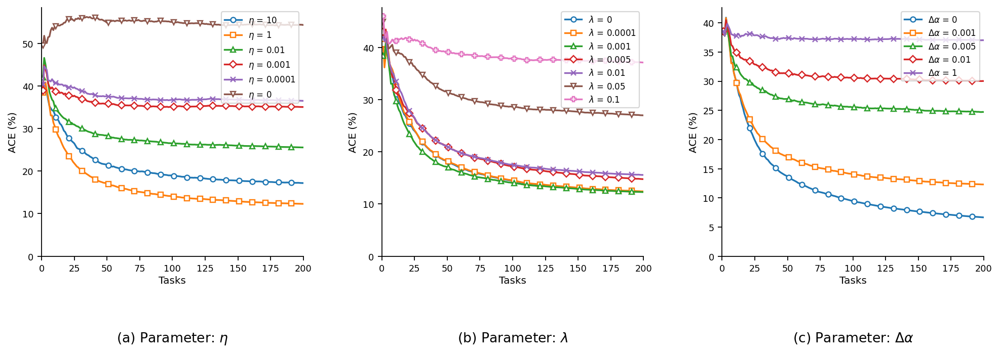
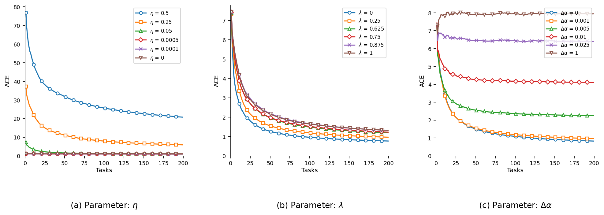

# AKLO reproduction report

Generated from the JSON files in `results/`. Every experiment is
repeated with seeds 0-9; the data and train/test split are fixed by
`data_seed=0`, and only the task and example order changes. Tables
report the mean ± standard deviation over the ten seeds; figures show
the mean. Classification ACE is a percentage; regression ACE is on the
target scale. W&B links are included when the run was tracked online.

## E1: main comparison (paper Table 1)

| Method | Syn1 | Syn2 | Landmine | Spam | Syn3 | Syn4 | London |
| --- | --- | --- | --- | --- | --- | --- | --- |
| ITOL | [37.05 ± 0.47](https://forge.coreweave.com/wandb/AI-Athena-Lab/AKLO-lifelong-online-learning/runs/gy88cz3z) | [38.17 ± 0.51](https://forge.coreweave.com/wandb/AI-Athena-Lab/AKLO-lifelong-online-learning/runs/smrrmohf) | [39.35 ± 0.85](https://forge.coreweave.com/wandb/AI-Athena-Lab/AKLO-lifelong-online-learning/runs/xr9i5cvm) | [25.76 ± 0.90](https://forge.coreweave.com/wandb/AI-Athena-Lab/AKLO-lifelong-online-learning/runs/htzzfodr) | [7.94 ± 0.01](https://forge.coreweave.com/wandb/AI-Athena-Lab/AKLO-lifelong-online-learning/runs/k07y2tfs) | [5.17 ± 0.01](https://forge.coreweave.com/wandb/AI-Athena-Lab/AKLO-lifelong-online-learning/runs/usq4y3et) | [14.81 ± 0.01](https://forge.coreweave.com/wandb/AI-Athena-Lab/AKLO-lifelong-online-learning/runs/0tqi99hh) |
| TOL | [23.86 ± 0.35](https://forge.coreweave.com/wandb/AI-Athena-Lab/AKLO-lifelong-online-learning/runs/v0fkqoav) | [37.82 ± 0.63](https://forge.coreweave.com/wandb/AI-Athena-Lab/AKLO-lifelong-online-learning/runs/vx6acdnz) | [38.93 ± 1.49](https://forge.coreweave.com/wandb/AI-Athena-Lab/AKLO-lifelong-online-learning/runs/lugbwh7t) | [20.37 ± 0.80](https://forge.coreweave.com/wandb/AI-Athena-Lab/AKLO-lifelong-online-learning/runs/vu1puavq) | [7.93 ± 0.01](https://forge.coreweave.com/wandb/AI-Athena-Lab/AKLO-lifelong-online-learning/runs/r19kxhrf) | [5.18 ± 0.01](https://forge.coreweave.com/wandb/AI-Athena-Lab/AKLO-lifelong-online-learning/runs/rtfeewse) | [12.60 ± 0.03](https://forge.coreweave.com/wandb/AI-Athena-Lab/AKLO-lifelong-online-learning/runs/gvtwcnjy) |
| UnifSum | [49.65 ± 0.73](https://forge.coreweave.com/wandb/AI-Athena-Lab/AKLO-lifelong-online-learning/runs/5aartbqp) | [50.36 ± 0.83](https://forge.coreweave.com/wandb/AI-Athena-Lab/AKLO-lifelong-online-learning/runs/k6t3robc) | [51.97 ± 8.85](https://forge.coreweave.com/wandb/AI-Athena-Lab/AKLO-lifelong-online-learning/runs/w8zc3eqw) | [24.51 ± 3.85](https://forge.coreweave.com/wandb/AI-Athena-Lab/AKLO-lifelong-online-learning/runs/tpo750dp) | [1.52 ± 0.11](https://forge.coreweave.com/wandb/AI-Athena-Lab/AKLO-lifelong-online-learning/runs/du964zps) | [1.39 ± 0.09](https://forge.coreweave.com/wandb/AI-Athena-Lab/AKLO-lifelong-online-learning/runs/e1uv51xv) | [14.89 ± 0.10](https://forge.coreweave.com/wandb/AI-Athena-Lab/AKLO-lifelong-online-learning/runs/r2k667xs) |
| TransOL | [36.71 ± 1.67](https://forge.coreweave.com/wandb/AI-Athena-Lab/AKLO-lifelong-online-learning/runs/dsvedcsh) | [43.11 ± 1.04](https://forge.coreweave.com/wandb/AI-Athena-Lab/AKLO-lifelong-online-learning/runs/8v49qsla) | [41.03 ± 2.90](https://forge.coreweave.com/wandb/AI-Athena-Lab/AKLO-lifelong-online-learning/runs/bn09bcoz) | [20.94 ± 1.77](https://forge.coreweave.com/wandb/AI-Athena-Lab/AKLO-lifelong-online-learning/runs/nnamkrbl) | [5.17 ± 0.10](https://forge.coreweave.com/wandb/AI-Athena-Lab/AKLO-lifelong-online-learning/runs/ygqkhnll) | [3.61 ± 0.06](https://forge.coreweave.com/wandb/AI-Athena-Lab/AKLO-lifelong-online-learning/runs/nhcnqjx8) | [13.21 ± 0.06](https://forge.coreweave.com/wandb/AI-Athena-Lab/AKLO-lifelong-online-learning/runs/xytx16m7) |
| OTB | [19.84 ± 0.66](https://forge.coreweave.com/wandb/AI-Athena-Lab/AKLO-lifelong-online-learning/runs/xzf6wqrc) | [37.79 ± 0.61](https://forge.coreweave.com/wandb/AI-Athena-Lab/AKLO-lifelong-online-learning/runs/fspkn277) | [33.71 ± 1.73](https://forge.coreweave.com/wandb/AI-Athena-Lab/AKLO-lifelong-online-learning/runs/0u3zh7x8) | [18.34 ± 0.64](https://forge.coreweave.com/wandb/AI-Athena-Lab/AKLO-lifelong-online-learning/runs/0hc5a2d1) | – | – | – |
| AKLO | [12.29 ± 0.83](https://forge.coreweave.com/wandb/AI-Athena-Lab/AKLO-lifelong-online-learning/runs/p9ar8sgx) | [10.72 ± 0.78](https://forge.coreweave.com/wandb/AI-Athena-Lab/AKLO-lifelong-online-learning/runs/bd7uucjl) | [30.96 ± 1.36](https://forge.coreweave.com/wandb/AI-Athena-Lab/AKLO-lifelong-online-learning/runs/7m870p3k) | [20.93 ± 1.61](https://forge.coreweave.com/wandb/AI-Athena-Lab/AKLO-lifelong-online-learning/runs/8v35qub5) | [0.96 ± 0.10](https://forge.coreweave.com/wandb/AI-Athena-Lab/AKLO-lifelong-online-learning/runs/mr6dr5yz) | [1.00 ± 0.10](https://forge.coreweave.com/wandb/AI-Athena-Lab/AKLO-lifelong-online-learning/runs/7q91264s) | [11.77 ± 0.09](https://forge.coreweave.com/wandb/AI-Athena-Lab/AKLO-lifelong-online-learning/runs/saexoxos) |

### Paper vs reproduction

| Dataset | Method | Paper | Reproduction |
| --- | --- | --- | --- |
| syn1 | ITOL | 36.18 | [37.05 ± 0.47](https://forge.coreweave.com/wandb/AI-Athena-Lab/AKLO-lifelong-online-learning/runs/gy88cz3z) |
| syn1 | TOL | 21.16 | [23.86 ± 0.35](https://forge.coreweave.com/wandb/AI-Athena-Lab/AKLO-lifelong-online-learning/runs/v0fkqoav) |
| syn1 | UnifSum | 49.63 | [49.65 ± 0.73](https://forge.coreweave.com/wandb/AI-Athena-Lab/AKLO-lifelong-online-learning/runs/5aartbqp) |
| syn1 | TransOL | 36.40 | [36.71 ± 1.67](https://forge.coreweave.com/wandb/AI-Athena-Lab/AKLO-lifelong-online-learning/runs/dsvedcsh) |
| syn1 | OTB | 30.19 | [19.84 ± 0.66](https://forge.coreweave.com/wandb/AI-Athena-Lab/AKLO-lifelong-online-learning/runs/xzf6wqrc) |
| syn1 | AKLO | 10.10 | [12.29 ± 0.83](https://forge.coreweave.com/wandb/AI-Athena-Lab/AKLO-lifelong-online-learning/runs/p9ar8sgx) |
| syn2 | ITOL | 33.70 | [38.17 ± 0.51](https://forge.coreweave.com/wandb/AI-Athena-Lab/AKLO-lifelong-online-learning/runs/smrrmohf) |
| syn2 | TOL | 33.34 | [37.82 ± 0.63](https://forge.coreweave.com/wandb/AI-Athena-Lab/AKLO-lifelong-online-learning/runs/vx6acdnz) |
| syn2 | UnifSum | 43.07 | [50.36 ± 0.83](https://forge.coreweave.com/wandb/AI-Athena-Lab/AKLO-lifelong-online-learning/runs/k6t3robc) |
| syn2 | TransOL | 32.97 | [43.11 ± 1.04](https://forge.coreweave.com/wandb/AI-Athena-Lab/AKLO-lifelong-online-learning/runs/8v49qsla) |
| syn2 | OTB | 34.90 | [37.79 ± 0.61](https://forge.coreweave.com/wandb/AI-Athena-Lab/AKLO-lifelong-online-learning/runs/fspkn277) |
| syn2 | AKLO | 10.16 | [10.72 ± 0.78](https://forge.coreweave.com/wandb/AI-Athena-Lab/AKLO-lifelong-online-learning/runs/bd7uucjl) |
| landmine | ITOL | 13.86 | [39.35 ± 0.85](https://forge.coreweave.com/wandb/AI-Athena-Lab/AKLO-lifelong-online-learning/runs/xr9i5cvm) |
| landmine | TOL | 11.54 | [38.93 ± 1.49](https://forge.coreweave.com/wandb/AI-Athena-Lab/AKLO-lifelong-online-learning/runs/lugbwh7t) |
| landmine | UnifSum | 7.97 | [51.97 ± 8.85](https://forge.coreweave.com/wandb/AI-Athena-Lab/AKLO-lifelong-online-learning/runs/w8zc3eqw) |
| landmine | TransOL | 8.05 | [41.03 ± 2.90](https://forge.coreweave.com/wandb/AI-Athena-Lab/AKLO-lifelong-online-learning/runs/bn09bcoz) |
| landmine | OTB | 10.94 | [33.71 ± 1.73](https://forge.coreweave.com/wandb/AI-Athena-Lab/AKLO-lifelong-online-learning/runs/0u3zh7x8) |
| landmine | AKLO | 7.30 | [30.96 ± 1.36](https://forge.coreweave.com/wandb/AI-Athena-Lab/AKLO-lifelong-online-learning/runs/7m870p3k) |
| spam | ITOL | 25.00 | [25.76 ± 0.90](https://forge.coreweave.com/wandb/AI-Athena-Lab/AKLO-lifelong-online-learning/runs/htzzfodr) |
| spam | TOL | 19.51 | [20.37 ± 0.80](https://forge.coreweave.com/wandb/AI-Athena-Lab/AKLO-lifelong-online-learning/runs/vu1puavq) |
| spam | UnifSum | 19.50 | [24.51 ± 3.85](https://forge.coreweave.com/wandb/AI-Athena-Lab/AKLO-lifelong-online-learning/runs/tpo750dp) |
| spam | TransOL | 24.50 | [20.94 ± 1.77](https://forge.coreweave.com/wandb/AI-Athena-Lab/AKLO-lifelong-online-learning/runs/nnamkrbl) |
| spam | OTB | 24.10 | [18.34 ± 0.64](https://forge.coreweave.com/wandb/AI-Athena-Lab/AKLO-lifelong-online-learning/runs/0hc5a2d1) |
| spam | AKLO | 17.36 | [20.93 ± 1.61](https://forge.coreweave.com/wandb/AI-Athena-Lab/AKLO-lifelong-online-learning/runs/8v35qub5) |
| syn3 | ITOL | 14.54 | [7.94 ± 0.01](https://forge.coreweave.com/wandb/AI-Athena-Lab/AKLO-lifelong-online-learning/runs/k07y2tfs) |
| syn3 | TOL | 7.63 | [7.93 ± 0.01](https://forge.coreweave.com/wandb/AI-Athena-Lab/AKLO-lifelong-online-learning/runs/r19kxhrf) |
| syn3 | UnifSum | 27.69 | [1.52 ± 0.11](https://forge.coreweave.com/wandb/AI-Athena-Lab/AKLO-lifelong-online-learning/runs/du964zps) |
| syn3 | TransOL | 61.61 | [5.17 ± 0.10](https://forge.coreweave.com/wandb/AI-Athena-Lab/AKLO-lifelong-online-learning/runs/ygqkhnll) |
| syn3 | AKLO | 4.06 | [0.96 ± 0.10](https://forge.coreweave.com/wandb/AI-Athena-Lab/AKLO-lifelong-online-learning/runs/mr6dr5yz) |
| syn4 | ITOL | 8.02 | [5.17 ± 0.01](https://forge.coreweave.com/wandb/AI-Athena-Lab/AKLO-lifelong-online-learning/runs/usq4y3et) |
| syn4 | TOL | 9.96 | [5.18 ± 0.01](https://forge.coreweave.com/wandb/AI-Athena-Lab/AKLO-lifelong-online-learning/runs/rtfeewse) |
| syn4 | UnifSum | 51.23 | [1.39 ± 0.09](https://forge.coreweave.com/wandb/AI-Athena-Lab/AKLO-lifelong-online-learning/runs/e1uv51xv) |
| syn4 | TransOL | 54.55 | [3.61 ± 0.06](https://forge.coreweave.com/wandb/AI-Athena-Lab/AKLO-lifelong-online-learning/runs/nhcnqjx8) |
| syn4 | AKLO | 2.98 | [1.00 ± 0.10](https://forge.coreweave.com/wandb/AI-Athena-Lab/AKLO-lifelong-online-learning/runs/7q91264s) |
| london | ITOL | 20.76 | [14.81 ± 0.01](https://forge.coreweave.com/wandb/AI-Athena-Lab/AKLO-lifelong-online-learning/runs/0tqi99hh) |
| london | TOL | 20.91 | [12.60 ± 0.03](https://forge.coreweave.com/wandb/AI-Athena-Lab/AKLO-lifelong-online-learning/runs/gvtwcnjy) |
| london | UnifSum | 10.94 | [14.89 ± 0.10](https://forge.coreweave.com/wandb/AI-Athena-Lab/AKLO-lifelong-online-learning/runs/r2k667xs) |
| london | TransOL | 79.58 | [13.21 ± 0.06](https://forge.coreweave.com/wandb/AI-Athena-Lab/AKLO-lifelong-online-learning/runs/xytx16m7) |
| london | AKLO | 10.05 | [11.77 ± 0.09](https://forge.coreweave.com/wandb/AI-Athena-Lab/AKLO-lifelong-online-learning/runs/saexoxos) |

## E2: number of observations per task (paper Figure 3)

| m_t | ITOL | TOL | UnifSum | TransOL | OTB | AKLO |
| --- | --- | --- | --- | --- | --- | --- |
| 10 | [43.30 ± 0.87](https://forge.coreweave.com/wandb/AI-Athena-Lab/AKLO-lifelong-online-learning/runs/klr760ky) | [38.10 ± 1.38](https://forge.coreweave.com/wandb/AI-Athena-Lab/AKLO-lifelong-online-learning/runs/6qu53ss8) | [41.96 ± 2.92](https://forge.coreweave.com/wandb/AI-Athena-Lab/AKLO-lifelong-online-learning/runs/8l97t5nb) | [41.67 ± 1.72](https://forge.coreweave.com/wandb/AI-Athena-Lab/AKLO-lifelong-online-learning/runs/o5ow9ufd) | [35.34 ± 1.38](https://forge.coreweave.com/wandb/AI-Athena-Lab/AKLO-lifelong-online-learning/runs/025ynrh8) | [24.27 ± 1.08](https://forge.coreweave.com/wandb/AI-Athena-Lab/AKLO-lifelong-online-learning/runs/cc6hi5c1) |
| 20 | [41.53 ± 0.42](https://forge.coreweave.com/wandb/AI-Athena-Lab/AKLO-lifelong-online-learning/runs/j68zn0sa) | [34.24 ± 0.95](https://forge.coreweave.com/wandb/AI-Athena-Lab/AKLO-lifelong-online-learning/runs/wj7go2zy) | [46.23 ± 3.96](https://forge.coreweave.com/wandb/AI-Athena-Lab/AKLO-lifelong-online-learning/runs/jhxg7mby) | [40.59 ± 1.50](https://forge.coreweave.com/wandb/AI-Athena-Lab/AKLO-lifelong-online-learning/runs/0mtqe4nm) | [30.99 ± 1.11](https://forge.coreweave.com/wandb/AI-Athena-Lab/AKLO-lifelong-online-learning/runs/8lx33xx7) | [20.21 ± 1.44](https://forge.coreweave.com/wandb/AI-Athena-Lab/AKLO-lifelong-online-learning/runs/w4n68xq9) |
| 40 | [39.82 ± 0.43](https://forge.coreweave.com/wandb/AI-Athena-Lab/AKLO-lifelong-online-learning/runs/p5mgjpil) | [29.14 ± 1.10](https://forge.coreweave.com/wandb/AI-Athena-Lab/AKLO-lifelong-online-learning/runs/fmppmbxl) | [49.24 ± 1.35](https://forge.coreweave.com/wandb/AI-Athena-Lab/AKLO-lifelong-online-learning/runs/t8652ib4) | [38.58 ± 1.74](https://forge.coreweave.com/wandb/AI-Athena-Lab/AKLO-lifelong-online-learning/runs/o2vgachl) | [25.30 ± 0.80](https://forge.coreweave.com/wandb/AI-Athena-Lab/AKLO-lifelong-online-learning/runs/7sbnyrva) | [14.91 ± 1.13](https://forge.coreweave.com/wandb/AI-Athena-Lab/AKLO-lifelong-online-learning/runs/kqoq9hk8) |
| 80 | [37.81 ± 0.59](https://forge.coreweave.com/wandb/AI-Athena-Lab/AKLO-lifelong-online-learning/runs/r7f8gqze) | [25.17 ± 0.59](https://forge.coreweave.com/wandb/AI-Athena-Lab/AKLO-lifelong-online-learning/runs/t5t72vhb) | [49.18 ± 0.88](https://forge.coreweave.com/wandb/AI-Athena-Lab/AKLO-lifelong-online-learning/runs/wzeb6xl4) | [36.68 ± 1.33](https://forge.coreweave.com/wandb/AI-Athena-Lab/AKLO-lifelong-online-learning/runs/o9hi1bz2) | [20.98 ± 0.49](https://forge.coreweave.com/wandb/AI-Athena-Lab/AKLO-lifelong-online-learning/runs/00xd22w5) | [13.04 ± 0.92](https://forge.coreweave.com/wandb/AI-Athena-Lab/AKLO-lifelong-online-learning/runs/xhy3vq7m) |
| 160 | [35.24 ± 0.38](https://forge.coreweave.com/wandb/AI-Athena-Lab/AKLO-lifelong-online-learning/runs/jk2if12t) | [22.28 ± 0.64](https://forge.coreweave.com/wandb/AI-Athena-Lab/AKLO-lifelong-online-learning/runs/9yjcaqj5) | [49.75 ± 0.36](https://forge.coreweave.com/wandb/AI-Athena-Lab/AKLO-lifelong-online-learning/runs/23l1lwp2) | [36.55 ± 1.61](https://forge.coreweave.com/wandb/AI-Athena-Lab/AKLO-lifelong-online-learning/runs/9za22goi) | [17.66 ± 0.57](https://forge.coreweave.com/wandb/AI-Athena-Lab/AKLO-lifelong-online-learning/runs/2geftj8h) | [11.99 ± 1.28](https://forge.coreweave.com/wandb/AI-Athena-Lab/AKLO-lifelong-online-learning/runs/ue7sw846) |
| 200 | [33.67 ± 0.44](https://forge.coreweave.com/wandb/AI-Athena-Lab/AKLO-lifelong-online-learning/runs/bq06pz87) | [21.02 ± 0.40](https://forge.coreweave.com/wandb/AI-Athena-Lab/AKLO-lifelong-online-learning/runs/e42ajo8d) | [49.88 ± 0.56](https://forge.coreweave.com/wandb/AI-Athena-Lab/AKLO-lifelong-online-learning/runs/t8gaz8el) | [35.97 ± 1.55](https://forge.coreweave.com/wandb/AI-Athena-Lab/AKLO-lifelong-online-learning/runs/fx7y9ziy) | [16.74 ± 0.48](https://forge.coreweave.com/wandb/AI-Athena-Lab/AKLO-lifelong-online-learning/runs/rkuryzjj) | [11.48 ± 0.64](https://forge.coreweave.com/wandb/AI-Athena-Lab/AKLO-lifelong-online-learning/runs/ebgs51z4) |
| 250 | [32.17 ± 0.47](https://forge.coreweave.com/wandb/AI-Athena-Lab/AKLO-lifelong-online-learning/runs/ejpmd1wh) | [20.61 ± 0.52](https://forge.coreweave.com/wandb/AI-Athena-Lab/AKLO-lifelong-online-learning/runs/dp2rgfsl) | [50.02 ± 0.46](https://forge.coreweave.com/wandb/AI-Athena-Lab/AKLO-lifelong-online-learning/runs/guvqlith) | [35.91 ± 1.34](https://forge.coreweave.com/wandb/AI-Athena-Lab/AKLO-lifelong-online-learning/runs/ji2rn56m) | [15.88 ± 0.39](https://forge.coreweave.com/wandb/AI-Athena-Lab/AKLO-lifelong-online-learning/runs/w365uwui) | [11.24 ± 0.50](https://forge.coreweave.com/wandb/AI-Athena-Lab/AKLO-lifelong-online-learning/runs/w3ilovi3) |
| 300 | [31.18 ± 0.39](https://forge.coreweave.com/wandb/AI-Athena-Lab/AKLO-lifelong-online-learning/runs/lfgydw5u) | [19.93 ± 0.46](https://forge.coreweave.com/wandb/AI-Athena-Lab/AKLO-lifelong-online-learning/runs/z28us9en) | [50.10 ± 0.33](https://forge.coreweave.com/wandb/AI-Athena-Lab/AKLO-lifelong-online-learning/runs/uhn0s3p3) | [36.01 ± 1.50](https://forge.coreweave.com/wandb/AI-Athena-Lab/AKLO-lifelong-online-learning/runs/rtb49luc) | [15.34 ± 0.45](https://forge.coreweave.com/wandb/AI-Athena-Lab/AKLO-lifelong-online-learning/runs/pux0axgh) | [11.20 ± 0.36](https://forge.coreweave.com/wandb/AI-Athena-Lab/AKLO-lifelong-online-learning/runs/fe6er02j) |

## E3: catastrophic forgetting (paper Table 2)

Training follows E1 exactly. E3 evaluates the test set of every task
`1..T` with a method-specific predictor. ITOL, AKLO, TranOL and OTB use
the frozen snapshot saved at the end of that task; TOL uses its single
final online model; Unif_Sum averages all task snapshots. No parameter
is updated during the test pass. The synthetic datasets use 50 tasks
(25 D1 + 25 D2) with 100 training and 100 separate test samples per
task. Landmine uses 150 training rows per task and all remaining rows
as test; Spam uses 200 training rows per user and all remaining rows as
test. London keeps an 80/20 split per school. Each experiment is
repeated with 10 seeds; the data and split are fixed and only the
task/example order changes. The primary metric is the task-averaged
test ACE, with the pooled test ACE as a secondary metric. Classification
ACE is multiplied by 100; regression ACE is on the target scale. OTB is
not defined for regression, so those cells are empty.

| Method | Syn1 | Syn2 | Landmine | Spam | Syn3 | Syn4 | London |
| --- | --- | --- | --- | --- | --- | --- | --- |
| ITOL | [35.87 ± 2.50](https://forge.coreweave.com/wandb/AI-Athena-Lab/AKLO-lifelong-online-learning/runs/2ldn281e) | [33.91 ± 1.89](https://forge.coreweave.com/wandb/AI-Athena-Lab/AKLO-lifelong-online-learning/runs/mgd3yd8l) | [37.95 ± 1.43](https://forge.coreweave.com/wandb/AI-Athena-Lab/AKLO-lifelong-online-learning/runs/sbkttlob) | [20.00 ± 1.75](https://forge.coreweave.com/wandb/AI-Athena-Lab/AKLO-lifelong-online-learning/runs/z0pz2g4u) | [6.90 ± 0.66](https://forge.coreweave.com/wandb/AI-Athena-Lab/AKLO-lifelong-online-learning/runs/b9br71pe) | [4.83 ± 0.36](https://forge.coreweave.com/wandb/AI-Athena-Lab/AKLO-lifelong-online-learning/runs/qa9ud4x5) | [12.77 ± 0.03](https://forge.coreweave.com/wandb/AI-Athena-Lab/AKLO-lifelong-online-learning/runs/5acuc8j8) |
| TOL | [38.32 ± 10.02](https://forge.coreweave.com/wandb/AI-Athena-Lab/AKLO-lifelong-online-learning/runs/fjdh2036) | [49.87 ± 0.60](https://forge.coreweave.com/wandb/AI-Athena-Lab/AKLO-lifelong-online-learning/runs/83kewsve) | [46.79 ± 13.53](https://forge.coreweave.com/wandb/AI-Athena-Lab/AKLO-lifelong-online-learning/runs/gnxb5ual) | [22.93 ± 7.81](https://forge.coreweave.com/wandb/AI-Athena-Lab/AKLO-lifelong-online-learning/runs/2iffvpyt) | [6.76 ± 4.16](https://forge.coreweave.com/wandb/AI-Athena-Lab/AKLO-lifelong-online-learning/runs/1qrhhn0t) | [4.28 ± 2.99](https://forge.coreweave.com/wandb/AI-Athena-Lab/AKLO-lifelong-online-learning/runs/30wuj9vi) | [13.86 ± 0.95](https://forge.coreweave.com/wandb/AI-Athena-Lab/AKLO-lifelong-online-learning/runs/yppoobqn) |
| UnifSum | [50.01 ± 0.20](https://forge.coreweave.com/wandb/AI-Athena-Lab/AKLO-lifelong-online-learning/runs/pdwch9mn) | [49.90 ± 0.49](https://forge.coreweave.com/wandb/AI-Athena-Lab/AKLO-lifelong-online-learning/runs/zjrk3wpm) | [55.44 ± 2.09](https://forge.coreweave.com/wandb/AI-Athena-Lab/AKLO-lifelong-online-learning/runs/35hejayb) | [20.81 ± 4.85](https://forge.coreweave.com/wandb/AI-Athena-Lab/AKLO-lifelong-online-learning/runs/hir20qi1) | [1.77 ± 0.56](https://forge.coreweave.com/wandb/AI-Athena-Lab/AKLO-lifelong-online-learning/runs/8r2k2038) | [1.29 ± 0.15](https://forge.coreweave.com/wandb/AI-Athena-Lab/AKLO-lifelong-online-learning/runs/zp31q9l5) | [14.75 ± 0.03](https://forge.coreweave.com/wandb/AI-Athena-Lab/AKLO-lifelong-online-learning/runs/ex6go45h) |
| TransOL | [37.07 ± 1.90](https://forge.coreweave.com/wandb/AI-Athena-Lab/AKLO-lifelong-online-learning/runs/fgoq0fng) | [42.22 ± 1.86](https://forge.coreweave.com/wandb/AI-Athena-Lab/AKLO-lifelong-online-learning/runs/nibypsm4) | [40.07 ± 2.61](https://forge.coreweave.com/wandb/AI-Athena-Lab/AKLO-lifelong-online-learning/runs/h90qb33h) | [18.82 ± 1.70](https://forge.coreweave.com/wandb/AI-Athena-Lab/AKLO-lifelong-online-learning/runs/m7skus6q) | [5.39 ± 0.72](https://forge.coreweave.com/wandb/AI-Athena-Lab/AKLO-lifelong-online-learning/runs/6yljgpan) | [3.49 ± 0.36](https://forge.coreweave.com/wandb/AI-Athena-Lab/AKLO-lifelong-online-learning/runs/lqg42cny) | [12.65 ± 0.07](https://forge.coreweave.com/wandb/AI-Athena-Lab/AKLO-lifelong-online-learning/runs/7k6mxoc3) |
| OTB | [18.37 ± 1.76](https://forge.coreweave.com/wandb/AI-Athena-Lab/AKLO-lifelong-online-learning/runs/sbzbyvp2) | [35.47 ± 1.25](https://forge.coreweave.com/wandb/AI-Athena-Lab/AKLO-lifelong-online-learning/runs/1l8nkf42) | [33.06 ± 1.86](https://forge.coreweave.com/wandb/AI-Athena-Lab/AKLO-lifelong-online-learning/runs/kmcgno8q) | [15.59 ± 1.63](https://forge.coreweave.com/wandb/AI-Athena-Lab/AKLO-lifelong-online-learning/runs/ep4nterc) | – | – | – |
| AKLO | [19.61 ± 2.93](https://forge.coreweave.com/wandb/AI-Athena-Lab/AKLO-lifelong-online-learning/runs/q6wvjtns) | [16.50 ± 2.79](https://forge.coreweave.com/wandb/AI-Athena-Lab/AKLO-lifelong-online-learning/runs/ojyhxoi9) | [33.25 ± 1.27](https://forge.coreweave.com/wandb/AI-Athena-Lab/AKLO-lifelong-online-learning/runs/aky014a7) | [19.67 ± 2.70](https://forge.coreweave.com/wandb/AI-Athena-Lab/AKLO-lifelong-online-learning/runs/y60ub5nq) | [1.40 ± 0.31](https://forge.coreweave.com/wandb/AI-Athena-Lab/AKLO-lifelong-online-learning/runs/m7rste9u) | [1.28 ± 0.23](https://forge.coreweave.com/wandb/AI-Athena-Lab/AKLO-lifelong-online-learning/runs/p4v7z16a) | [11.63 ± 0.08](https://forge.coreweave.com/wandb/AI-Athena-Lab/AKLO-lifelong-online-learning/runs/ewtu0aa5) |

### Secondary metric: pooled test ACE

| Method | Syn1 | Syn2 | Landmine | Spam | Syn3 | Syn4 | London |
| --- | --- | --- | --- | --- | --- | --- | --- |
| ITOL | [35.87 ± 2.50](https://forge.coreweave.com/wandb/AI-Athena-Lab/AKLO-lifelong-online-learning/runs/2ldn281e) | [33.91 ± 1.89](https://forge.coreweave.com/wandb/AI-Athena-Lab/AKLO-lifelong-online-learning/runs/mgd3yd8l) | [39.28 ± 1.51](https://forge.coreweave.com/wandb/AI-Athena-Lab/AKLO-lifelong-online-learning/runs/sbkttlob) | [20.00 ± 1.75](https://forge.coreweave.com/wandb/AI-Athena-Lab/AKLO-lifelong-online-learning/runs/z0pz2g4u) | [6.90 ± 0.66](https://forge.coreweave.com/wandb/AI-Athena-Lab/AKLO-lifelong-online-learning/runs/b9br71pe) | [4.83 ± 0.36](https://forge.coreweave.com/wandb/AI-Athena-Lab/AKLO-lifelong-online-learning/runs/qa9ud4x5) | [12.43 ± 0.04](https://forge.coreweave.com/wandb/AI-Athena-Lab/AKLO-lifelong-online-learning/runs/5acuc8j8) |
| TOL | [38.32 ± 10.02](https://forge.coreweave.com/wandb/AI-Athena-Lab/AKLO-lifelong-online-learning/runs/fjdh2036) | [49.87 ± 0.60](https://forge.coreweave.com/wandb/AI-Athena-Lab/AKLO-lifelong-online-learning/runs/83kewsve) | [46.62 ± 12.56](https://forge.coreweave.com/wandb/AI-Athena-Lab/AKLO-lifelong-online-learning/runs/gnxb5ual) | [22.93 ± 7.81](https://forge.coreweave.com/wandb/AI-Athena-Lab/AKLO-lifelong-online-learning/runs/2iffvpyt) | [6.76 ± 4.16](https://forge.coreweave.com/wandb/AI-Athena-Lab/AKLO-lifelong-online-learning/runs/1qrhhn0t) | [4.28 ± 2.99](https://forge.coreweave.com/wandb/AI-Athena-Lab/AKLO-lifelong-online-learning/runs/30wuj9vi) | [14.03 ± 0.96](https://forge.coreweave.com/wandb/AI-Athena-Lab/AKLO-lifelong-online-learning/runs/yppoobqn) |
| UnifSum | [50.01 ± 0.20](https://forge.coreweave.com/wandb/AI-Athena-Lab/AKLO-lifelong-online-learning/runs/pdwch9mn) | [49.90 ± 0.49](https://forge.coreweave.com/wandb/AI-Athena-Lab/AKLO-lifelong-online-learning/runs/zjrk3wpm) | [54.35 ± 2.12](https://forge.coreweave.com/wandb/AI-Athena-Lab/AKLO-lifelong-online-learning/runs/35hejayb) | [20.81 ± 4.85](https://forge.coreweave.com/wandb/AI-Athena-Lab/AKLO-lifelong-online-learning/runs/hir20qi1) | [1.77 ± 0.56](https://forge.coreweave.com/wandb/AI-Athena-Lab/AKLO-lifelong-online-learning/runs/8r2k2038) | [1.29 ± 0.15](https://forge.coreweave.com/wandb/AI-Athena-Lab/AKLO-lifelong-online-learning/runs/zp31q9l5) | [14.94 ± 0.03](https://forge.coreweave.com/wandb/AI-Athena-Lab/AKLO-lifelong-online-learning/runs/ex6go45h) |
| TransOL | [37.07 ± 1.90](https://forge.coreweave.com/wandb/AI-Athena-Lab/AKLO-lifelong-online-learning/runs/fgoq0fng) | [42.22 ± 1.86](https://forge.coreweave.com/wandb/AI-Athena-Lab/AKLO-lifelong-online-learning/runs/nibypsm4) | [40.86 ± 2.39](https://forge.coreweave.com/wandb/AI-Athena-Lab/AKLO-lifelong-online-learning/runs/h90qb33h) | [18.82 ± 1.70](https://forge.coreweave.com/wandb/AI-Athena-Lab/AKLO-lifelong-online-learning/runs/m7skus6q) | [5.39 ± 0.72](https://forge.coreweave.com/wandb/AI-Athena-Lab/AKLO-lifelong-online-learning/runs/6yljgpan) | [3.49 ± 0.36](https://forge.coreweave.com/wandb/AI-Athena-Lab/AKLO-lifelong-online-learning/runs/lqg42cny) | [12.74 ± 0.07](https://forge.coreweave.com/wandb/AI-Athena-Lab/AKLO-lifelong-online-learning/runs/7k6mxoc3) |
| OTB | [18.37 ± 1.76](https://forge.coreweave.com/wandb/AI-Athena-Lab/AKLO-lifelong-online-learning/runs/sbzbyvp2) | [35.47 ± 1.25](https://forge.coreweave.com/wandb/AI-Athena-Lab/AKLO-lifelong-online-learning/runs/1l8nkf42) | [34.38 ± 1.86](https://forge.coreweave.com/wandb/AI-Athena-Lab/AKLO-lifelong-online-learning/runs/kmcgno8q) | [15.59 ± 1.63](https://forge.coreweave.com/wandb/AI-Athena-Lab/AKLO-lifelong-online-learning/runs/ep4nterc) | – | – | – |
| AKLO | [19.61 ± 2.93](https://forge.coreweave.com/wandb/AI-Athena-Lab/AKLO-lifelong-online-learning/runs/q6wvjtns) | [16.50 ± 2.79](https://forge.coreweave.com/wandb/AI-Athena-Lab/AKLO-lifelong-online-learning/runs/ojyhxoi9) | [34.59 ± 1.52](https://forge.coreweave.com/wandb/AI-Athena-Lab/AKLO-lifelong-online-learning/runs/aky014a7) | [19.67 ± 2.70](https://forge.coreweave.com/wandb/AI-Athena-Lab/AKLO-lifelong-online-learning/runs/y60ub5nq) | [1.40 ± 0.31](https://forge.coreweave.com/wandb/AI-Athena-Lab/AKLO-lifelong-online-learning/runs/m7rste9u) | [1.28 ± 0.23](https://forge.coreweave.com/wandb/AI-Athena-Lab/AKLO-lifelong-online-learning/runs/p4v7z16a) | [11.80 ± 0.09](https://forge.coreweave.com/wandb/AI-Athena-Lab/AKLO-lifelong-online-learning/runs/ewtu0aa5) |

### Paper vs reproduction

| Dataset | Method | Paper Table 2 | Our test ACE |
| --- | --- | --- | --- |
| Syn1 | ITOL | 36.36 | [35.87 ± 2.50](https://forge.coreweave.com/wandb/AI-Athena-Lab/AKLO-lifelong-online-learning/runs/2ldn281e) |
| Syn1 | TOL | 21.54 | [38.32 ± 10.02](https://forge.coreweave.com/wandb/AI-Athena-Lab/AKLO-lifelong-online-learning/runs/fjdh2036) |
| Syn1 | UnifSum | 49.96 | [50.01 ± 0.20](https://forge.coreweave.com/wandb/AI-Athena-Lab/AKLO-lifelong-online-learning/runs/pdwch9mn) |
| Syn1 | TransOL | 35.99 | [37.07 ± 1.90](https://forge.coreweave.com/wandb/AI-Athena-Lab/AKLO-lifelong-online-learning/runs/fgoq0fng) |
| Syn1 | OTB | 30.24 | [18.37 ± 1.76](https://forge.coreweave.com/wandb/AI-Athena-Lab/AKLO-lifelong-online-learning/runs/sbzbyvp2) |
| Syn1 | AKLO | 8.78 | [19.61 ± 2.93](https://forge.coreweave.com/wandb/AI-Athena-Lab/AKLO-lifelong-online-learning/runs/q6wvjtns) |
| Syn2 | ITOL | 33.51 | [33.91 ± 1.89](https://forge.coreweave.com/wandb/AI-Athena-Lab/AKLO-lifelong-online-learning/runs/mgd3yd8l) |
| Syn2 | TOL | 33.65 | [49.87 ± 0.60](https://forge.coreweave.com/wandb/AI-Athena-Lab/AKLO-lifelong-online-learning/runs/83kewsve) |
| Syn2 | UnifSum | 41.32 | [49.90 ± 0.49](https://forge.coreweave.com/wandb/AI-Athena-Lab/AKLO-lifelong-online-learning/runs/zjrk3wpm) |
| Syn2 | TransOL | 32.56 | [42.22 ± 1.86](https://forge.coreweave.com/wandb/AI-Athena-Lab/AKLO-lifelong-online-learning/runs/nibypsm4) |
| Syn2 | OTB | 35.06 | [35.47 ± 1.25](https://forge.coreweave.com/wandb/AI-Athena-Lab/AKLO-lifelong-online-learning/runs/1l8nkf42) |
| Syn2 | AKLO | 8.34 | [16.50 ± 2.79](https://forge.coreweave.com/wandb/AI-Athena-Lab/AKLO-lifelong-online-learning/runs/ojyhxoi9) |
| Landmine | ITOL | 14.00 | [37.95 ± 1.43](https://forge.coreweave.com/wandb/AI-Athena-Lab/AKLO-lifelong-online-learning/runs/sbkttlob) |
| Landmine | TOL | 11.59 | [46.79 ± 13.53](https://forge.coreweave.com/wandb/AI-Athena-Lab/AKLO-lifelong-online-learning/runs/gnxb5ual) |
| Landmine | UnifSum | 6.86 | [55.44 ± 2.09](https://forge.coreweave.com/wandb/AI-Athena-Lab/AKLO-lifelong-online-learning/runs/35hejayb) |
| Landmine | TransOL | 8.08 | [40.07 ± 2.61](https://forge.coreweave.com/wandb/AI-Athena-Lab/AKLO-lifelong-online-learning/runs/h90qb33h) |
| Landmine | OTB | 11.09 | [33.06 ± 1.86](https://forge.coreweave.com/wandb/AI-Athena-Lab/AKLO-lifelong-online-learning/runs/kmcgno8q) |
| Landmine | AKLO | 6.78 | [33.25 ± 1.27](https://forge.coreweave.com/wandb/AI-Athena-Lab/AKLO-lifelong-online-learning/runs/aky014a7) |
| Spam | ITOL | 25.23 | [20.00 ± 1.75](https://forge.coreweave.com/wandb/AI-Athena-Lab/AKLO-lifelong-online-learning/runs/z0pz2g4u) |
| Spam | TOL | 17.13 | [22.93 ± 7.81](https://forge.coreweave.com/wandb/AI-Athena-Lab/AKLO-lifelong-online-learning/runs/2iffvpyt) |
| Spam | UnifSum | 12.33 | [20.81 ± 4.85](https://forge.coreweave.com/wandb/AI-Athena-Lab/AKLO-lifelong-online-learning/runs/hir20qi1) |
| Spam | TransOL | 26.43 | [18.82 ± 1.70](https://forge.coreweave.com/wandb/AI-Athena-Lab/AKLO-lifelong-online-learning/runs/m7skus6q) |
| Spam | OTB | 23.17 | [15.59 ± 1.63](https://forge.coreweave.com/wandb/AI-Athena-Lab/AKLO-lifelong-online-learning/runs/ep4nterc) |
| Spam | AKLO | 9.97 | [19.67 ± 2.70](https://forge.coreweave.com/wandb/AI-Athena-Lab/AKLO-lifelong-online-learning/runs/y60ub5nq) |
| Syn3 | ITOL | 14.53 | [6.90 ± 0.66](https://forge.coreweave.com/wandb/AI-Athena-Lab/AKLO-lifelong-online-learning/runs/b9br71pe) |
| Syn3 | TOL | 7.62 | [6.76 ± 4.16](https://forge.coreweave.com/wandb/AI-Athena-Lab/AKLO-lifelong-online-learning/runs/1qrhhn0t) |
| Syn3 | UnifSum | 27.60 | [1.77 ± 0.56](https://forge.coreweave.com/wandb/AI-Athena-Lab/AKLO-lifelong-online-learning/runs/8r2k2038) |
| Syn3 | TransOL | 61.54 | [5.39 ± 0.72](https://forge.coreweave.com/wandb/AI-Athena-Lab/AKLO-lifelong-online-learning/runs/6yljgpan) |
| Syn3 | AKLO | 3.58 | [1.40 ± 0.31](https://forge.coreweave.com/wandb/AI-Athena-Lab/AKLO-lifelong-online-learning/runs/m7rste9u) |
| Syn4 | ITOL | 8.05 | [4.83 ± 0.36](https://forge.coreweave.com/wandb/AI-Athena-Lab/AKLO-lifelong-online-learning/runs/qa9ud4x5) |
| Syn4 | TOL | 9.82 | [4.28 ± 2.99](https://forge.coreweave.com/wandb/AI-Athena-Lab/AKLO-lifelong-online-learning/runs/30wuj9vi) |
| Syn4 | UnifSum | 51.36 | [1.29 ± 0.15](https://forge.coreweave.com/wandb/AI-Athena-Lab/AKLO-lifelong-online-learning/runs/zp31q9l5) |
| Syn4 | TransOL | 54.57 | [3.49 ± 0.36](https://forge.coreweave.com/wandb/AI-Athena-Lab/AKLO-lifelong-online-learning/runs/lqg42cny) |
| Syn4 | AKLO | 2.34 | [1.28 ± 0.23](https://forge.coreweave.com/wandb/AI-Athena-Lab/AKLO-lifelong-online-learning/runs/p4v7z16a) |
| London | ITOL | 20.80 | [12.77 ± 0.03](https://forge.coreweave.com/wandb/AI-Athena-Lab/AKLO-lifelong-online-learning/runs/5acuc8j8) |
| London | TOL | 20.87 | [13.86 ± 0.95](https://forge.coreweave.com/wandb/AI-Athena-Lab/AKLO-lifelong-online-learning/runs/yppoobqn) |
| London | UnifSum | 10.42 | [14.75 ± 0.03](https://forge.coreweave.com/wandb/AI-Athena-Lab/AKLO-lifelong-online-learning/runs/ex6go45h) |
| London | TransOL | 79.58 | [12.65 ± 0.07](https://forge.coreweave.com/wandb/AI-Athena-Lab/AKLO-lifelong-online-learning/runs/7k6mxoc3) |
| London | AKLO | 9.57 | [11.63 ± 0.08](https://forge.coreweave.com/wandb/AI-Athena-Lab/AKLO-lifelong-online-learning/runs/ewtu0aa5) |

The paper reports mean ± standard deviation over 10 repetitions. Our
table uses the same aggregation over seeds 0-9. E3 is a hybrid
protocol: the per-task methods (ITOL, AKLO, TranOL, OTB) are evaluated
with the snapshot saved at the end of each task, while TOL and
Unif_Sum use stricter global predictors. AKLO's snapshot contains the
knowledge base before the task, the beta weights at the end of the
task, the current predictor, and alpha at the end of the task. On syn2
the D2 tasks flip the labels of the D1 marginal, so TOL and Unif_Sum
are near chance while the per-task methods retain task-specific
models. See `docs/experiment_protocol.md` for the exact protocol.

## E4: classification sensitivity (paper Figure 4)

### eta

| eta | ACE (%) | W&B |
| --- | --- | --- |
| 0 | 54.34 ± 0.00 | [run](https://forge.coreweave.com/wandb/AI-Athena-Lab/AKLO-lifelong-online-learning/runs/4lsb6ii4) |
| 0.0001 | 36.51 ± 0.13 | [run](https://forge.coreweave.com/wandb/AI-Athena-Lab/AKLO-lifelong-online-learning/runs/o22cznx4) |
| 0.001 | 35.05 ± 0.17 | [run](https://forge.coreweave.com/wandb/AI-Athena-Lab/AKLO-lifelong-online-learning/runs/mslwrkg5) |
| 0.01 | 25.56 ± 0.81 | [run](https://forge.coreweave.com/wandb/AI-Athena-Lab/AKLO-lifelong-online-learning/runs/lx1uduk3) |
| 1 | 12.29 ± 0.83 | [run](https://forge.coreweave.com/wandb/AI-Athena-Lab/AKLO-lifelong-online-learning/runs/v3f59qoj) |
| 10 | 17.18 ± 1.54 | [run](https://forge.coreweave.com/wandb/AI-Athena-Lab/AKLO-lifelong-online-learning/runs/19iog183) |

### lambda

| lambda | ACE (%) | W&B |
| --- | --- | --- |
| 0 | 12.37 ± 0.86 | [run](https://forge.coreweave.com/wandb/AI-Athena-Lab/AKLO-lifelong-online-learning/runs/c8sf6zek) |
| 0.0001 | 12.43 ± 0.88 | [run](https://forge.coreweave.com/wandb/AI-Athena-Lab/AKLO-lifelong-online-learning/runs/xh9zmtx1) |
| 0.001 | 12.29 ± 0.83 | [run](https://forge.coreweave.com/wandb/AI-Athena-Lab/AKLO-lifelong-online-learning/runs/2cbwoni1) |
| 0.005 | 14.77 ± 1.47 | [run](https://forge.coreweave.com/wandb/AI-Athena-Lab/AKLO-lifelong-online-learning/runs/nz70k965) |
| 0.01 | 15.58 ± 0.77 | [run](https://forge.coreweave.com/wandb/AI-Athena-Lab/AKLO-lifelong-online-learning/runs/8vsvtd7n) |
| 0.05 | 27.01 ± 1.90 | [run](https://forge.coreweave.com/wandb/AI-Athena-Lab/AKLO-lifelong-online-learning/runs/o67hwy2r) |
| 0.1 | 37.15 ± 2.37 | [run](https://forge.coreweave.com/wandb/AI-Athena-Lab/AKLO-lifelong-online-learning/runs/s89efcfi) |

### delta_alpha

| delta_alpha | ACE (%) | W&B |
| --- | --- | --- |
| 0 | 6.65 ± 0.98 | [run](https://forge.coreweave.com/wandb/AI-Athena-Lab/AKLO-lifelong-online-learning/runs/sl2g0j3t) |
| 0.001 | 12.29 ± 0.83 | [run](https://forge.coreweave.com/wandb/AI-Athena-Lab/AKLO-lifelong-online-learning/runs/bhpmbxhn) |
| 0.005 | 24.71 ± 0.36 | [run](https://forge.coreweave.com/wandb/AI-Athena-Lab/AKLO-lifelong-online-learning/runs/545ca6t3) |
| 0.01 | 30.02 ± 0.34 | [run](https://forge.coreweave.com/wandb/AI-Athena-Lab/AKLO-lifelong-online-learning/runs/aua6lelu) |
| 1 | 37.02 ± 0.45 | [run](https://forge.coreweave.com/wandb/AI-Athena-Lab/AKLO-lifelong-online-learning/runs/338s9cfu) |

## E5: regression sensitivity (paper Figure 5)

### eta

| eta | ACE | W&B |
| --- | --- | --- |
| 0 | 1.11 ± 0.00 | [run](https://forge.coreweave.com/wandb/AI-Athena-Lab/AKLO-lifelong-online-learning/runs/8y5xus7m) |
| 0.0001 | 0.99 ± 0.00 | [run](https://forge.coreweave.com/wandb/AI-Athena-Lab/AKLO-lifelong-online-learning/runs/xs3jzm3k) |
| 0.0005 | 0.96 ± 0.00 | [run](https://forge.coreweave.com/wandb/AI-Athena-Lab/AKLO-lifelong-online-learning/runs/8e1wfvyg) |
| 0.05 | 0.96 ± 0.10 | [run](https://forge.coreweave.com/wandb/AI-Athena-Lab/AKLO-lifelong-online-learning/runs/wvpju459) |
| 0.25 | 5.89 ± 1.86 | [run](https://forge.coreweave.com/wandb/AI-Athena-Lab/AKLO-lifelong-online-learning/runs/eqcc9zol) |
| 0.5 | 20.75 ± 4.53 | [run](https://forge.coreweave.com/wandb/AI-Athena-Lab/AKLO-lifelong-online-learning/runs/5max29ss) |

### lambda

| lambda | ACE | W&B |
| --- | --- | --- |
| 0 | 0.76 ± 0.07 | [run](https://forge.coreweave.com/wandb/AI-Athena-Lab/AKLO-lifelong-online-learning/runs/f3efap0h) |
| 0.25 | 0.96 ± 0.10 | [run](https://forge.coreweave.com/wandb/AI-Athena-Lab/AKLO-lifelong-online-learning/runs/zve5n0b2) |
| 0.625 | 1.19 ± 0.14 | [run](https://forge.coreweave.com/wandb/AI-Athena-Lab/AKLO-lifelong-online-learning/runs/ufb64nir) |
| 0.75 | 1.22 ± 0.17 | [run](https://forge.coreweave.com/wandb/AI-Athena-Lab/AKLO-lifelong-online-learning/runs/wkhx2nqa) |
| 0.875 | 1.32 ± 0.15 | [run](https://forge.coreweave.com/wandb/AI-Athena-Lab/AKLO-lifelong-online-learning/runs/4ft8l9su) |
| 1 | 1.32 ± 0.19 | [run](https://forge.coreweave.com/wandb/AI-Athena-Lab/AKLO-lifelong-online-learning/runs/lefwzr7i) |

### delta_alpha

| delta_alpha | ACE | W&B |
| --- | --- | --- |
| 0 | 0.83 ± 0.12 | [run](https://forge.coreweave.com/wandb/AI-Athena-Lab/AKLO-lifelong-online-learning/runs/8cnrsfs1) |
| 0.001 | 0.96 ± 0.10 | [run](https://forge.coreweave.com/wandb/AI-Athena-Lab/AKLO-lifelong-online-learning/runs/xidyrjar) |
| 0.005 | 2.25 ± 0.05 | [run](https://forge.coreweave.com/wandb/AI-Athena-Lab/AKLO-lifelong-online-learning/runs/ldpmh7yy) |
| 0.01 | 4.11 ± 0.03 | [run](https://forge.coreweave.com/wandb/AI-Athena-Lab/AKLO-lifelong-online-learning/runs/7j6otq00) |
| 0.025 | 6.41 ± 0.01 | [run](https://forge.coreweave.com/wandb/AI-Athena-Lab/AKLO-lifelong-online-learning/runs/uz2sawq9) |
| 1 | 7.94 ± 0.01 | [run](https://forge.coreweave.com/wandb/AI-Athena-Lab/AKLO-lifelong-online-learning/runs/hdui2pe1) |

## E6: AKLOMS tau sensitivity (paper Table 3)

| Dataset | 0.001 | 0.01 | 0.05 | 0.1 | 0.5 | 1 | 5 | 10 | 100 |
| --- | --- | --- | --- | --- | --- | --- | --- | --- | --- |
| Syn1 | [12.28 ± 0.84](https://forge.coreweave.com/wandb/AI-Athena-Lab/AKLO-lifelong-online-learning/runs/w8b9mq74) | [12.29 ± 0.84](https://forge.coreweave.com/wandb/AI-Athena-Lab/AKLO-lifelong-online-learning/runs/tnbdiu9j) | [12.30 ± 0.85](https://forge.coreweave.com/wandb/AI-Athena-Lab/AKLO-lifelong-online-learning/runs/8tfneuy3) | [12.32 ± 0.85](https://forge.coreweave.com/wandb/AI-Athena-Lab/AKLO-lifelong-online-learning/runs/c3k7bv89) | [12.46 ± 0.84](https://forge.coreweave.com/wandb/AI-Athena-Lab/AKLO-lifelong-online-learning/runs/3mrucfp9) | [12.66 ± 0.83](https://forge.coreweave.com/wandb/AI-Athena-Lab/AKLO-lifelong-online-learning/runs/pxdpmwn2) | [12.86 ± 0.85](https://forge.coreweave.com/wandb/AI-Athena-Lab/AKLO-lifelong-online-learning/runs/31e881l7) | [12.85 ± 0.85](https://forge.coreweave.com/wandb/AI-Athena-Lab/AKLO-lifelong-online-learning/runs/u4ad88g3) | [24.48 ± 1.60](https://forge.coreweave.com/wandb/AI-Athena-Lab/AKLO-lifelong-online-learning/runs/c22f214w) |
| Syn2 | [10.76 ± 0.82](https://forge.coreweave.com/wandb/AI-Athena-Lab/AKLO-lifelong-online-learning/runs/6cvhdrc1) | [10.76 ± 0.82](https://forge.coreweave.com/wandb/AI-Athena-Lab/AKLO-lifelong-online-learning/runs/rp15oi8e) | [10.79 ± 0.82](https://forge.coreweave.com/wandb/AI-Athena-Lab/AKLO-lifelong-online-learning/runs/zqrr9yaj) | [10.82 ± 0.82](https://forge.coreweave.com/wandb/AI-Athena-Lab/AKLO-lifelong-online-learning/runs/st8eces1) | [11.15 ± 0.78](https://forge.coreweave.com/wandb/AI-Athena-Lab/AKLO-lifelong-online-learning/runs/iy2f1aro) | [11.52 ± 0.75](https://forge.coreweave.com/wandb/AI-Athena-Lab/AKLO-lifelong-online-learning/runs/3zg58ofc) | [11.95 ± 0.85](https://forge.coreweave.com/wandb/AI-Athena-Lab/AKLO-lifelong-online-learning/runs/hosstfkc) | [12.02 ± 0.81](https://forge.coreweave.com/wandb/AI-Athena-Lab/AKLO-lifelong-online-learning/runs/uic18hpf) | [40.53 ± 2.00](https://forge.coreweave.com/wandb/AI-Athena-Lab/AKLO-lifelong-online-learning/runs/khsnte9c) |
| Landmine | [31.38 ± 1.49](https://forge.coreweave.com/wandb/AI-Athena-Lab/AKLO-lifelong-online-learning/runs/lszloy2z) | [31.39 ± 1.49](https://forge.coreweave.com/wandb/AI-Athena-Lab/AKLO-lifelong-online-learning/runs/qvu6ekjr) | [31.38 ± 1.46](https://forge.coreweave.com/wandb/AI-Athena-Lab/AKLO-lifelong-online-learning/runs/ogpub83d) | [31.39 ± 1.44](https://forge.coreweave.com/wandb/AI-Athena-Lab/AKLO-lifelong-online-learning/runs/e211a8hr) | [31.94 ± 1.55](https://forge.coreweave.com/wandb/AI-Athena-Lab/AKLO-lifelong-online-learning/runs/2k84k0w8) | [32.47 ± 1.67](https://forge.coreweave.com/wandb/AI-Athena-Lab/AKLO-lifelong-online-learning/runs/pff5m0fg) | [34.74 ± 1.66](https://forge.coreweave.com/wandb/AI-Athena-Lab/AKLO-lifelong-online-learning/runs/09qn85q8) | [36.08 ± 1.62](https://forge.coreweave.com/wandb/AI-Athena-Lab/AKLO-lifelong-online-learning/runs/kjnx7mom) | [43.25 ± 3.18](https://forge.coreweave.com/wandb/AI-Athena-Lab/AKLO-lifelong-online-learning/runs/5y8id4xe) |
| Spam | [20.98 ± 1.65](https://forge.coreweave.com/wandb/AI-Athena-Lab/AKLO-lifelong-online-learning/runs/h7pq009y) | [20.98 ± 1.65](https://forge.coreweave.com/wandb/AI-Athena-Lab/AKLO-lifelong-online-learning/runs/z9jqw37p) | [20.98 ± 1.65](https://forge.coreweave.com/wandb/AI-Athena-Lab/AKLO-lifelong-online-learning/runs/s1y7v39x) | [20.98 ± 1.65](https://forge.coreweave.com/wandb/AI-Athena-Lab/AKLO-lifelong-online-learning/runs/z1xuwipi) | [20.98 ± 1.65](https://forge.coreweave.com/wandb/AI-Athena-Lab/AKLO-lifelong-online-learning/runs/gm9wgj99) | [20.98 ± 1.65](https://forge.coreweave.com/wandb/AI-Athena-Lab/AKLO-lifelong-online-learning/runs/60e2z2sb) | [20.98 ± 1.65](https://forge.coreweave.com/wandb/AI-Athena-Lab/AKLO-lifelong-online-learning/runs/x9x5rqr4) | [21.03 ± 1.60](https://forge.coreweave.com/wandb/AI-Athena-Lab/AKLO-lifelong-online-learning/runs/nkwvraja) | [20.98 ± 1.60](https://forge.coreweave.com/wandb/AI-Athena-Lab/AKLO-lifelong-online-learning/runs/i0xjc1o5) |
| Syn3 | [1.01 ± 0.11](https://forge.coreweave.com/wandb/AI-Athena-Lab/AKLO-lifelong-online-learning/runs/xgexbgvm) | [1.01 ± 0.11](https://forge.coreweave.com/wandb/AI-Athena-Lab/AKLO-lifelong-online-learning/runs/d1c0s763) | [1.02 ± 0.11](https://forge.coreweave.com/wandb/AI-Athena-Lab/AKLO-lifelong-online-learning/runs/8ya5ua35) | [1.02 ± 0.11](https://forge.coreweave.com/wandb/AI-Athena-Lab/AKLO-lifelong-online-learning/runs/enye8akp) | [1.02 ± 0.10](https://forge.coreweave.com/wandb/AI-Athena-Lab/AKLO-lifelong-online-learning/runs/leexa7ll) | [1.05 ± 0.10](https://forge.coreweave.com/wandb/AI-Athena-Lab/AKLO-lifelong-online-learning/runs/or0jbmxa) | [2.48 ± 0.16](https://forge.coreweave.com/wandb/AI-Athena-Lab/AKLO-lifelong-online-learning/runs/pqw3n2z5) | [5.27 ± 0.26](https://forge.coreweave.com/wandb/AI-Athena-Lab/AKLO-lifelong-online-learning/runs/on0k9iw7) | [6.57 ± 0.30](https://forge.coreweave.com/wandb/AI-Athena-Lab/AKLO-lifelong-online-learning/runs/kur6e5xn) |
| Syn4 | [1.03 ± 0.10](https://forge.coreweave.com/wandb/AI-Athena-Lab/AKLO-lifelong-online-learning/runs/rtvn2g6z) | [1.03 ± 0.10](https://forge.coreweave.com/wandb/AI-Athena-Lab/AKLO-lifelong-online-learning/runs/txy5k2gn) | [1.04 ± 0.10](https://forge.coreweave.com/wandb/AI-Athena-Lab/AKLO-lifelong-online-learning/runs/l3vkoeq4) | [1.05 ± 0.10](https://forge.coreweave.com/wandb/AI-Athena-Lab/AKLO-lifelong-online-learning/runs/qlaspvk9) | [1.05 ± 0.10](https://forge.coreweave.com/wandb/AI-Athena-Lab/AKLO-lifelong-online-learning/runs/4k40dngj) | [1.09 ± 0.10](https://forge.coreweave.com/wandb/AI-Athena-Lab/AKLO-lifelong-online-learning/runs/b3mu9xm1) | [2.84 ± 0.21](https://forge.coreweave.com/wandb/AI-Athena-Lab/AKLO-lifelong-online-learning/runs/fyph9yca) | [4.79 ± 0.32](https://forge.coreweave.com/wandb/AI-Athena-Lab/AKLO-lifelong-online-learning/runs/z3hhryk2) | [4.93 ± 0.33](https://forge.coreweave.com/wandb/AI-Athena-Lab/AKLO-lifelong-online-learning/runs/jblvdgty) |
| London | [11.77 ± 0.09](https://forge.coreweave.com/wandb/AI-Athena-Lab/AKLO-lifelong-online-learning/runs/sk54tlto) | [11.77 ± 0.09](https://forge.coreweave.com/wandb/AI-Athena-Lab/AKLO-lifelong-online-learning/runs/a75456r1) | [11.79 ± 0.09](https://forge.coreweave.com/wandb/AI-Athena-Lab/AKLO-lifelong-online-learning/runs/atm4773k) | [11.78 ± 0.08](https://forge.coreweave.com/wandb/AI-Athena-Lab/AKLO-lifelong-online-learning/runs/9pb3wq74) | [11.77 ± 0.09](https://forge.coreweave.com/wandb/AI-Athena-Lab/AKLO-lifelong-online-learning/runs/zz778061) | [11.78 ± 0.08](https://forge.coreweave.com/wandb/AI-Athena-Lab/AKLO-lifelong-online-learning/runs/p0i8pybt) | [14.12 ± 0.19](https://forge.coreweave.com/wandb/AI-Athena-Lab/AKLO-lifelong-online-learning/runs/p54mui6y) | [14.83 ± 0.20](https://forge.coreweave.com/wandb/AI-Athena-Lab/AKLO-lifelong-online-learning/runs/6nkti3nr) | [14.83 ± 0.20](https://forge.coreweave.com/wandb/AI-Athena-Lab/AKLO-lifelong-online-learning/runs/fq7dw7jk) |

## E7: AKLOMS model selection (paper Figure 7)

| Tasks | tau=0 | tau=0.001 | tau=0.01 | tau=0.05 | tau=0.1 | tau=0.5 | tau=1 | tau=5 | tau=10 | tau=15 | tau=20 | tau=25 |
| --- | --- | --- | --- | --- | --- | --- | --- | --- | --- | --- | --- | --- |
| 50 | 15.72 ± 1.91 | 15.86 ± 1.97 | 15.86 ± 1.97 | 15.86 ± 1.97 | 15.87 ± 1.97 | 15.88 ± 1.97 | 15.91 ± 1.98 | 16.19 ± 1.90 | 16.40 ± 1.92 | 16.74 ± 1.65 | 16.91 ± 1.77 | 17.14 ± 1.91 |
| 100 | 14.36 ± 0.70 | 14.45 ± 0.74 | 14.45 ± 0.74 | 14.46 ± 0.74 | 14.46 ± 0.74 | 14.52 ± 0.74 | 14.62 ± 0.72 | 14.96 ± 0.81 | 15.05 ± 0.84 | 15.25 ± 0.76 | 15.58 ± 0.79 | 15.96 ± 0.85 |
| 150 | 12.63 ± 0.80 | 12.67 ± 0.84 | 12.67 ± 0.84 | 12.68 ± 0.84 | 12.69 ± 0.84 | 12.77 ± 0.83 | 12.92 ± 0.83 | 13.24 ± 0.81 | 13.27 ± 0.82 | 13.42 ± 0.91 | 13.66 ± 0.86 | 14.11 ± 0.92 |
| 200 | 12.29 ± 0.83 | 12.28 ± 0.84 | 12.29 ± 0.84 | 12.30 ± 0.85 | 12.32 ± 0.85 | 12.46 ± 0.84 | 12.66 ± 0.83 | 12.86 ± 0.85 | 12.85 ± 0.85 | 13.01 ± 0.76 | 13.38 ± 0.75 | 13.86 ± 0.81 |
| 400 | 11.28 ± 0.40 | 11.21 ± 0.42 | 11.21 ± 0.42 | 11.23 ± 0.42 | 11.26 ± 0.42 | 11.54 ± 0.43 | 11.87 ± 0.42 | 11.74 ± 0.43 | 11.69 ± 0.47 | 11.90 ± 0.44 | 12.25 ± 0.46 | 12.71 ± 0.38 |

### Selected-model ratio (%)

| Tasks | tau=0 | tau=0.001 | tau=0.01 | tau=0.05 | tau=0.1 | tau=0.5 | tau=1 | tau=5 | tau=10 | tau=15 | tau=20 | tau=25 |
| --- | --- | --- | --- | --- | --- | --- | --- | --- | --- | --- | --- | --- |
| 50 | 98.00 ± 0.00 | 98.00 ± 0.00 | 98.00 ± 0.00 | 98.00 ± 0.00 | 98.00 ± 0.00 | 98.00 ± 0.00 | 98.00 ± 0.00 | 97.00 ± 1.00 | 94.80 ± 2.71 | 91.60 ± 4.96 | 89.60 ± 4.72 | 87.00 ± 6.65 |
| 100 | 99.00 ± 0.00 | 99.00 ± 0.00 | 99.00 ± 0.00 | 99.00 ± 0.00 | 99.00 ± 0.00 | 99.00 ± 0.00 | 99.00 ± 0.00 | 96.40 ± 2.54 | 92.00 ± 5.08 | 89.00 ± 5.46 | 86.10 ± 6.82 | 83.00 ± 7.85 |
| 150 | 99.33 ± 0.00 | 99.33 ± 0.00 | 99.33 ± 0.00 | 99.33 ± 0.00 | 99.33 ± 0.00 | 99.33 ± 0.00 | 99.13 ± 0.43 | 97.40 ± 2.47 | 94.40 ± 4.23 | 91.07 ± 5.78 | 88.67 ± 6.48 | 86.40 ± 7.18 |
| 200 | 99.50 ± 0.00 | 99.50 ± 0.00 | 99.50 ± 0.00 | 99.50 ± 0.00 | 99.50 ± 0.00 | 99.50 ± 0.00 | 99.50 ± 0.00 | 97.55 ± 1.23 | 95.00 ± 2.40 | 92.60 ± 3.67 | 90.05 ± 4.61 | 86.90 ± 5.90 |
| 400 | 99.75 ± 0.00 | 99.75 ± 0.00 | 99.75 ± 0.00 | 99.75 ± 0.00 | 99.75 ± 0.00 | 99.75 ± 0.00 | 99.60 ± 0.30 | 97.03 ± 2.18 | 94.70 ± 3.69 | 92.47 ± 4.76 | 90.22 ± 5.85 | 88.30 ± 6.71 |

Panel (a) follows the chart itself: raw ACE (%) on the paper's
`tau = 0..25` and 10-35 axes. The sentence below Figure 7 that
describes an ACE ratio is treated as an editorial error, so no ratio
normalization is applied. Panel (b) plots ACE against the
selected-model ratio and zooms the x-axis to 0.8-1.0.

## E8: runtime scaling (paper Figure 8)

### AKLO runtime (seconds)

| Tasks \ m_t | 50 | 100 | 150 | 200 | 250 | 300 |
| --- | --- | --- | --- | --- | --- | --- |
| 100 | 0.359 ± 0.158 | 0.887 ± 0.331 | 1.343 ± 0.502 | 1.735 ± 0.682 | 2.106 ± 0.789 | 2.362 ± 0.894 |
| 200 | 0.813 ± 0.358 | 1.648 ± 0.687 | 2.395 ± 1.000 | 3.350 ± 1.601 | 4.419 ± 2.220 | 4.729 ± 2.351 |
| 300 | 1.332 ± 0.628 | 2.790 ± 1.267 | 4.195 ± 1.909 | 5.731 ± 2.595 | 7.022 ± 2.882 | 7.659 ± 3.266 |
| 400 | 1.883 ± 0.845 | 3.685 ± 1.730 | 5.235 ± 2.371 | 7.346 ± 3.374 | 9.154 ± 4.262 | 10.258 ± 4.223 |
| 500 | 2.452 ± 0.918 | 4.879 ± 1.804 | 7.335 ± 2.493 | 10.236 ± 3.420 | 12.122 ± 4.251 | 13.724 ± 5.006 |
| 600 | 3.039 ± 1.043 | 5.474 ± 2.261 | 8.819 ± 3.448 | 11.549 ± 4.929 | 14.763 ± 6.954 | 17.442 ± 8.421 |
| 700 | 3.554 ± 1.648 | 6.675 ± 3.080 | 10.477 ± 4.714 | 13.660 ± 5.473 | 15.640 ± 6.668 | 21.825 ± 8.156 |
| 800 | 4.127 ± 2.008 | 8.178 ± 3.928 | 11.960 ± 5.238 | 15.504 ± 6.889 | 18.965 ± 8.125 | 21.292 ± 8.276 |

### AKLOMS runtime (seconds)

| Tasks \ tau | 0 | 0.001 | 0.0025 | 0.005 | 0.01 | 0.025 | 0.05 | 10 |
| --- | --- | --- | --- | --- | --- | --- | --- | --- |
| 100 | 0.792 ± 0.372 | 1.554 ± 0.632 | 1.407 ± 0.538 | 1.453 ± 0.531 | 1.508 ± 0.579 | 1.531 ± 0.623 | 1.388 ± 0.512 | 1.457 ± 0.556 |
| 200 | 1.762 ± 0.636 | 3.152 ± 1.098 | 3.160 ± 1.100 | 3.147 ± 1.083 | 3.181 ± 1.076 | 3.004 ± 1.006 | 3.306 ± 1.114 | 3.317 ± 1.187 |
| 300 | 4.504 ± 4.400 | 5.455 ± 2.045 | 5.426 ± 1.885 | 5.369 ± 1.892 | 5.401 ± 1.930 | 5.325 ± 1.978 | 5.417 ± 1.924 | 5.235 ± 1.788 |
| 400 | 3.400 ± 1.576 | 7.746 ± 3.449 | 7.418 ± 3.172 | 7.405 ± 3.142 | 7.467 ± 3.047 | 7.389 ± 3.132 | 7.387 ± 3.213 | 7.836 ± 2.850 |
| 500 | 5.012 ± 1.860 | 11.163 ± 3.522 | 11.445 ± 3.930 | 10.499 ± 3.339 | 10.450 ± 4.382 | 10.503 ± 4.425 | 10.379 ± 4.620 | 9.748 ± 4.197 |
| 600 | 6.266 ± 2.353 | 14.595 ± 4.456 | 14.404 ± 4.670 | 14.357 ± 4.561 | 14.037 ± 4.772 | 14.300 ± 4.710 | 14.501 ± 4.669 | 14.243 ± 4.744 |

`train_seconds` covers only the per-sample predict/update loop; data
loading and W&B calls are excluded. Each cell reports the mean ±
standard deviation over the ten seeds. E8 was run without other
experiments to reduce CPU contention; background W&B uploads can still
perturb wall-clock timing, so the absolute seconds are indicative and
the scaling shape is the reliable signal. The small-task-count cells
are the noisiest; the trend is clearest from 400 tasks upward.

At the tested `tau` values the AKLOMS cover stays close to the full
knowledge base (see E6/E7), so the AKLOMS table mainly measures the
cost of a near-full cover. Consequently the `tau > 0` rows nearly
coincide and sit slightly above `tau=0`: the per-sample cover check is
overhead until `tau` is large enough to discard many models. The
paper's negative `tau`/runtime trend requires much larger `tau` in this
implementation; `tau=0` is the AKLO-equivalent special case.

The absolute seconds are much smaller than the paper's because
`train_seconds` excludes data loading and logging, the implementation
uses vectorized NumPy, and the cover check is an exact nearest-cover
binary search rather than a pairwise distance matrix. Compare the
scaling shape, not the absolute values.

## Theory checks

The empirical checks of Theorem 1, Corollary 1.1, and Corollary 1.2 are
diagnostics, not benchmark runs, and are not logged to W&B. The summary
and per-run reports are in [theory/README.md](theory/README.md).

## Figures

*Figure 3 reproduction: mean cumulative ACE over 10 seeds for each number of observations per task `m_t` on syn1.*

*Figure 4 reproduction: mean cumulative ACE over 10 seeds for the classification sensitivity sweeps on syn1.*

*Figure 5 reproduction: mean cumulative ACE over 10 seeds for the regression sensitivity sweeps on syn3.*

*Figure 7 reproduction: (a) ACE (%) versus `tau` for each task count on syn1; (b) ACE versus the ratio of remaining models, zoomed to 0.8-1.0. Curves are means over 10 seeds.*

*Figure 8 reproduction: mean runtime over 10 seeds. (a) AKLO; (b) AKLOMS.*
