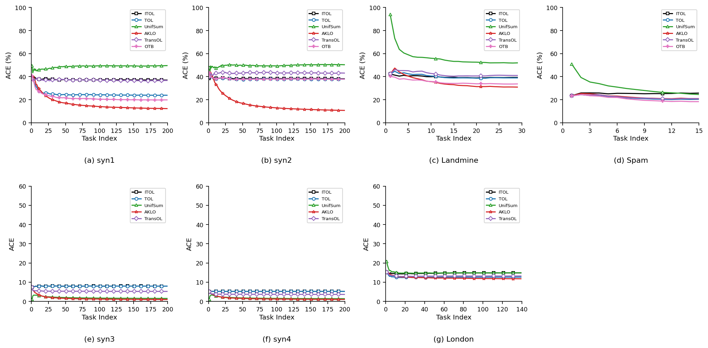
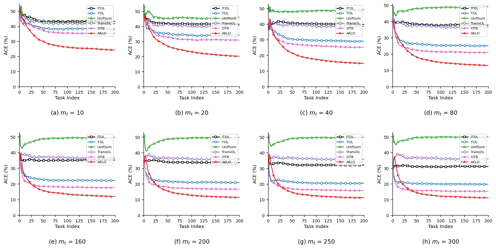
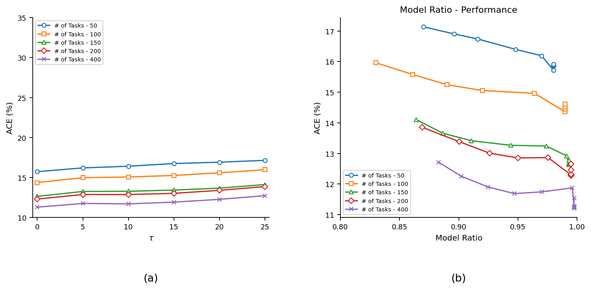
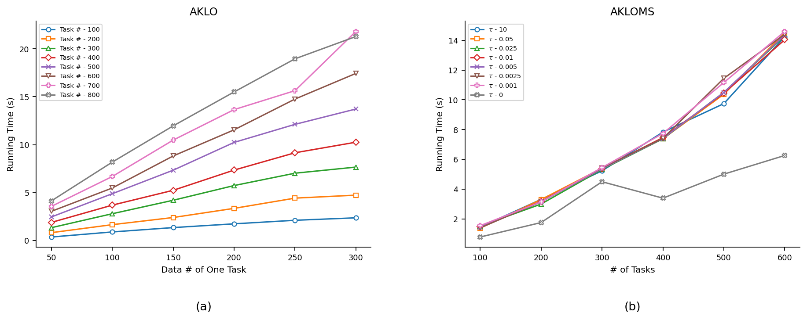

# AKLO reproduction report

Generated from the JSON files in `results/`. Every experiment is
repeated with seeds 0-9; the data and train/test split are fixed by
`data_seed=0`, and only the task and example order changes. Tables
report the mean ± standard deviation over the ten seeds; figures show
the mean. Classification ACE is a percentage; regression ACE is on the
target scale. Each number links to the W&B group that holds all ten
seeds of that configuration; links are omitted when the run was not
tracked online.

## E1: main comparison (paper Table 1)

| Method | Syn1 | Syn2 | Landmine | Spam | Syn3 | Syn4 | London |
| --- | --- | --- | --- | --- | --- | --- | --- |
| ITOL | [37.05 ± 0.47](https://forge.coreweave.com/wandb/AI-Athena-Lab/AKLO-lifelong-online-learning/groups/e1_main-syn1-itol) | [38.17 ± 0.51](https://forge.coreweave.com/wandb/AI-Athena-Lab/AKLO-lifelong-online-learning/groups/e1_main-syn2-itol) | [39.35 ± 0.85](https://forge.coreweave.com/wandb/AI-Athena-Lab/AKLO-lifelong-online-learning/groups/e1_main-landmine-itol) | [25.76 ± 0.90](https://forge.coreweave.com/wandb/AI-Athena-Lab/AKLO-lifelong-online-learning/groups/e1_main-spam-itol) | [7.94 ± 0.01](https://forge.coreweave.com/wandb/AI-Athena-Lab/AKLO-lifelong-online-learning/groups/e1_main-syn3-itol) | [5.17 ± 0.01](https://forge.coreweave.com/wandb/AI-Athena-Lab/AKLO-lifelong-online-learning/groups/e1_main-syn4-itol) | [14.81 ± 0.01](https://forge.coreweave.com/wandb/AI-Athena-Lab/AKLO-lifelong-online-learning/groups/e1_main-london-itol) |
| TOL | [23.86 ± 0.35](https://forge.coreweave.com/wandb/AI-Athena-Lab/AKLO-lifelong-online-learning/groups/e1_main-syn1-tol) | [37.82 ± 0.63](https://forge.coreweave.com/wandb/AI-Athena-Lab/AKLO-lifelong-online-learning/groups/e1_main-syn2-tol) | [38.93 ± 1.49](https://forge.coreweave.com/wandb/AI-Athena-Lab/AKLO-lifelong-online-learning/groups/e1_main-landmine-tol) | [20.37 ± 0.80](https://forge.coreweave.com/wandb/AI-Athena-Lab/AKLO-lifelong-online-learning/groups/e1_main-spam-tol) | [7.93 ± 0.01](https://forge.coreweave.com/wandb/AI-Athena-Lab/AKLO-lifelong-online-learning/groups/e1_main-syn3-tol) | [5.18 ± 0.01](https://forge.coreweave.com/wandb/AI-Athena-Lab/AKLO-lifelong-online-learning/groups/e1_main-syn4-tol) | [12.60 ± 0.03](https://forge.coreweave.com/wandb/AI-Athena-Lab/AKLO-lifelong-online-learning/groups/e1_main-london-tol) |
| UnifSum | [49.65 ± 0.73](https://forge.coreweave.com/wandb/AI-Athena-Lab/AKLO-lifelong-online-learning/groups/e1_main-syn1-unif_sum) | [50.36 ± 0.83](https://forge.coreweave.com/wandb/AI-Athena-Lab/AKLO-lifelong-online-learning/groups/e1_main-syn2-unif_sum) | [51.97 ± 8.85](https://forge.coreweave.com/wandb/AI-Athena-Lab/AKLO-lifelong-online-learning/groups/e1_main-landmine-unif_sum) | [24.51 ± 3.85](https://forge.coreweave.com/wandb/AI-Athena-Lab/AKLO-lifelong-online-learning/groups/e1_main-spam-unif_sum) | [1.52 ± 0.11](https://forge.coreweave.com/wandb/AI-Athena-Lab/AKLO-lifelong-online-learning/groups/e1_main-syn3-unif_sum) | [1.39 ± 0.09](https://forge.coreweave.com/wandb/AI-Athena-Lab/AKLO-lifelong-online-learning/groups/e1_main-syn4-unif_sum) | [14.89 ± 0.10](https://forge.coreweave.com/wandb/AI-Athena-Lab/AKLO-lifelong-online-learning/groups/e1_main-london-unif_sum) |
| TransOL | [36.71 ± 1.67](https://forge.coreweave.com/wandb/AI-Athena-Lab/AKLO-lifelong-online-learning/groups/e1_main-syn1-tranol) | [43.11 ± 1.04](https://forge.coreweave.com/wandb/AI-Athena-Lab/AKLO-lifelong-online-learning/groups/e1_main-syn2-tranol) | [41.03 ± 2.90](https://forge.coreweave.com/wandb/AI-Athena-Lab/AKLO-lifelong-online-learning/groups/e1_main-landmine-tranol) | [20.94 ± 1.77](https://forge.coreweave.com/wandb/AI-Athena-Lab/AKLO-lifelong-online-learning/groups/e1_main-spam-tranol) | [5.17 ± 0.10](https://forge.coreweave.com/wandb/AI-Athena-Lab/AKLO-lifelong-online-learning/groups/e1_main-syn3-tranol) | [3.61 ± 0.06](https://forge.coreweave.com/wandb/AI-Athena-Lab/AKLO-lifelong-online-learning/groups/e1_main-syn4-tranol) | [13.21 ± 0.06](https://forge.coreweave.com/wandb/AI-Athena-Lab/AKLO-lifelong-online-learning/groups/e1_main-london-tranol) |
| OTB | [19.84 ± 0.66](https://forge.coreweave.com/wandb/AI-Athena-Lab/AKLO-lifelong-online-learning/groups/e1_main-syn1-otb) | [37.79 ± 0.61](https://forge.coreweave.com/wandb/AI-Athena-Lab/AKLO-lifelong-online-learning/groups/e1_main-syn2-otb) | [33.71 ± 1.73](https://forge.coreweave.com/wandb/AI-Athena-Lab/AKLO-lifelong-online-learning/groups/e1_main-landmine-otb) | [18.34 ± 0.64](https://forge.coreweave.com/wandb/AI-Athena-Lab/AKLO-lifelong-online-learning/groups/e1_main-spam-otb) | – | – | – |
| AKLO | [12.29 ± 0.83](https://forge.coreweave.com/wandb/AI-Athena-Lab/AKLO-lifelong-online-learning/groups/e1_main-syn1-aklo) | [10.72 ± 0.78](https://forge.coreweave.com/wandb/AI-Athena-Lab/AKLO-lifelong-online-learning/groups/e1_main-syn2-aklo) | [30.96 ± 1.36](https://forge.coreweave.com/wandb/AI-Athena-Lab/AKLO-lifelong-online-learning/groups/e1_main-landmine-aklo) | [20.93 ± 1.61](https://forge.coreweave.com/wandb/AI-Athena-Lab/AKLO-lifelong-online-learning/groups/e1_main-spam-aklo) | [0.96 ± 0.10](https://forge.coreweave.com/wandb/AI-Athena-Lab/AKLO-lifelong-online-learning/groups/e1_main-syn3-aklo) | [1.00 ± 0.10](https://forge.coreweave.com/wandb/AI-Athena-Lab/AKLO-lifelong-online-learning/groups/e1_main-syn4-aklo) | [11.77 ± 0.09](https://forge.coreweave.com/wandb/AI-Athena-Lab/AKLO-lifelong-online-learning/groups/e1_main-london-aklo) |

### Paper vs reproduction

| Dataset | Method | Paper | Reproduction |
| --- | --- | --- | --- |
| syn1 | ITOL | 36.18 | [37.05 ± 0.47](https://forge.coreweave.com/wandb/AI-Athena-Lab/AKLO-lifelong-online-learning/groups/e1_main-syn1-itol) |
| syn1 | TOL | 21.16 | [23.86 ± 0.35](https://forge.coreweave.com/wandb/AI-Athena-Lab/AKLO-lifelong-online-learning/groups/e1_main-syn1-tol) |
| syn1 | UnifSum | 49.63 | [49.65 ± 0.73](https://forge.coreweave.com/wandb/AI-Athena-Lab/AKLO-lifelong-online-learning/groups/e1_main-syn1-unif_sum) |
| syn1 | TransOL | 36.40 | [36.71 ± 1.67](https://forge.coreweave.com/wandb/AI-Athena-Lab/AKLO-lifelong-online-learning/groups/e1_main-syn1-tranol) |
| syn1 | OTB | 30.19 | [19.84 ± 0.66](https://forge.coreweave.com/wandb/AI-Athena-Lab/AKLO-lifelong-online-learning/groups/e1_main-syn1-otb) |
| syn1 | AKLO | 10.10 | [12.29 ± 0.83](https://forge.coreweave.com/wandb/AI-Athena-Lab/AKLO-lifelong-online-learning/groups/e1_main-syn1-aklo) |
| syn2 | ITOL | 33.70 | [38.17 ± 0.51](https://forge.coreweave.com/wandb/AI-Athena-Lab/AKLO-lifelong-online-learning/groups/e1_main-syn2-itol) |
| syn2 | TOL | 33.34 | [37.82 ± 0.63](https://forge.coreweave.com/wandb/AI-Athena-Lab/AKLO-lifelong-online-learning/groups/e1_main-syn2-tol) |
| syn2 | UnifSum | 43.07 | [50.36 ± 0.83](https://forge.coreweave.com/wandb/AI-Athena-Lab/AKLO-lifelong-online-learning/groups/e1_main-syn2-unif_sum) |
| syn2 | TransOL | 32.97 | [43.11 ± 1.04](https://forge.coreweave.com/wandb/AI-Athena-Lab/AKLO-lifelong-online-learning/groups/e1_main-syn2-tranol) |
| syn2 | OTB | 34.90 | [37.79 ± 0.61](https://forge.coreweave.com/wandb/AI-Athena-Lab/AKLO-lifelong-online-learning/groups/e1_main-syn2-otb) |
| syn2 | AKLO | 10.16 | [10.72 ± 0.78](https://forge.coreweave.com/wandb/AI-Athena-Lab/AKLO-lifelong-online-learning/groups/e1_main-syn2-aklo) |
| landmine | ITOL | 13.86 | [39.35 ± 0.85](https://forge.coreweave.com/wandb/AI-Athena-Lab/AKLO-lifelong-online-learning/groups/e1_main-landmine-itol) |
| landmine | TOL | 11.54 | [38.93 ± 1.49](https://forge.coreweave.com/wandb/AI-Athena-Lab/AKLO-lifelong-online-learning/groups/e1_main-landmine-tol) |
| landmine | UnifSum | 7.97 | [51.97 ± 8.85](https://forge.coreweave.com/wandb/AI-Athena-Lab/AKLO-lifelong-online-learning/groups/e1_main-landmine-unif_sum) |
| landmine | TransOL | 8.05 | [41.03 ± 2.90](https://forge.coreweave.com/wandb/AI-Athena-Lab/AKLO-lifelong-online-learning/groups/e1_main-landmine-tranol) |
| landmine | OTB | 10.94 | [33.71 ± 1.73](https://forge.coreweave.com/wandb/AI-Athena-Lab/AKLO-lifelong-online-learning/groups/e1_main-landmine-otb) |
| landmine | AKLO | 7.30 | [30.96 ± 1.36](https://forge.coreweave.com/wandb/AI-Athena-Lab/AKLO-lifelong-online-learning/groups/e1_main-landmine-aklo) |
| spam | ITOL | 25.00 | [25.76 ± 0.90](https://forge.coreweave.com/wandb/AI-Athena-Lab/AKLO-lifelong-online-learning/groups/e1_main-spam-itol) |
| spam | TOL | 19.51 | [20.37 ± 0.80](https://forge.coreweave.com/wandb/AI-Athena-Lab/AKLO-lifelong-online-learning/groups/e1_main-spam-tol) |
| spam | UnifSum | 19.50 | [24.51 ± 3.85](https://forge.coreweave.com/wandb/AI-Athena-Lab/AKLO-lifelong-online-learning/groups/e1_main-spam-unif_sum) |
| spam | TransOL | 24.50 | [20.94 ± 1.77](https://forge.coreweave.com/wandb/AI-Athena-Lab/AKLO-lifelong-online-learning/groups/e1_main-spam-tranol) |
| spam | OTB | 24.10 | [18.34 ± 0.64](https://forge.coreweave.com/wandb/AI-Athena-Lab/AKLO-lifelong-online-learning/groups/e1_main-spam-otb) |
| spam | AKLO | 17.36 | [20.93 ± 1.61](https://forge.coreweave.com/wandb/AI-Athena-Lab/AKLO-lifelong-online-learning/groups/e1_main-spam-aklo) |
| syn3 | ITOL | 14.54 | [7.94 ± 0.01](https://forge.coreweave.com/wandb/AI-Athena-Lab/AKLO-lifelong-online-learning/groups/e1_main-syn3-itol) |
| syn3 | TOL | 7.63 | [7.93 ± 0.01](https://forge.coreweave.com/wandb/AI-Athena-Lab/AKLO-lifelong-online-learning/groups/e1_main-syn3-tol) |
| syn3 | UnifSum | 27.69 | [1.52 ± 0.11](https://forge.coreweave.com/wandb/AI-Athena-Lab/AKLO-lifelong-online-learning/groups/e1_main-syn3-unif_sum) |
| syn3 | TransOL | 61.61 | [5.17 ± 0.10](https://forge.coreweave.com/wandb/AI-Athena-Lab/AKLO-lifelong-online-learning/groups/e1_main-syn3-tranol) |
| syn3 | AKLO | 4.06 | [0.96 ± 0.10](https://forge.coreweave.com/wandb/AI-Athena-Lab/AKLO-lifelong-online-learning/groups/e1_main-syn3-aklo) |
| syn4 | ITOL | 8.02 | [5.17 ± 0.01](https://forge.coreweave.com/wandb/AI-Athena-Lab/AKLO-lifelong-online-learning/groups/e1_main-syn4-itol) |
| syn4 | TOL | 9.96 | [5.18 ± 0.01](https://forge.coreweave.com/wandb/AI-Athena-Lab/AKLO-lifelong-online-learning/groups/e1_main-syn4-tol) |
| syn4 | UnifSum | 51.23 | [1.39 ± 0.09](https://forge.coreweave.com/wandb/AI-Athena-Lab/AKLO-lifelong-online-learning/groups/e1_main-syn4-unif_sum) |
| syn4 | TransOL | 54.55 | [3.61 ± 0.06](https://forge.coreweave.com/wandb/AI-Athena-Lab/AKLO-lifelong-online-learning/groups/e1_main-syn4-tranol) |
| syn4 | AKLO | 2.98 | [1.00 ± 0.10](https://forge.coreweave.com/wandb/AI-Athena-Lab/AKLO-lifelong-online-learning/groups/e1_main-syn4-aklo) |
| london | ITOL | 20.76 | [14.81 ± 0.01](https://forge.coreweave.com/wandb/AI-Athena-Lab/AKLO-lifelong-online-learning/groups/e1_main-london-itol) |
| london | TOL | 20.91 | [12.60 ± 0.03](https://forge.coreweave.com/wandb/AI-Athena-Lab/AKLO-lifelong-online-learning/groups/e1_main-london-tol) |
| london | UnifSum | 10.94 | [14.89 ± 0.10](https://forge.coreweave.com/wandb/AI-Athena-Lab/AKLO-lifelong-online-learning/groups/e1_main-london-unif_sum) |
| london | TransOL | 79.58 | [13.21 ± 0.06](https://forge.coreweave.com/wandb/AI-Athena-Lab/AKLO-lifelong-online-learning/groups/e1_main-london-tranol) |
| london | AKLO | 10.05 | [11.77 ± 0.09](https://forge.coreweave.com/wandb/AI-Athena-Lab/AKLO-lifelong-online-learning/groups/e1_main-london-aklo) |

## E2: number of observations per task (paper Figure 3)

| m_t | ITOL | TOL | UnifSum | TransOL | OTB | AKLO |
| --- | --- | --- | --- | --- | --- | --- |
| 10 | [43.30 ± 0.87](https://forge.coreweave.com/wandb/AI-Athena-Lab/AKLO-lifelong-online-learning/groups/e2_small_m-syn1-itol-m10) | [38.10 ± 1.38](https://forge.coreweave.com/wandb/AI-Athena-Lab/AKLO-lifelong-online-learning/groups/e2_small_m-syn1-tol-m10) | [41.96 ± 2.92](https://forge.coreweave.com/wandb/AI-Athena-Lab/AKLO-lifelong-online-learning/groups/e2_small_m-syn1-unif_sum-m10) | [41.67 ± 1.72](https://forge.coreweave.com/wandb/AI-Athena-Lab/AKLO-lifelong-online-learning/groups/e2_small_m-syn1-tranol-m10) | [35.34 ± 1.38](https://forge.coreweave.com/wandb/AI-Athena-Lab/AKLO-lifelong-online-learning/groups/e2_small_m-syn1-otb-m10) | [24.27 ± 1.08](https://forge.coreweave.com/wandb/AI-Athena-Lab/AKLO-lifelong-online-learning/groups/e2_small_m-syn1-aklo-m10) |
| 20 | [41.53 ± 0.42](https://forge.coreweave.com/wandb/AI-Athena-Lab/AKLO-lifelong-online-learning/groups/e2_small_m-syn1-itol-m20) | [34.24 ± 0.95](https://forge.coreweave.com/wandb/AI-Athena-Lab/AKLO-lifelong-online-learning/groups/e2_small_m-syn1-tol-m20) | [46.23 ± 3.96](https://forge.coreweave.com/wandb/AI-Athena-Lab/AKLO-lifelong-online-learning/groups/e2_small_m-syn1-unif_sum-m20) | [40.59 ± 1.50](https://forge.coreweave.com/wandb/AI-Athena-Lab/AKLO-lifelong-online-learning/groups/e2_small_m-syn1-tranol-m20) | [30.99 ± 1.11](https://forge.coreweave.com/wandb/AI-Athena-Lab/AKLO-lifelong-online-learning/groups/e2_small_m-syn1-otb-m20) | [20.21 ± 1.44](https://forge.coreweave.com/wandb/AI-Athena-Lab/AKLO-lifelong-online-learning/groups/e2_small_m-syn1-aklo-m20) |
| 40 | [39.82 ± 0.43](https://forge.coreweave.com/wandb/AI-Athena-Lab/AKLO-lifelong-online-learning/groups/e2_small_m-syn1-itol-m40) | [29.14 ± 1.10](https://forge.coreweave.com/wandb/AI-Athena-Lab/AKLO-lifelong-online-learning/groups/e2_small_m-syn1-tol-m40) | [49.24 ± 1.35](https://forge.coreweave.com/wandb/AI-Athena-Lab/AKLO-lifelong-online-learning/groups/e2_small_m-syn1-unif_sum-m40) | [38.58 ± 1.74](https://forge.coreweave.com/wandb/AI-Athena-Lab/AKLO-lifelong-online-learning/groups/e2_small_m-syn1-tranol-m40) | [25.30 ± 0.80](https://forge.coreweave.com/wandb/AI-Athena-Lab/AKLO-lifelong-online-learning/groups/e2_small_m-syn1-otb-m40) | [14.91 ± 1.13](https://forge.coreweave.com/wandb/AI-Athena-Lab/AKLO-lifelong-online-learning/groups/e2_small_m-syn1-aklo-m40) |
| 80 | [37.81 ± 0.59](https://forge.coreweave.com/wandb/AI-Athena-Lab/AKLO-lifelong-online-learning/groups/e2_small_m-syn1-itol-m80) | [25.17 ± 0.59](https://forge.coreweave.com/wandb/AI-Athena-Lab/AKLO-lifelong-online-learning/groups/e2_small_m-syn1-tol-m80) | [49.18 ± 0.88](https://forge.coreweave.com/wandb/AI-Athena-Lab/AKLO-lifelong-online-learning/groups/e2_small_m-syn1-unif_sum-m80) | [36.68 ± 1.33](https://forge.coreweave.com/wandb/AI-Athena-Lab/AKLO-lifelong-online-learning/groups/e2_small_m-syn1-tranol-m80) | [20.98 ± 0.49](https://forge.coreweave.com/wandb/AI-Athena-Lab/AKLO-lifelong-online-learning/groups/e2_small_m-syn1-otb-m80) | [13.04 ± 0.92](https://forge.coreweave.com/wandb/AI-Athena-Lab/AKLO-lifelong-online-learning/groups/e2_small_m-syn1-aklo-m80) |
| 160 | [35.24 ± 0.38](https://forge.coreweave.com/wandb/AI-Athena-Lab/AKLO-lifelong-online-learning/groups/e2_small_m-syn1-itol-m160) | [22.28 ± 0.64](https://forge.coreweave.com/wandb/AI-Athena-Lab/AKLO-lifelong-online-learning/groups/e2_small_m-syn1-tol-m160) | [49.75 ± 0.36](https://forge.coreweave.com/wandb/AI-Athena-Lab/AKLO-lifelong-online-learning/groups/e2_small_m-syn1-unif_sum-m160) | [36.55 ± 1.61](https://forge.coreweave.com/wandb/AI-Athena-Lab/AKLO-lifelong-online-learning/groups/e2_small_m-syn1-tranol-m160) | [17.66 ± 0.57](https://forge.coreweave.com/wandb/AI-Athena-Lab/AKLO-lifelong-online-learning/groups/e2_small_m-syn1-otb-m160) | [11.99 ± 1.28](https://forge.coreweave.com/wandb/AI-Athena-Lab/AKLO-lifelong-online-learning/groups/e2_small_m-syn1-aklo-m160) |
| 200 | [33.67 ± 0.44](https://forge.coreweave.com/wandb/AI-Athena-Lab/AKLO-lifelong-online-learning/groups/e2_small_m-syn1-itol-m200) | [21.02 ± 0.40](https://forge.coreweave.com/wandb/AI-Athena-Lab/AKLO-lifelong-online-learning/groups/e2_small_m-syn1-tol-m200) | [49.88 ± 0.56](https://forge.coreweave.com/wandb/AI-Athena-Lab/AKLO-lifelong-online-learning/groups/e2_small_m-syn1-unif_sum-m200) | [35.97 ± 1.55](https://forge.coreweave.com/wandb/AI-Athena-Lab/AKLO-lifelong-online-learning/groups/e2_small_m-syn1-tranol-m200) | [16.74 ± 0.48](https://forge.coreweave.com/wandb/AI-Athena-Lab/AKLO-lifelong-online-learning/groups/e2_small_m-syn1-otb-m200) | [11.48 ± 0.64](https://forge.coreweave.com/wandb/AI-Athena-Lab/AKLO-lifelong-online-learning/groups/e2_small_m-syn1-aklo-m200) |
| 250 | [32.17 ± 0.47](https://forge.coreweave.com/wandb/AI-Athena-Lab/AKLO-lifelong-online-learning/groups/e2_small_m-syn1-itol-m250) | [20.61 ± 0.52](https://forge.coreweave.com/wandb/AI-Athena-Lab/AKLO-lifelong-online-learning/groups/e2_small_m-syn1-tol-m250) | [50.02 ± 0.46](https://forge.coreweave.com/wandb/AI-Athena-Lab/AKLO-lifelong-online-learning/groups/e2_small_m-syn1-unif_sum-m250) | [35.91 ± 1.34](https://forge.coreweave.com/wandb/AI-Athena-Lab/AKLO-lifelong-online-learning/groups/e2_small_m-syn1-tranol-m250) | [15.88 ± 0.39](https://forge.coreweave.com/wandb/AI-Athena-Lab/AKLO-lifelong-online-learning/groups/e2_small_m-syn1-otb-m250) | [11.24 ± 0.50](https://forge.coreweave.com/wandb/AI-Athena-Lab/AKLO-lifelong-online-learning/groups/e2_small_m-syn1-aklo-m250) |
| 300 | [31.18 ± 0.39](https://forge.coreweave.com/wandb/AI-Athena-Lab/AKLO-lifelong-online-learning/groups/e2_small_m-syn1-itol-m300) | [19.93 ± 0.46](https://forge.coreweave.com/wandb/AI-Athena-Lab/AKLO-lifelong-online-learning/groups/e2_small_m-syn1-tol-m300) | [50.10 ± 0.33](https://forge.coreweave.com/wandb/AI-Athena-Lab/AKLO-lifelong-online-learning/groups/e2_small_m-syn1-unif_sum-m300) | [36.01 ± 1.50](https://forge.coreweave.com/wandb/AI-Athena-Lab/AKLO-lifelong-online-learning/groups/e2_small_m-syn1-tranol-m300) | [15.34 ± 0.45](https://forge.coreweave.com/wandb/AI-Athena-Lab/AKLO-lifelong-online-learning/groups/e2_small_m-syn1-otb-m300) | [11.20 ± 0.36](https://forge.coreweave.com/wandb/AI-Athena-Lab/AKLO-lifelong-online-learning/groups/e2_small_m-syn1-aklo-m300) |

## E3: catastrophic forgetting (paper Table 2)

Training follows E1 exactly. E3 evaluates the test set of every task
`1..T` with a method-specific predictor. ITOL, AKLO, TranOL and OTB use
the frozen snapshot saved at the end of that task; TOL uses its single
final online model; Unif_Sum averages all task snapshots. No parameter
is updated during the test pass. The synthetic datasets use 50 tasks
(25 D1 + 25 D2) with 100 training and 100 separate test samples per
task. Landmine uses 150 training rows per task and all remaining rows
as test; Spam uses 200 training rows per user and all remaining rows as
test. London keeps an 80/20 split per school. Each experiment is
repeated with 10 seeds; the data and split are fixed and only the
task/example order changes. The primary metric is the task-averaged
test ACE, with the pooled test ACE as a secondary metric. Classification
ACE is multiplied by 100; regression ACE is on the target scale. OTB is
not defined for regression, so those cells are empty.

| Method | Syn1 | Syn2 | Landmine | Spam | Syn3 | Syn4 | London |
| --- | --- | --- | --- | --- | --- | --- | --- |
| ITOL | [35.87 ± 2.50](https://forge.coreweave.com/wandb/AI-Athena-Lab/AKLO-lifelong-online-learning/groups/e3_catastrophic-forgetting-syn1-itol) | [33.91 ± 1.89](https://forge.coreweave.com/wandb/AI-Athena-Lab/AKLO-lifelong-online-learning/groups/e3_catastrophic-forgetting-syn2-itol) | [37.95 ± 1.43](https://forge.coreweave.com/wandb/AI-Athena-Lab/AKLO-lifelong-online-learning/groups/e3_catastrophic-forgetting-landmine-itol) | [20.00 ± 1.75](https://forge.coreweave.com/wandb/AI-Athena-Lab/AKLO-lifelong-online-learning/groups/e3_catastrophic-forgetting-spam-itol) | [6.90 ± 0.66](https://forge.coreweave.com/wandb/AI-Athena-Lab/AKLO-lifelong-online-learning/groups/e3_catastrophic-forgetting-syn3-itol) | [4.83 ± 0.36](https://forge.coreweave.com/wandb/AI-Athena-Lab/AKLO-lifelong-online-learning/groups/e3_catastrophic-forgetting-syn4-itol) | [12.77 ± 0.03](https://forge.coreweave.com/wandb/AI-Athena-Lab/AKLO-lifelong-online-learning/groups/e3_catastrophic-forgetting-london-itol) |
| TOL | [38.32 ± 10.02](https://forge.coreweave.com/wandb/AI-Athena-Lab/AKLO-lifelong-online-learning/groups/e3_catastrophic-forgetting-syn1-tol) | [49.87 ± 0.60](https://forge.coreweave.com/wandb/AI-Athena-Lab/AKLO-lifelong-online-learning/groups/e3_catastrophic-forgetting-syn2-tol) | [46.79 ± 13.53](https://forge.coreweave.com/wandb/AI-Athena-Lab/AKLO-lifelong-online-learning/groups/e3_catastrophic-forgetting-landmine-tol) | [22.93 ± 7.81](https://forge.coreweave.com/wandb/AI-Athena-Lab/AKLO-lifelong-online-learning/groups/e3_catastrophic-forgetting-spam-tol) | [6.76 ± 4.16](https://forge.coreweave.com/wandb/AI-Athena-Lab/AKLO-lifelong-online-learning/groups/e3_catastrophic-forgetting-syn3-tol) | [4.28 ± 2.99](https://forge.coreweave.com/wandb/AI-Athena-Lab/AKLO-lifelong-online-learning/groups/e3_catastrophic-forgetting-syn4-tol) | [13.86 ± 0.95](https://forge.coreweave.com/wandb/AI-Athena-Lab/AKLO-lifelong-online-learning/groups/e3_catastrophic-forgetting-london-tol) |
| UnifSum | [50.01 ± 0.20](https://forge.coreweave.com/wandb/AI-Athena-Lab/AKLO-lifelong-online-learning/groups/e3_catastrophic-forgetting-syn1-unif_sum) | [49.90 ± 0.49](https://forge.coreweave.com/wandb/AI-Athena-Lab/AKLO-lifelong-online-learning/groups/e3_catastrophic-forgetting-syn2-unif_sum) | [55.44 ± 2.09](https://forge.coreweave.com/wandb/AI-Athena-Lab/AKLO-lifelong-online-learning/groups/e3_catastrophic-forgetting-landmine-unif_sum) | [20.81 ± 4.85](https://forge.coreweave.com/wandb/AI-Athena-Lab/AKLO-lifelong-online-learning/groups/e3_catastrophic-forgetting-spam-unif_sum) | [1.77 ± 0.56](https://forge.coreweave.com/wandb/AI-Athena-Lab/AKLO-lifelong-online-learning/groups/e3_catastrophic-forgetting-syn3-unif_sum) | [1.29 ± 0.15](https://forge.coreweave.com/wandb/AI-Athena-Lab/AKLO-lifelong-online-learning/groups/e3_catastrophic-forgetting-syn4-unif_sum) | [14.75 ± 0.03](https://forge.coreweave.com/wandb/AI-Athena-Lab/AKLO-lifelong-online-learning/groups/e3_catastrophic-forgetting-london-unif_sum) |
| TransOL | [37.07 ± 1.90](https://forge.coreweave.com/wandb/AI-Athena-Lab/AKLO-lifelong-online-learning/groups/e3_catastrophic-forgetting-syn1-tranol) | [42.22 ± 1.86](https://forge.coreweave.com/wandb/AI-Athena-Lab/AKLO-lifelong-online-learning/groups/e3_catastrophic-forgetting-syn2-tranol) | [40.07 ± 2.61](https://forge.coreweave.com/wandb/AI-Athena-Lab/AKLO-lifelong-online-learning/groups/e3_catastrophic-forgetting-landmine-tranol) | [18.82 ± 1.70](https://forge.coreweave.com/wandb/AI-Athena-Lab/AKLO-lifelong-online-learning/groups/e3_catastrophic-forgetting-spam-tranol) | [5.39 ± 0.72](https://forge.coreweave.com/wandb/AI-Athena-Lab/AKLO-lifelong-online-learning/groups/e3_catastrophic-forgetting-syn3-tranol) | [3.49 ± 0.36](https://forge.coreweave.com/wandb/AI-Athena-Lab/AKLO-lifelong-online-learning/groups/e3_catastrophic-forgetting-syn4-tranol) | [12.65 ± 0.07](https://forge.coreweave.com/wandb/AI-Athena-Lab/AKLO-lifelong-online-learning/groups/e3_catastrophic-forgetting-london-tranol) |
| OTB | [18.37 ± 1.76](https://forge.coreweave.com/wandb/AI-Athena-Lab/AKLO-lifelong-online-learning/groups/e3_catastrophic-forgetting-syn1-otb) | [35.47 ± 1.25](https://forge.coreweave.com/wandb/AI-Athena-Lab/AKLO-lifelong-online-learning/groups/e3_catastrophic-forgetting-syn2-otb) | [33.06 ± 1.86](https://forge.coreweave.com/wandb/AI-Athena-Lab/AKLO-lifelong-online-learning/groups/e3_catastrophic-forgetting-landmine-otb) | [15.59 ± 1.63](https://forge.coreweave.com/wandb/AI-Athena-Lab/AKLO-lifelong-online-learning/groups/e3_catastrophic-forgetting-spam-otb) | – | – | – |
| AKLO | [19.61 ± 2.93](https://forge.coreweave.com/wandb/AI-Athena-Lab/AKLO-lifelong-online-learning/groups/e3_catastrophic-forgetting-syn1-aklo) | [16.50 ± 2.79](https://forge.coreweave.com/wandb/AI-Athena-Lab/AKLO-lifelong-online-learning/groups/e3_catastrophic-forgetting-syn2-aklo) | [33.25 ± 1.27](https://forge.coreweave.com/wandb/AI-Athena-Lab/AKLO-lifelong-online-learning/groups/e3_catastrophic-forgetting-landmine-aklo) | [19.67 ± 2.70](https://forge.coreweave.com/wandb/AI-Athena-Lab/AKLO-lifelong-online-learning/groups/e3_catastrophic-forgetting-spam-aklo) | [1.40 ± 0.31](https://forge.coreweave.com/wandb/AI-Athena-Lab/AKLO-lifelong-online-learning/groups/e3_catastrophic-forgetting-syn3-aklo) | [1.28 ± 0.23](https://forge.coreweave.com/wandb/AI-Athena-Lab/AKLO-lifelong-online-learning/groups/e3_catastrophic-forgetting-syn4-aklo) | [11.63 ± 0.08](https://forge.coreweave.com/wandb/AI-Athena-Lab/AKLO-lifelong-online-learning/groups/e3_catastrophic-forgetting-london-aklo) |

### Secondary metric: pooled test ACE

| Method | Syn1 | Syn2 | Landmine | Spam | Syn3 | Syn4 | London |
| --- | --- | --- | --- | --- | --- | --- | --- |
| ITOL | [35.87 ± 2.50](https://forge.coreweave.com/wandb/AI-Athena-Lab/AKLO-lifelong-online-learning/groups/e3_catastrophic-forgetting-syn1-itol) | [33.91 ± 1.89](https://forge.coreweave.com/wandb/AI-Athena-Lab/AKLO-lifelong-online-learning/groups/e3_catastrophic-forgetting-syn2-itol) | [39.28 ± 1.51](https://forge.coreweave.com/wandb/AI-Athena-Lab/AKLO-lifelong-online-learning/groups/e3_catastrophic-forgetting-landmine-itol) | [20.00 ± 1.75](https://forge.coreweave.com/wandb/AI-Athena-Lab/AKLO-lifelong-online-learning/groups/e3_catastrophic-forgetting-spam-itol) | [6.90 ± 0.66](https://forge.coreweave.com/wandb/AI-Athena-Lab/AKLO-lifelong-online-learning/groups/e3_catastrophic-forgetting-syn3-itol) | [4.83 ± 0.36](https://forge.coreweave.com/wandb/AI-Athena-Lab/AKLO-lifelong-online-learning/groups/e3_catastrophic-forgetting-syn4-itol) | [12.43 ± 0.04](https://forge.coreweave.com/wandb/AI-Athena-Lab/AKLO-lifelong-online-learning/groups/e3_catastrophic-forgetting-london-itol) |
| TOL | [38.32 ± 10.02](https://forge.coreweave.com/wandb/AI-Athena-Lab/AKLO-lifelong-online-learning/groups/e3_catastrophic-forgetting-syn1-tol) | [49.87 ± 0.60](https://forge.coreweave.com/wandb/AI-Athena-Lab/AKLO-lifelong-online-learning/groups/e3_catastrophic-forgetting-syn2-tol) | [46.62 ± 12.56](https://forge.coreweave.com/wandb/AI-Athena-Lab/AKLO-lifelong-online-learning/groups/e3_catastrophic-forgetting-landmine-tol) | [22.93 ± 7.81](https://forge.coreweave.com/wandb/AI-Athena-Lab/AKLO-lifelong-online-learning/groups/e3_catastrophic-forgetting-spam-tol) | [6.76 ± 4.16](https://forge.coreweave.com/wandb/AI-Athena-Lab/AKLO-lifelong-online-learning/groups/e3_catastrophic-forgetting-syn3-tol) | [4.28 ± 2.99](https://forge.coreweave.com/wandb/AI-Athena-Lab/AKLO-lifelong-online-learning/groups/e3_catastrophic-forgetting-syn4-tol) | [14.03 ± 0.96](https://forge.coreweave.com/wandb/AI-Athena-Lab/AKLO-lifelong-online-learning/groups/e3_catastrophic-forgetting-london-tol) |
| UnifSum | [50.01 ± 0.20](https://forge.coreweave.com/wandb/AI-Athena-Lab/AKLO-lifelong-online-learning/groups/e3_catastrophic-forgetting-syn1-unif_sum) | [49.90 ± 0.49](https://forge.coreweave.com/wandb/AI-Athena-Lab/AKLO-lifelong-online-learning/groups/e3_catastrophic-forgetting-syn2-unif_sum) | [54.35 ± 2.12](https://forge.coreweave.com/wandb/AI-Athena-Lab/AKLO-lifelong-online-learning/groups/e3_catastrophic-forgetting-landmine-unif_sum) | [20.81 ± 4.85](https://forge.coreweave.com/wandb/AI-Athena-Lab/AKLO-lifelong-online-learning/groups/e3_catastrophic-forgetting-spam-unif_sum) | [1.77 ± 0.56](https://forge.coreweave.com/wandb/AI-Athena-Lab/AKLO-lifelong-online-learning/groups/e3_catastrophic-forgetting-syn3-unif_sum) | [1.29 ± 0.15](https://forge.coreweave.com/wandb/AI-Athena-Lab/AKLO-lifelong-online-learning/groups/e3_catastrophic-forgetting-syn4-unif_sum) | [14.94 ± 0.03](https://forge.coreweave.com/wandb/AI-Athena-Lab/AKLO-lifelong-online-learning/groups/e3_catastrophic-forgetting-london-unif_sum) |
| TransOL | [37.07 ± 1.90](https://forge.coreweave.com/wandb/AI-Athena-Lab/AKLO-lifelong-online-learning/groups/e3_catastrophic-forgetting-syn1-tranol) | [42.22 ± 1.86](https://forge.coreweave.com/wandb/AI-Athena-Lab/AKLO-lifelong-online-learning/groups/e3_catastrophic-forgetting-syn2-tranol) | [40.86 ± 2.39](https://forge.coreweave.com/wandb/AI-Athena-Lab/AKLO-lifelong-online-learning/groups/e3_catastrophic-forgetting-landmine-tranol) | [18.82 ± 1.70](https://forge.coreweave.com/wandb/AI-Athena-Lab/AKLO-lifelong-online-learning/groups/e3_catastrophic-forgetting-spam-tranol) | [5.39 ± 0.72](https://forge.coreweave.com/wandb/AI-Athena-Lab/AKLO-lifelong-online-learning/groups/e3_catastrophic-forgetting-syn3-tranol) | [3.49 ± 0.36](https://forge.coreweave.com/wandb/AI-Athena-Lab/AKLO-lifelong-online-learning/groups/e3_catastrophic-forgetting-syn4-tranol) | [12.74 ± 0.07](https://forge.coreweave.com/wandb/AI-Athena-Lab/AKLO-lifelong-online-learning/groups/e3_catastrophic-forgetting-london-tranol) |
| OTB | [18.37 ± 1.76](https://forge.coreweave.com/wandb/AI-Athena-Lab/AKLO-lifelong-online-learning/groups/e3_catastrophic-forgetting-syn1-otb) | [35.47 ± 1.25](https://forge.coreweave.com/wandb/AI-Athena-Lab/AKLO-lifelong-online-learning/groups/e3_catastrophic-forgetting-syn2-otb) | [34.38 ± 1.86](https://forge.coreweave.com/wandb/AI-Athena-Lab/AKLO-lifelong-online-learning/groups/e3_catastrophic-forgetting-landmine-otb) | [15.59 ± 1.63](https://forge.coreweave.com/wandb/AI-Athena-Lab/AKLO-lifelong-online-learning/groups/e3_catastrophic-forgetting-spam-otb) | – | – | – |
| AKLO | [19.61 ± 2.93](https://forge.coreweave.com/wandb/AI-Athena-Lab/AKLO-lifelong-online-learning/groups/e3_catastrophic-forgetting-syn1-aklo) | [16.50 ± 2.79](https://forge.coreweave.com/wandb/AI-Athena-Lab/AKLO-lifelong-online-learning/groups/e3_catastrophic-forgetting-syn2-aklo) | [34.59 ± 1.52](https://forge.coreweave.com/wandb/AI-Athena-Lab/AKLO-lifelong-online-learning/groups/e3_catastrophic-forgetting-landmine-aklo) | [19.67 ± 2.70](https://forge.coreweave.com/wandb/AI-Athena-Lab/AKLO-lifelong-online-learning/groups/e3_catastrophic-forgetting-spam-aklo) | [1.40 ± 0.31](https://forge.coreweave.com/wandb/AI-Athena-Lab/AKLO-lifelong-online-learning/groups/e3_catastrophic-forgetting-syn3-aklo) | [1.28 ± 0.23](https://forge.coreweave.com/wandb/AI-Athena-Lab/AKLO-lifelong-online-learning/groups/e3_catastrophic-forgetting-syn4-aklo) | [11.80 ± 0.09](https://forge.coreweave.com/wandb/AI-Athena-Lab/AKLO-lifelong-online-learning/groups/e3_catastrophic-forgetting-london-aklo) |

### Paper vs reproduction

| Dataset | Method | Paper Table 2 | Our test ACE |
| --- | --- | --- | --- |
| Syn1 | ITOL | 36.36 | [35.87 ± 2.50](https://forge.coreweave.com/wandb/AI-Athena-Lab/AKLO-lifelong-online-learning/groups/e3_catastrophic-forgetting-syn1-itol) |
| Syn1 | TOL | 21.54 | [38.32 ± 10.02](https://forge.coreweave.com/wandb/AI-Athena-Lab/AKLO-lifelong-online-learning/groups/e3_catastrophic-forgetting-syn1-tol) |
| Syn1 | UnifSum | 49.96 | [50.01 ± 0.20](https://forge.coreweave.com/wandb/AI-Athena-Lab/AKLO-lifelong-online-learning/groups/e3_catastrophic-forgetting-syn1-unif_sum) |
| Syn1 | TransOL | 35.99 | [37.07 ± 1.90](https://forge.coreweave.com/wandb/AI-Athena-Lab/AKLO-lifelong-online-learning/groups/e3_catastrophic-forgetting-syn1-tranol) |
| Syn1 | OTB | 30.24 | [18.37 ± 1.76](https://forge.coreweave.com/wandb/AI-Athena-Lab/AKLO-lifelong-online-learning/groups/e3_catastrophic-forgetting-syn1-otb) |
| Syn1 | AKLO | 8.78 | [19.61 ± 2.93](https://forge.coreweave.com/wandb/AI-Athena-Lab/AKLO-lifelong-online-learning/groups/e3_catastrophic-forgetting-syn1-aklo) |
| Syn2 | ITOL | 33.51 | [33.91 ± 1.89](https://forge.coreweave.com/wandb/AI-Athena-Lab/AKLO-lifelong-online-learning/groups/e3_catastrophic-forgetting-syn2-itol) |
| Syn2 | TOL | 33.65 | [49.87 ± 0.60](https://forge.coreweave.com/wandb/AI-Athena-Lab/AKLO-lifelong-online-learning/groups/e3_catastrophic-forgetting-syn2-tol) |
| Syn2 | UnifSum | 41.32 | [49.90 ± 0.49](https://forge.coreweave.com/wandb/AI-Athena-Lab/AKLO-lifelong-online-learning/groups/e3_catastrophic-forgetting-syn2-unif_sum) |
| Syn2 | TransOL | 32.56 | [42.22 ± 1.86](https://forge.coreweave.com/wandb/AI-Athena-Lab/AKLO-lifelong-online-learning/groups/e3_catastrophic-forgetting-syn2-tranol) |
| Syn2 | OTB | 35.06 | [35.47 ± 1.25](https://forge.coreweave.com/wandb/AI-Athena-Lab/AKLO-lifelong-online-learning/groups/e3_catastrophic-forgetting-syn2-otb) |
| Syn2 | AKLO | 8.34 | [16.50 ± 2.79](https://forge.coreweave.com/wandb/AI-Athena-Lab/AKLO-lifelong-online-learning/groups/e3_catastrophic-forgetting-syn2-aklo) |
| Landmine | ITOL | 14.00 | [37.95 ± 1.43](https://forge.coreweave.com/wandb/AI-Athena-Lab/AKLO-lifelong-online-learning/groups/e3_catastrophic-forgetting-landmine-itol) |
| Landmine | TOL | 11.59 | [46.79 ± 13.53](https://forge.coreweave.com/wandb/AI-Athena-Lab/AKLO-lifelong-online-learning/groups/e3_catastrophic-forgetting-landmine-tol) |
| Landmine | UnifSum | 6.86 | [55.44 ± 2.09](https://forge.coreweave.com/wandb/AI-Athena-Lab/AKLO-lifelong-online-learning/groups/e3_catastrophic-forgetting-landmine-unif_sum) |
| Landmine | TransOL | 8.08 | [40.07 ± 2.61](https://forge.coreweave.com/wandb/AI-Athena-Lab/AKLO-lifelong-online-learning/groups/e3_catastrophic-forgetting-landmine-tranol) |
| Landmine | OTB | 11.09 | [33.06 ± 1.86](https://forge.coreweave.com/wandb/AI-Athena-Lab/AKLO-lifelong-online-learning/groups/e3_catastrophic-forgetting-landmine-otb) |
| Landmine | AKLO | 6.78 | [33.25 ± 1.27](https://forge.coreweave.com/wandb/AI-Athena-Lab/AKLO-lifelong-online-learning/groups/e3_catastrophic-forgetting-landmine-aklo) |
| Spam | ITOL | 25.23 | [20.00 ± 1.75](https://forge.coreweave.com/wandb/AI-Athena-Lab/AKLO-lifelong-online-learning/groups/e3_catastrophic-forgetting-spam-itol) |
| Spam | TOL | 17.13 | [22.93 ± 7.81](https://forge.coreweave.com/wandb/AI-Athena-Lab/AKLO-lifelong-online-learning/groups/e3_catastrophic-forgetting-spam-tol) |
| Spam | UnifSum | 12.33 | [20.81 ± 4.85](https://forge.coreweave.com/wandb/AI-Athena-Lab/AKLO-lifelong-online-learning/groups/e3_catastrophic-forgetting-spam-unif_sum) |
| Spam | TransOL | 26.43 | [18.82 ± 1.70](https://forge.coreweave.com/wandb/AI-Athena-Lab/AKLO-lifelong-online-learning/groups/e3_catastrophic-forgetting-spam-tranol) |
| Spam | OTB | 23.17 | [15.59 ± 1.63](https://forge.coreweave.com/wandb/AI-Athena-Lab/AKLO-lifelong-online-learning/groups/e3_catastrophic-forgetting-spam-otb) |
| Spam | AKLO | 9.97 | [19.67 ± 2.70](https://forge.coreweave.com/wandb/AI-Athena-Lab/AKLO-lifelong-online-learning/groups/e3_catastrophic-forgetting-spam-aklo) |
| Syn3 | ITOL | 14.53 | [6.90 ± 0.66](https://forge.coreweave.com/wandb/AI-Athena-Lab/AKLO-lifelong-online-learning/groups/e3_catastrophic-forgetting-syn3-itol) |
| Syn3 | TOL | 7.62 | [6.76 ± 4.16](https://forge.coreweave.com/wandb/AI-Athena-Lab/AKLO-lifelong-online-learning/groups/e3_catastrophic-forgetting-syn3-tol) |
| Syn3 | UnifSum | 27.60 | [1.77 ± 0.56](https://forge.coreweave.com/wandb/AI-Athena-Lab/AKLO-lifelong-online-learning/groups/e3_catastrophic-forgetting-syn3-unif_sum) |
| Syn3 | TransOL | 61.54 | [5.39 ± 0.72](https://forge.coreweave.com/wandb/AI-Athena-Lab/AKLO-lifelong-online-learning/groups/e3_catastrophic-forgetting-syn3-tranol) |
| Syn3 | AKLO | 3.58 | [1.40 ± 0.31](https://forge.coreweave.com/wandb/AI-Athena-Lab/AKLO-lifelong-online-learning/groups/e3_catastrophic-forgetting-syn3-aklo) |
| Syn4 | ITOL | 8.05 | [4.83 ± 0.36](https://forge.coreweave.com/wandb/AI-Athena-Lab/AKLO-lifelong-online-learning/groups/e3_catastrophic-forgetting-syn4-itol) |
| Syn4 | TOL | 9.82 | [4.28 ± 2.99](https://forge.coreweave.com/wandb/AI-Athena-Lab/AKLO-lifelong-online-learning/groups/e3_catastrophic-forgetting-syn4-tol) |
| Syn4 | UnifSum | 51.36 | [1.29 ± 0.15](https://forge.coreweave.com/wandb/AI-Athena-Lab/AKLO-lifelong-online-learning/groups/e3_catastrophic-forgetting-syn4-unif_sum) |
| Syn4 | TransOL | 54.57 | [3.49 ± 0.36](https://forge.coreweave.com/wandb/AI-Athena-Lab/AKLO-lifelong-online-learning/groups/e3_catastrophic-forgetting-syn4-tranol) |
| Syn4 | AKLO | 2.34 | [1.28 ± 0.23](https://forge.coreweave.com/wandb/AI-Athena-Lab/AKLO-lifelong-online-learning/groups/e3_catastrophic-forgetting-syn4-aklo) |
| London | ITOL | 20.80 | [12.77 ± 0.03](https://forge.coreweave.com/wandb/AI-Athena-Lab/AKLO-lifelong-online-learning/groups/e3_catastrophic-forgetting-london-itol) |
| London | TOL | 20.87 | [13.86 ± 0.95](https://forge.coreweave.com/wandb/AI-Athena-Lab/AKLO-lifelong-online-learning/groups/e3_catastrophic-forgetting-london-tol) |
| London | UnifSum | 10.42 | [14.75 ± 0.03](https://forge.coreweave.com/wandb/AI-Athena-Lab/AKLO-lifelong-online-learning/groups/e3_catastrophic-forgetting-london-unif_sum) |
| London | TransOL | 79.58 | [12.65 ± 0.07](https://forge.coreweave.com/wandb/AI-Athena-Lab/AKLO-lifelong-online-learning/groups/e3_catastrophic-forgetting-london-tranol) |
| London | AKLO | 9.57 | [11.63 ± 0.08](https://forge.coreweave.com/wandb/AI-Athena-Lab/AKLO-lifelong-online-learning/groups/e3_catastrophic-forgetting-london-aklo) |

The paper reports mean ± standard deviation over 10 repetitions. Our
table uses the same aggregation over seeds 0-9. E3 is a hybrid
protocol: the per-task methods (ITOL, AKLO, TranOL, OTB) are evaluated
with the snapshot saved at the end of each task, while TOL and
Unif_Sum use stricter global predictors. AKLO's snapshot contains the
knowledge base before the task, the beta weights at the end of the
task, the current predictor, and alpha at the end of the task. On syn2
the D2 tasks flip the labels of the D1 marginal, so TOL and Unif_Sum
are near chance while the per-task methods retain task-specific
models. See `docs/experiment_protocol.md` for the exact protocol.

## E4: classification sensitivity (paper Figure 4)

### eta

| eta | ACE (%) |
| --- | --- |
| 0 | [54.34 ± 0.00](https://forge.coreweave.com/wandb/AI-Athena-Lab/AKLO-lifelong-online-learning/groups/e4_sensitivity_cls-syn1-aklo-eta-0) |
| 0.0001 | [36.51 ± 0.13](https://forge.coreweave.com/wandb/AI-Athena-Lab/AKLO-lifelong-online-learning/groups/e4_sensitivity_cls-syn1-aklo-eta-0.0001) |
| 0.001 | [35.05 ± 0.17](https://forge.coreweave.com/wandb/AI-Athena-Lab/AKLO-lifelong-online-learning/groups/e4_sensitivity_cls-syn1-aklo-eta-0.001) |
| 0.01 | [25.56 ± 0.81](https://forge.coreweave.com/wandb/AI-Athena-Lab/AKLO-lifelong-online-learning/groups/e4_sensitivity_cls-syn1-aklo-eta-0.01) |
| 1 | [12.29 ± 0.83](https://forge.coreweave.com/wandb/AI-Athena-Lab/AKLO-lifelong-online-learning/groups/e4_sensitivity_cls-syn1-aklo-eta-1) |
| 10 | [17.18 ± 1.54](https://forge.coreweave.com/wandb/AI-Athena-Lab/AKLO-lifelong-online-learning/groups/e4_sensitivity_cls-syn1-aklo-eta-10) |

### lambda

| lambda | ACE (%) |
| --- | --- |
| 0 | [12.37 ± 0.86](https://forge.coreweave.com/wandb/AI-Athena-Lab/AKLO-lifelong-online-learning/groups/e4_sensitivity_cls-syn1-aklo-lambda-0) |
| 0.0001 | [12.43 ± 0.88](https://forge.coreweave.com/wandb/AI-Athena-Lab/AKLO-lifelong-online-learning/groups/e4_sensitivity_cls-syn1-aklo-lambda-0.0001) |
| 0.001 | [12.29 ± 0.83](https://forge.coreweave.com/wandb/AI-Athena-Lab/AKLO-lifelong-online-learning/groups/e4_sensitivity_cls-syn1-aklo-lambda-0.001) |
| 0.005 | [14.77 ± 1.47](https://forge.coreweave.com/wandb/AI-Athena-Lab/AKLO-lifelong-online-learning/groups/e4_sensitivity_cls-syn1-aklo-lambda-0.005) |
| 0.01 | [15.58 ± 0.77](https://forge.coreweave.com/wandb/AI-Athena-Lab/AKLO-lifelong-online-learning/groups/e4_sensitivity_cls-syn1-aklo-lambda-0.01) |
| 0.05 | [27.01 ± 1.90](https://forge.coreweave.com/wandb/AI-Athena-Lab/AKLO-lifelong-online-learning/groups/e4_sensitivity_cls-syn1-aklo-lambda-0.05) |
| 0.1 | [37.15 ± 2.37](https://forge.coreweave.com/wandb/AI-Athena-Lab/AKLO-lifelong-online-learning/groups/e4_sensitivity_cls-syn1-aklo-lambda-0.1) |

### delta_alpha

| delta_alpha | ACE (%) |
| --- | --- |
| 0 | [6.65 ± 0.98](https://forge.coreweave.com/wandb/AI-Athena-Lab/AKLO-lifelong-online-learning/groups/e4_sensitivity_cls-syn1-aklo-delta_alpha-0) |
| 0.001 | [12.29 ± 0.83](https://forge.coreweave.com/wandb/AI-Athena-Lab/AKLO-lifelong-online-learning/groups/e4_sensitivity_cls-syn1-aklo-delta_alpha-0.001) |
| 0.005 | [24.71 ± 0.36](https://forge.coreweave.com/wandb/AI-Athena-Lab/AKLO-lifelong-online-learning/groups/e4_sensitivity_cls-syn1-aklo-delta_alpha-0.005) |
| 0.01 | [30.02 ± 0.34](https://forge.coreweave.com/wandb/AI-Athena-Lab/AKLO-lifelong-online-learning/groups/e4_sensitivity_cls-syn1-aklo-delta_alpha-0.01) |
| 1 | [37.02 ± 0.45](https://forge.coreweave.com/wandb/AI-Athena-Lab/AKLO-lifelong-online-learning/groups/e4_sensitivity_cls-syn1-aklo-delta_alpha-1) |

## E5: regression sensitivity (paper Figure 5)

### eta

| eta | ACE |
| --- | --- |
| 0 | [1.11 ± 0.00](https://forge.coreweave.com/wandb/AI-Athena-Lab/AKLO-lifelong-online-learning/groups/e5_sensitivity_reg-syn3-aklo-eta-0) |
| 0.0001 | [0.99 ± 0.00](https://forge.coreweave.com/wandb/AI-Athena-Lab/AKLO-lifelong-online-learning/groups/e5_sensitivity_reg-syn3-aklo-eta-0.0001) |
| 0.0005 | [0.96 ± 0.00](https://forge.coreweave.com/wandb/AI-Athena-Lab/AKLO-lifelong-online-learning/groups/e5_sensitivity_reg-syn3-aklo-eta-0.0005) |
| 0.05 | [0.96 ± 0.10](https://forge.coreweave.com/wandb/AI-Athena-Lab/AKLO-lifelong-online-learning/groups/e5_sensitivity_reg-syn3-aklo-eta-0.05) |
| 0.25 | [5.89 ± 1.86](https://forge.coreweave.com/wandb/AI-Athena-Lab/AKLO-lifelong-online-learning/groups/e5_sensitivity_reg-syn3-aklo-eta-0.25) |
| 0.5 | [20.75 ± 4.53](https://forge.coreweave.com/wandb/AI-Athena-Lab/AKLO-lifelong-online-learning/groups/e5_sensitivity_reg-syn3-aklo-eta-0.5) |

### lambda

| lambda | ACE |
| --- | --- |
| 0 | [0.76 ± 0.07](https://forge.coreweave.com/wandb/AI-Athena-Lab/AKLO-lifelong-online-learning/groups/e5_sensitivity_reg-syn3-aklo-lambda-0) |
| 0.25 | [0.96 ± 0.10](https://forge.coreweave.com/wandb/AI-Athena-Lab/AKLO-lifelong-online-learning/groups/e5_sensitivity_reg-syn3-aklo-lambda-0.25) |
| 0.625 | [1.19 ± 0.14](https://forge.coreweave.com/wandb/AI-Athena-Lab/AKLO-lifelong-online-learning/groups/e5_sensitivity_reg-syn3-aklo-lambda-0.625) |
| 0.75 | [1.22 ± 0.17](https://forge.coreweave.com/wandb/AI-Athena-Lab/AKLO-lifelong-online-learning/groups/e5_sensitivity_reg-syn3-aklo-lambda-0.75) |
| 0.875 | [1.32 ± 0.15](https://forge.coreweave.com/wandb/AI-Athena-Lab/AKLO-lifelong-online-learning/groups/e5_sensitivity_reg-syn3-aklo-lambda-0.875) |
| 1 | [1.32 ± 0.19](https://forge.coreweave.com/wandb/AI-Athena-Lab/AKLO-lifelong-online-learning/groups/e5_sensitivity_reg-syn3-aklo-lambda-1) |

### delta_alpha

| delta_alpha | ACE |
| --- | --- |
| 0 | [0.83 ± 0.12](https://forge.coreweave.com/wandb/AI-Athena-Lab/AKLO-lifelong-online-learning/groups/e5_sensitivity_reg-syn3-aklo-delta_alpha-0) |
| 0.001 | [0.96 ± 0.10](https://forge.coreweave.com/wandb/AI-Athena-Lab/AKLO-lifelong-online-learning/groups/e5_sensitivity_reg-syn3-aklo-delta_alpha-0.001) |
| 0.005 | [2.25 ± 0.05](https://forge.coreweave.com/wandb/AI-Athena-Lab/AKLO-lifelong-online-learning/groups/e5_sensitivity_reg-syn3-aklo-delta_alpha-0.005) |
| 0.01 | [4.11 ± 0.03](https://forge.coreweave.com/wandb/AI-Athena-Lab/AKLO-lifelong-online-learning/groups/e5_sensitivity_reg-syn3-aklo-delta_alpha-0.01) |
| 0.025 | [6.41 ± 0.01](https://forge.coreweave.com/wandb/AI-Athena-Lab/AKLO-lifelong-online-learning/groups/e5_sensitivity_reg-syn3-aklo-delta_alpha-0.025) |
| 1 | [7.94 ± 0.01](https://forge.coreweave.com/wandb/AI-Athena-Lab/AKLO-lifelong-online-learning/groups/e5_sensitivity_reg-syn3-aklo-delta_alpha-1) |

## E6: AKLOMS tau sensitivity (paper Table 3)

| Dataset | 0.001 | 0.01 | 0.05 | 0.1 | 0.5 | 1 | 5 | 10 | 100 |
| --- | --- | --- | --- | --- | --- | --- | --- | --- | --- |
| Syn1 | [12.28 ± 0.84](https://forge.coreweave.com/wandb/AI-Athena-Lab/AKLO-lifelong-online-learning/groups/e6_akloms_tau-syn1-akloms-tau0.001) | [12.29 ± 0.84](https://forge.coreweave.com/wandb/AI-Athena-Lab/AKLO-lifelong-online-learning/groups/e6_akloms_tau-syn1-akloms-tau0.01) | [12.30 ± 0.85](https://forge.coreweave.com/wandb/AI-Athena-Lab/AKLO-lifelong-online-learning/groups/e6_akloms_tau-syn1-akloms-tau0.05) | [12.32 ± 0.85](https://forge.coreweave.com/wandb/AI-Athena-Lab/AKLO-lifelong-online-learning/groups/e6_akloms_tau-syn1-akloms-tau0.1) | [12.46 ± 0.84](https://forge.coreweave.com/wandb/AI-Athena-Lab/AKLO-lifelong-online-learning/groups/e6_akloms_tau-syn1-akloms-tau0.5) | [12.66 ± 0.83](https://forge.coreweave.com/wandb/AI-Athena-Lab/AKLO-lifelong-online-learning/groups/e6_akloms_tau-syn1-akloms-tau1) | [12.86 ± 0.85](https://forge.coreweave.com/wandb/AI-Athena-Lab/AKLO-lifelong-online-learning/groups/e6_akloms_tau-syn1-akloms-tau5) | [12.85 ± 0.85](https://forge.coreweave.com/wandb/AI-Athena-Lab/AKLO-lifelong-online-learning/groups/e6_akloms_tau-syn1-akloms-tau10) | [24.48 ± 1.60](https://forge.coreweave.com/wandb/AI-Athena-Lab/AKLO-lifelong-online-learning/groups/e6_akloms_tau-syn1-akloms-tau100) |
| Syn2 | [10.76 ± 0.82](https://forge.coreweave.com/wandb/AI-Athena-Lab/AKLO-lifelong-online-learning/groups/e6_akloms_tau-syn2-akloms-tau0.001) | [10.76 ± 0.82](https://forge.coreweave.com/wandb/AI-Athena-Lab/AKLO-lifelong-online-learning/groups/e6_akloms_tau-syn2-akloms-tau0.01) | [10.79 ± 0.82](https://forge.coreweave.com/wandb/AI-Athena-Lab/AKLO-lifelong-online-learning/groups/e6_akloms_tau-syn2-akloms-tau0.05) | [10.82 ± 0.82](https://forge.coreweave.com/wandb/AI-Athena-Lab/AKLO-lifelong-online-learning/groups/e6_akloms_tau-syn2-akloms-tau0.1) | [11.15 ± 0.78](https://forge.coreweave.com/wandb/AI-Athena-Lab/AKLO-lifelong-online-learning/groups/e6_akloms_tau-syn2-akloms-tau0.5) | [11.52 ± 0.75](https://forge.coreweave.com/wandb/AI-Athena-Lab/AKLO-lifelong-online-learning/groups/e6_akloms_tau-syn2-akloms-tau1) | [11.95 ± 0.85](https://forge.coreweave.com/wandb/AI-Athena-Lab/AKLO-lifelong-online-learning/groups/e6_akloms_tau-syn2-akloms-tau5) | [12.02 ± 0.81](https://forge.coreweave.com/wandb/AI-Athena-Lab/AKLO-lifelong-online-learning/groups/e6_akloms_tau-syn2-akloms-tau10) | [40.53 ± 2.00](https://forge.coreweave.com/wandb/AI-Athena-Lab/AKLO-lifelong-online-learning/groups/e6_akloms_tau-syn2-akloms-tau100) |
| Landmine | [31.38 ± 1.49](https://forge.coreweave.com/wandb/AI-Athena-Lab/AKLO-lifelong-online-learning/groups/e6_akloms_tau-landmine-akloms-tau0.001) | [31.39 ± 1.49](https://forge.coreweave.com/wandb/AI-Athena-Lab/AKLO-lifelong-online-learning/groups/e6_akloms_tau-landmine-akloms-tau0.01) | [31.38 ± 1.46](https://forge.coreweave.com/wandb/AI-Athena-Lab/AKLO-lifelong-online-learning/groups/e6_akloms_tau-landmine-akloms-tau0.05) | [31.39 ± 1.44](https://forge.coreweave.com/wandb/AI-Athena-Lab/AKLO-lifelong-online-learning/groups/e6_akloms_tau-landmine-akloms-tau0.1) | [31.94 ± 1.55](https://forge.coreweave.com/wandb/AI-Athena-Lab/AKLO-lifelong-online-learning/groups/e6_akloms_tau-landmine-akloms-tau0.5) | [32.47 ± 1.67](https://forge.coreweave.com/wandb/AI-Athena-Lab/AKLO-lifelong-online-learning/groups/e6_akloms_tau-landmine-akloms-tau1) | [34.74 ± 1.66](https://forge.coreweave.com/wandb/AI-Athena-Lab/AKLO-lifelong-online-learning/groups/e6_akloms_tau-landmine-akloms-tau5) | [36.08 ± 1.62](https://forge.coreweave.com/wandb/AI-Athena-Lab/AKLO-lifelong-online-learning/groups/e6_akloms_tau-landmine-akloms-tau10) | [43.25 ± 3.18](https://forge.coreweave.com/wandb/AI-Athena-Lab/AKLO-lifelong-online-learning/groups/e6_akloms_tau-landmine-akloms-tau100) |
| Spam | [20.98 ± 1.65](https://forge.coreweave.com/wandb/AI-Athena-Lab/AKLO-lifelong-online-learning/groups/e6_akloms_tau-spam-akloms-tau0.001) | [20.98 ± 1.65](https://forge.coreweave.com/wandb/AI-Athena-Lab/AKLO-lifelong-online-learning/groups/e6_akloms_tau-spam-akloms-tau0.01) | [20.98 ± 1.65](https://forge.coreweave.com/wandb/AI-Athena-Lab/AKLO-lifelong-online-learning/groups/e6_akloms_tau-spam-akloms-tau0.05) | [20.98 ± 1.65](https://forge.coreweave.com/wandb/AI-Athena-Lab/AKLO-lifelong-online-learning/groups/e6_akloms_tau-spam-akloms-tau0.1) | [20.98 ± 1.65](https://forge.coreweave.com/wandb/AI-Athena-Lab/AKLO-lifelong-online-learning/groups/e6_akloms_tau-spam-akloms-tau0.5) | [20.98 ± 1.65](https://forge.coreweave.com/wandb/AI-Athena-Lab/AKLO-lifelong-online-learning/groups/e6_akloms_tau-spam-akloms-tau1) | [20.98 ± 1.65](https://forge.coreweave.com/wandb/AI-Athena-Lab/AKLO-lifelong-online-learning/groups/e6_akloms_tau-spam-akloms-tau5) | [21.03 ± 1.60](https://forge.coreweave.com/wandb/AI-Athena-Lab/AKLO-lifelong-online-learning/groups/e6_akloms_tau-spam-akloms-tau10) | [20.98 ± 1.60](https://forge.coreweave.com/wandb/AI-Athena-Lab/AKLO-lifelong-online-learning/groups/e6_akloms_tau-spam-akloms-tau100) |
| Syn3 | [1.01 ± 0.11](https://forge.coreweave.com/wandb/AI-Athena-Lab/AKLO-lifelong-online-learning/groups/e6_akloms_tau-syn3-akloms-tau0.001) | [1.01 ± 0.11](https://forge.coreweave.com/wandb/AI-Athena-Lab/AKLO-lifelong-online-learning/groups/e6_akloms_tau-syn3-akloms-tau0.01) | [1.02 ± 0.11](https://forge.coreweave.com/wandb/AI-Athena-Lab/AKLO-lifelong-online-learning/groups/e6_akloms_tau-syn3-akloms-tau0.05) | [1.02 ± 0.11](https://forge.coreweave.com/wandb/AI-Athena-Lab/AKLO-lifelong-online-learning/groups/e6_akloms_tau-syn3-akloms-tau0.1) | [1.02 ± 0.10](https://forge.coreweave.com/wandb/AI-Athena-Lab/AKLO-lifelong-online-learning/groups/e6_akloms_tau-syn3-akloms-tau0.5) | [1.05 ± 0.10](https://forge.coreweave.com/wandb/AI-Athena-Lab/AKLO-lifelong-online-learning/groups/e6_akloms_tau-syn3-akloms-tau1) | [2.48 ± 0.16](https://forge.coreweave.com/wandb/AI-Athena-Lab/AKLO-lifelong-online-learning/groups/e6_akloms_tau-syn3-akloms-tau5) | [5.27 ± 0.26](https://forge.coreweave.com/wandb/AI-Athena-Lab/AKLO-lifelong-online-learning/groups/e6_akloms_tau-syn3-akloms-tau10) | [6.57 ± 0.30](https://forge.coreweave.com/wandb/AI-Athena-Lab/AKLO-lifelong-online-learning/groups/e6_akloms_tau-syn3-akloms-tau100) |
| Syn4 | [1.03 ± 0.10](https://forge.coreweave.com/wandb/AI-Athena-Lab/AKLO-lifelong-online-learning/groups/e6_akloms_tau-syn4-akloms-tau0.001) | [1.03 ± 0.10](https://forge.coreweave.com/wandb/AI-Athena-Lab/AKLO-lifelong-online-learning/groups/e6_akloms_tau-syn4-akloms-tau0.01) | [1.04 ± 0.10](https://forge.coreweave.com/wandb/AI-Athena-Lab/AKLO-lifelong-online-learning/groups/e6_akloms_tau-syn4-akloms-tau0.05) | [1.05 ± 0.10](https://forge.coreweave.com/wandb/AI-Athena-Lab/AKLO-lifelong-online-learning/groups/e6_akloms_tau-syn4-akloms-tau0.1) | [1.05 ± 0.10](https://forge.coreweave.com/wandb/AI-Athena-Lab/AKLO-lifelong-online-learning/groups/e6_akloms_tau-syn4-akloms-tau0.5) | [1.09 ± 0.10](https://forge.coreweave.com/wandb/AI-Athena-Lab/AKLO-lifelong-online-learning/groups/e6_akloms_tau-syn4-akloms-tau1) | [2.84 ± 0.21](https://forge.coreweave.com/wandb/AI-Athena-Lab/AKLO-lifelong-online-learning/groups/e6_akloms_tau-syn4-akloms-tau5) | [4.79 ± 0.32](https://forge.coreweave.com/wandb/AI-Athena-Lab/AKLO-lifelong-online-learning/groups/e6_akloms_tau-syn4-akloms-tau10) | [4.93 ± 0.33](https://forge.coreweave.com/wandb/AI-Athena-Lab/AKLO-lifelong-online-learning/groups/e6_akloms_tau-syn4-akloms-tau100) |
| London | [11.77 ± 0.09](https://forge.coreweave.com/wandb/AI-Athena-Lab/AKLO-lifelong-online-learning/groups/e6_akloms_tau-london-akloms-tau0.001) | [11.77 ± 0.09](https://forge.coreweave.com/wandb/AI-Athena-Lab/AKLO-lifelong-online-learning/groups/e6_akloms_tau-london-akloms-tau0.01) | [11.79 ± 0.09](https://forge.coreweave.com/wandb/AI-Athena-Lab/AKLO-lifelong-online-learning/groups/e6_akloms_tau-london-akloms-tau0.05) | [11.78 ± 0.08](https://forge.coreweave.com/wandb/AI-Athena-Lab/AKLO-lifelong-online-learning/groups/e6_akloms_tau-london-akloms-tau0.1) | [11.77 ± 0.09](https://forge.coreweave.com/wandb/AI-Athena-Lab/AKLO-lifelong-online-learning/groups/e6_akloms_tau-london-akloms-tau0.5) | [11.78 ± 0.08](https://forge.coreweave.com/wandb/AI-Athena-Lab/AKLO-lifelong-online-learning/groups/e6_akloms_tau-london-akloms-tau1) | [14.12 ± 0.19](https://forge.coreweave.com/wandb/AI-Athena-Lab/AKLO-lifelong-online-learning/groups/e6_akloms_tau-london-akloms-tau5) | [14.83 ± 0.20](https://forge.coreweave.com/wandb/AI-Athena-Lab/AKLO-lifelong-online-learning/groups/e6_akloms_tau-london-akloms-tau10) | [14.83 ± 0.20](https://forge.coreweave.com/wandb/AI-Athena-Lab/AKLO-lifelong-online-learning/groups/e6_akloms_tau-london-akloms-tau100) |

## E7: AKLOMS model selection (paper Figure 7)

| Tasks | tau=0 | tau=0.001 | tau=0.01 | tau=0.05 | tau=0.1 | tau=0.5 | tau=1 | tau=5 | tau=10 | tau=15 | tau=20 | tau=25 |
| --- | --- | --- | --- | --- | --- | --- | --- | --- | --- | --- | --- | --- |
| 50 | [15.72 ± 1.91](https://forge.coreweave.com/wandb/AI-Athena-Lab/AKLO-lifelong-online-learning/groups/e7_akloms_models-syn1-akloms-T50-tau0) | [15.86 ± 1.97](https://forge.coreweave.com/wandb/AI-Athena-Lab/AKLO-lifelong-online-learning/groups/e7_akloms_models-syn1-akloms-T50-tau0.001) | [15.86 ± 1.97](https://forge.coreweave.com/wandb/AI-Athena-Lab/AKLO-lifelong-online-learning/groups/e7_akloms_models-syn1-akloms-T50-tau0.01) | [15.86 ± 1.97](https://forge.coreweave.com/wandb/AI-Athena-Lab/AKLO-lifelong-online-learning/groups/e7_akloms_models-syn1-akloms-T50-tau0.05) | [15.87 ± 1.97](https://forge.coreweave.com/wandb/AI-Athena-Lab/AKLO-lifelong-online-learning/groups/e7_akloms_models-syn1-akloms-T50-tau0.1) | [15.88 ± 1.97](https://forge.coreweave.com/wandb/AI-Athena-Lab/AKLO-lifelong-online-learning/groups/e7_akloms_models-syn1-akloms-T50-tau0.5) | [15.91 ± 1.98](https://forge.coreweave.com/wandb/AI-Athena-Lab/AKLO-lifelong-online-learning/groups/e7_akloms_models-syn1-akloms-T50-tau1) | [16.19 ± 1.90](https://forge.coreweave.com/wandb/AI-Athena-Lab/AKLO-lifelong-online-learning/groups/e7_akloms_models-syn1-akloms-T50-tau5) | [16.40 ± 1.92](https://forge.coreweave.com/wandb/AI-Athena-Lab/AKLO-lifelong-online-learning/groups/e7_akloms_models-syn1-akloms-T50-tau10) | [16.74 ± 1.65](https://forge.coreweave.com/wandb/AI-Athena-Lab/AKLO-lifelong-online-learning/groups/e7_akloms_models-syn1-akloms-T50-tau15) | [16.91 ± 1.77](https://forge.coreweave.com/wandb/AI-Athena-Lab/AKLO-lifelong-online-learning/groups/e7_akloms_models-syn1-akloms-T50-tau20) | [17.14 ± 1.91](https://forge.coreweave.com/wandb/AI-Athena-Lab/AKLO-lifelong-online-learning/groups/e7_akloms_models-syn1-akloms-T50-tau25) |
| 100 | [14.36 ± 0.70](https://forge.coreweave.com/wandb/AI-Athena-Lab/AKLO-lifelong-online-learning/groups/e7_akloms_models-syn1-akloms-T100-tau0) | [14.45 ± 0.74](https://forge.coreweave.com/wandb/AI-Athena-Lab/AKLO-lifelong-online-learning/groups/e7_akloms_models-syn1-akloms-T100-tau0.001) | [14.45 ± 0.74](https://forge.coreweave.com/wandb/AI-Athena-Lab/AKLO-lifelong-online-learning/groups/e7_akloms_models-syn1-akloms-T100-tau0.01) | [14.46 ± 0.74](https://forge.coreweave.com/wandb/AI-Athena-Lab/AKLO-lifelong-online-learning/groups/e7_akloms_models-syn1-akloms-T100-tau0.05) | [14.46 ± 0.74](https://forge.coreweave.com/wandb/AI-Athena-Lab/AKLO-lifelong-online-learning/groups/e7_akloms_models-syn1-akloms-T100-tau0.1) | [14.52 ± 0.74](https://forge.coreweave.com/wandb/AI-Athena-Lab/AKLO-lifelong-online-learning/groups/e7_akloms_models-syn1-akloms-T100-tau0.5) | [14.62 ± 0.72](https://forge.coreweave.com/wandb/AI-Athena-Lab/AKLO-lifelong-online-learning/groups/e7_akloms_models-syn1-akloms-T100-tau1) | [14.96 ± 0.81](https://forge.coreweave.com/wandb/AI-Athena-Lab/AKLO-lifelong-online-learning/groups/e7_akloms_models-syn1-akloms-T100-tau5) | [15.05 ± 0.84](https://forge.coreweave.com/wandb/AI-Athena-Lab/AKLO-lifelong-online-learning/groups/e7_akloms_models-syn1-akloms-T100-tau10) | [15.25 ± 0.76](https://forge.coreweave.com/wandb/AI-Athena-Lab/AKLO-lifelong-online-learning/groups/e7_akloms_models-syn1-akloms-T100-tau15) | [15.58 ± 0.79](https://forge.coreweave.com/wandb/AI-Athena-Lab/AKLO-lifelong-online-learning/groups/e7_akloms_models-syn1-akloms-T100-tau20) | [15.96 ± 0.85](https://forge.coreweave.com/wandb/AI-Athena-Lab/AKLO-lifelong-online-learning/groups/e7_akloms_models-syn1-akloms-T100-tau25) |
| 150 | [12.63 ± 0.80](https://forge.coreweave.com/wandb/AI-Athena-Lab/AKLO-lifelong-online-learning/groups/e7_akloms_models-syn1-akloms-T150-tau0) | [12.67 ± 0.84](https://forge.coreweave.com/wandb/AI-Athena-Lab/AKLO-lifelong-online-learning/groups/e7_akloms_models-syn1-akloms-T150-tau0.001) | [12.67 ± 0.84](https://forge.coreweave.com/wandb/AI-Athena-Lab/AKLO-lifelong-online-learning/groups/e7_akloms_models-syn1-akloms-T150-tau0.01) | [12.68 ± 0.84](https://forge.coreweave.com/wandb/AI-Athena-Lab/AKLO-lifelong-online-learning/groups/e7_akloms_models-syn1-akloms-T150-tau0.05) | [12.69 ± 0.84](https://forge.coreweave.com/wandb/AI-Athena-Lab/AKLO-lifelong-online-learning/groups/e7_akloms_models-syn1-akloms-T150-tau0.1) | [12.77 ± 0.83](https://forge.coreweave.com/wandb/AI-Athena-Lab/AKLO-lifelong-online-learning/groups/e7_akloms_models-syn1-akloms-T150-tau0.5) | [12.92 ± 0.83](https://forge.coreweave.com/wandb/AI-Athena-Lab/AKLO-lifelong-online-learning/groups/e7_akloms_models-syn1-akloms-T150-tau1) | [13.24 ± 0.81](https://forge.coreweave.com/wandb/AI-Athena-Lab/AKLO-lifelong-online-learning/groups/e7_akloms_models-syn1-akloms-T150-tau5) | [13.27 ± 0.82](https://forge.coreweave.com/wandb/AI-Athena-Lab/AKLO-lifelong-online-learning/groups/e7_akloms_models-syn1-akloms-T150-tau10) | [13.42 ± 0.91](https://forge.coreweave.com/wandb/AI-Athena-Lab/AKLO-lifelong-online-learning/groups/e7_akloms_models-syn1-akloms-T150-tau15) | [13.66 ± 0.86](https://forge.coreweave.com/wandb/AI-Athena-Lab/AKLO-lifelong-online-learning/groups/e7_akloms_models-syn1-akloms-T150-tau20) | [14.11 ± 0.92](https://forge.coreweave.com/wandb/AI-Athena-Lab/AKLO-lifelong-online-learning/groups/e7_akloms_models-syn1-akloms-T150-tau25) |
| 200 | [12.29 ± 0.83](https://forge.coreweave.com/wandb/AI-Athena-Lab/AKLO-lifelong-online-learning/groups/e7_akloms_models-syn1-akloms-T200-tau0) | [12.28 ± 0.84](https://forge.coreweave.com/wandb/AI-Athena-Lab/AKLO-lifelong-online-learning/groups/e7_akloms_models-syn1-akloms-T200-tau0.001) | [12.29 ± 0.84](https://forge.coreweave.com/wandb/AI-Athena-Lab/AKLO-lifelong-online-learning/groups/e7_akloms_models-syn1-akloms-T200-tau0.01) | [12.30 ± 0.85](https://forge.coreweave.com/wandb/AI-Athena-Lab/AKLO-lifelong-online-learning/groups/e7_akloms_models-syn1-akloms-T200-tau0.05) | [12.32 ± 0.85](https://forge.coreweave.com/wandb/AI-Athena-Lab/AKLO-lifelong-online-learning/groups/e7_akloms_models-syn1-akloms-T200-tau0.1) | [12.46 ± 0.84](https://forge.coreweave.com/wandb/AI-Athena-Lab/AKLO-lifelong-online-learning/groups/e7_akloms_models-syn1-akloms-T200-tau0.5) | [12.66 ± 0.83](https://forge.coreweave.com/wandb/AI-Athena-Lab/AKLO-lifelong-online-learning/groups/e7_akloms_models-syn1-akloms-T200-tau1) | [12.86 ± 0.85](https://forge.coreweave.com/wandb/AI-Athena-Lab/AKLO-lifelong-online-learning/groups/e7_akloms_models-syn1-akloms-T200-tau5) | [12.85 ± 0.85](https://forge.coreweave.com/wandb/AI-Athena-Lab/AKLO-lifelong-online-learning/groups/e7_akloms_models-syn1-akloms-T200-tau10) | [13.01 ± 0.76](https://forge.coreweave.com/wandb/AI-Athena-Lab/AKLO-lifelong-online-learning/groups/e7_akloms_models-syn1-akloms-T200-tau15) | [13.38 ± 0.75](https://forge.coreweave.com/wandb/AI-Athena-Lab/AKLO-lifelong-online-learning/groups/e7_akloms_models-syn1-akloms-T200-tau20) | [13.86 ± 0.81](https://forge.coreweave.com/wandb/AI-Athena-Lab/AKLO-lifelong-online-learning/groups/e7_akloms_models-syn1-akloms-T200-tau25) |
| 400 | [11.28 ± 0.40](https://forge.coreweave.com/wandb/AI-Athena-Lab/AKLO-lifelong-online-learning/groups/e7_akloms_models-syn1-akloms-T400-tau0) | [11.21 ± 0.42](https://forge.coreweave.com/wandb/AI-Athena-Lab/AKLO-lifelong-online-learning/groups/e7_akloms_models-syn1-akloms-T400-tau0.001) | [11.21 ± 0.42](https://forge.coreweave.com/wandb/AI-Athena-Lab/AKLO-lifelong-online-learning/groups/e7_akloms_models-syn1-akloms-T400-tau0.01) | [11.23 ± 0.42](https://forge.coreweave.com/wandb/AI-Athena-Lab/AKLO-lifelong-online-learning/groups/e7_akloms_models-syn1-akloms-T400-tau0.05) | [11.26 ± 0.42](https://forge.coreweave.com/wandb/AI-Athena-Lab/AKLO-lifelong-online-learning/groups/e7_akloms_models-syn1-akloms-T400-tau0.1) | [11.54 ± 0.43](https://forge.coreweave.com/wandb/AI-Athena-Lab/AKLO-lifelong-online-learning/groups/e7_akloms_models-syn1-akloms-T400-tau0.5) | [11.87 ± 0.42](https://forge.coreweave.com/wandb/AI-Athena-Lab/AKLO-lifelong-online-learning/groups/e7_akloms_models-syn1-akloms-T400-tau1) | [11.74 ± 0.43](https://forge.coreweave.com/wandb/AI-Athena-Lab/AKLO-lifelong-online-learning/groups/e7_akloms_models-syn1-akloms-T400-tau5) | [11.69 ± 0.47](https://forge.coreweave.com/wandb/AI-Athena-Lab/AKLO-lifelong-online-learning/groups/e7_akloms_models-syn1-akloms-T400-tau10) | [11.90 ± 0.44](https://forge.coreweave.com/wandb/AI-Athena-Lab/AKLO-lifelong-online-learning/groups/e7_akloms_models-syn1-akloms-T400-tau15) | [12.25 ± 0.46](https://forge.coreweave.com/wandb/AI-Athena-Lab/AKLO-lifelong-online-learning/groups/e7_akloms_models-syn1-akloms-T400-tau20) | [12.71 ± 0.38](https://forge.coreweave.com/wandb/AI-Athena-Lab/AKLO-lifelong-online-learning/groups/e7_akloms_models-syn1-akloms-T400-tau25) |

### Selected-model ratio (%)

| Tasks | tau=0 | tau=0.001 | tau=0.01 | tau=0.05 | tau=0.1 | tau=0.5 | tau=1 | tau=5 | tau=10 | tau=15 | tau=20 | tau=25 |
| --- | --- | --- | --- | --- | --- | --- | --- | --- | --- | --- | --- | --- |
| 50 | [98.00 ± 0.00](https://forge.coreweave.com/wandb/AI-Athena-Lab/AKLO-lifelong-online-learning/groups/e7_akloms_models-syn1-akloms-T50-tau0) | [98.00 ± 0.00](https://forge.coreweave.com/wandb/AI-Athena-Lab/AKLO-lifelong-online-learning/groups/e7_akloms_models-syn1-akloms-T50-tau0.001) | [98.00 ± 0.00](https://forge.coreweave.com/wandb/AI-Athena-Lab/AKLO-lifelong-online-learning/groups/e7_akloms_models-syn1-akloms-T50-tau0.01) | [98.00 ± 0.00](https://forge.coreweave.com/wandb/AI-Athena-Lab/AKLO-lifelong-online-learning/groups/e7_akloms_models-syn1-akloms-T50-tau0.05) | [98.00 ± 0.00](https://forge.coreweave.com/wandb/AI-Athena-Lab/AKLO-lifelong-online-learning/groups/e7_akloms_models-syn1-akloms-T50-tau0.1) | [98.00 ± 0.00](https://forge.coreweave.com/wandb/AI-Athena-Lab/AKLO-lifelong-online-learning/groups/e7_akloms_models-syn1-akloms-T50-tau0.5) | [98.00 ± 0.00](https://forge.coreweave.com/wandb/AI-Athena-Lab/AKLO-lifelong-online-learning/groups/e7_akloms_models-syn1-akloms-T50-tau1) | [97.00 ± 1.00](https://forge.coreweave.com/wandb/AI-Athena-Lab/AKLO-lifelong-online-learning/groups/e7_akloms_models-syn1-akloms-T50-tau5) | [94.80 ± 2.71](https://forge.coreweave.com/wandb/AI-Athena-Lab/AKLO-lifelong-online-learning/groups/e7_akloms_models-syn1-akloms-T50-tau10) | [91.60 ± 4.96](https://forge.coreweave.com/wandb/AI-Athena-Lab/AKLO-lifelong-online-learning/groups/e7_akloms_models-syn1-akloms-T50-tau15) | [89.60 ± 4.72](https://forge.coreweave.com/wandb/AI-Athena-Lab/AKLO-lifelong-online-learning/groups/e7_akloms_models-syn1-akloms-T50-tau20) | [87.00 ± 6.65](https://forge.coreweave.com/wandb/AI-Athena-Lab/AKLO-lifelong-online-learning/groups/e7_akloms_models-syn1-akloms-T50-tau25) |
| 100 | [99.00 ± 0.00](https://forge.coreweave.com/wandb/AI-Athena-Lab/AKLO-lifelong-online-learning/groups/e7_akloms_models-syn1-akloms-T100-tau0) | [99.00 ± 0.00](https://forge.coreweave.com/wandb/AI-Athena-Lab/AKLO-lifelong-online-learning/groups/e7_akloms_models-syn1-akloms-T100-tau0.001) | [99.00 ± 0.00](https://forge.coreweave.com/wandb/AI-Athena-Lab/AKLO-lifelong-online-learning/groups/e7_akloms_models-syn1-akloms-T100-tau0.01) | [99.00 ± 0.00](https://forge.coreweave.com/wandb/AI-Athena-Lab/AKLO-lifelong-online-learning/groups/e7_akloms_models-syn1-akloms-T100-tau0.05) | [99.00 ± 0.00](https://forge.coreweave.com/wandb/AI-Athena-Lab/AKLO-lifelong-online-learning/groups/e7_akloms_models-syn1-akloms-T100-tau0.1) | [99.00 ± 0.00](https://forge.coreweave.com/wandb/AI-Athena-Lab/AKLO-lifelong-online-learning/groups/e7_akloms_models-syn1-akloms-T100-tau0.5) | [99.00 ± 0.00](https://forge.coreweave.com/wandb/AI-Athena-Lab/AKLO-lifelong-online-learning/groups/e7_akloms_models-syn1-akloms-T100-tau1) | [96.40 ± 2.54](https://forge.coreweave.com/wandb/AI-Athena-Lab/AKLO-lifelong-online-learning/groups/e7_akloms_models-syn1-akloms-T100-tau5) | [92.00 ± 5.08](https://forge.coreweave.com/wandb/AI-Athena-Lab/AKLO-lifelong-online-learning/groups/e7_akloms_models-syn1-akloms-T100-tau10) | [89.00 ± 5.46](https://forge.coreweave.com/wandb/AI-Athena-Lab/AKLO-lifelong-online-learning/groups/e7_akloms_models-syn1-akloms-T100-tau15) | [86.10 ± 6.82](https://forge.coreweave.com/wandb/AI-Athena-Lab/AKLO-lifelong-online-learning/groups/e7_akloms_models-syn1-akloms-T100-tau20) | [83.00 ± 7.85](https://forge.coreweave.com/wandb/AI-Athena-Lab/AKLO-lifelong-online-learning/groups/e7_akloms_models-syn1-akloms-T100-tau25) |
| 150 | [99.33 ± 0.00](https://forge.coreweave.com/wandb/AI-Athena-Lab/AKLO-lifelong-online-learning/groups/e7_akloms_models-syn1-akloms-T150-tau0) | [99.33 ± 0.00](https://forge.coreweave.com/wandb/AI-Athena-Lab/AKLO-lifelong-online-learning/groups/e7_akloms_models-syn1-akloms-T150-tau0.001) | [99.33 ± 0.00](https://forge.coreweave.com/wandb/AI-Athena-Lab/AKLO-lifelong-online-learning/groups/e7_akloms_models-syn1-akloms-T150-tau0.01) | [99.33 ± 0.00](https://forge.coreweave.com/wandb/AI-Athena-Lab/AKLO-lifelong-online-learning/groups/e7_akloms_models-syn1-akloms-T150-tau0.05) | [99.33 ± 0.00](https://forge.coreweave.com/wandb/AI-Athena-Lab/AKLO-lifelong-online-learning/groups/e7_akloms_models-syn1-akloms-T150-tau0.1) | [99.33 ± 0.00](https://forge.coreweave.com/wandb/AI-Athena-Lab/AKLO-lifelong-online-learning/groups/e7_akloms_models-syn1-akloms-T150-tau0.5) | [99.13 ± 0.43](https://forge.coreweave.com/wandb/AI-Athena-Lab/AKLO-lifelong-online-learning/groups/e7_akloms_models-syn1-akloms-T150-tau1) | [97.40 ± 2.47](https://forge.coreweave.com/wandb/AI-Athena-Lab/AKLO-lifelong-online-learning/groups/e7_akloms_models-syn1-akloms-T150-tau5) | [94.40 ± 4.23](https://forge.coreweave.com/wandb/AI-Athena-Lab/AKLO-lifelong-online-learning/groups/e7_akloms_models-syn1-akloms-T150-tau10) | [91.07 ± 5.78](https://forge.coreweave.com/wandb/AI-Athena-Lab/AKLO-lifelong-online-learning/groups/e7_akloms_models-syn1-akloms-T150-tau15) | [88.67 ± 6.48](https://forge.coreweave.com/wandb/AI-Athena-Lab/AKLO-lifelong-online-learning/groups/e7_akloms_models-syn1-akloms-T150-tau20) | [86.40 ± 7.18](https://forge.coreweave.com/wandb/AI-Athena-Lab/AKLO-lifelong-online-learning/groups/e7_akloms_models-syn1-akloms-T150-tau25) |
| 200 | [99.50 ± 0.00](https://forge.coreweave.com/wandb/AI-Athena-Lab/AKLO-lifelong-online-learning/groups/e7_akloms_models-syn1-akloms-T200-tau0) | [99.50 ± 0.00](https://forge.coreweave.com/wandb/AI-Athena-Lab/AKLO-lifelong-online-learning/groups/e7_akloms_models-syn1-akloms-T200-tau0.001) | [99.50 ± 0.00](https://forge.coreweave.com/wandb/AI-Athena-Lab/AKLO-lifelong-online-learning/groups/e7_akloms_models-syn1-akloms-T200-tau0.01) | [99.50 ± 0.00](https://forge.coreweave.com/wandb/AI-Athena-Lab/AKLO-lifelong-online-learning/groups/e7_akloms_models-syn1-akloms-T200-tau0.05) | [99.50 ± 0.00](https://forge.coreweave.com/wandb/AI-Athena-Lab/AKLO-lifelong-online-learning/groups/e7_akloms_models-syn1-akloms-T200-tau0.1) | [99.50 ± 0.00](https://forge.coreweave.com/wandb/AI-Athena-Lab/AKLO-lifelong-online-learning/groups/e7_akloms_models-syn1-akloms-T200-tau0.5) | [99.50 ± 0.00](https://forge.coreweave.com/wandb/AI-Athena-Lab/AKLO-lifelong-online-learning/groups/e7_akloms_models-syn1-akloms-T200-tau1) | [97.55 ± 1.23](https://forge.coreweave.com/wandb/AI-Athena-Lab/AKLO-lifelong-online-learning/groups/e7_akloms_models-syn1-akloms-T200-tau5) | [95.00 ± 2.40](https://forge.coreweave.com/wandb/AI-Athena-Lab/AKLO-lifelong-online-learning/groups/e7_akloms_models-syn1-akloms-T200-tau10) | [92.60 ± 3.67](https://forge.coreweave.com/wandb/AI-Athena-Lab/AKLO-lifelong-online-learning/groups/e7_akloms_models-syn1-akloms-T200-tau15) | [90.05 ± 4.61](https://forge.coreweave.com/wandb/AI-Athena-Lab/AKLO-lifelong-online-learning/groups/e7_akloms_models-syn1-akloms-T200-tau20) | [86.90 ± 5.90](https://forge.coreweave.com/wandb/AI-Athena-Lab/AKLO-lifelong-online-learning/groups/e7_akloms_models-syn1-akloms-T200-tau25) |
| 400 | [99.75 ± 0.00](https://forge.coreweave.com/wandb/AI-Athena-Lab/AKLO-lifelong-online-learning/groups/e7_akloms_models-syn1-akloms-T400-tau0) | [99.75 ± 0.00](https://forge.coreweave.com/wandb/AI-Athena-Lab/AKLO-lifelong-online-learning/groups/e7_akloms_models-syn1-akloms-T400-tau0.001) | [99.75 ± 0.00](https://forge.coreweave.com/wandb/AI-Athena-Lab/AKLO-lifelong-online-learning/groups/e7_akloms_models-syn1-akloms-T400-tau0.01) | [99.75 ± 0.00](https://forge.coreweave.com/wandb/AI-Athena-Lab/AKLO-lifelong-online-learning/groups/e7_akloms_models-syn1-akloms-T400-tau0.05) | [99.75 ± 0.00](https://forge.coreweave.com/wandb/AI-Athena-Lab/AKLO-lifelong-online-learning/groups/e7_akloms_models-syn1-akloms-T400-tau0.1) | [99.75 ± 0.00](https://forge.coreweave.com/wandb/AI-Athena-Lab/AKLO-lifelong-online-learning/groups/e7_akloms_models-syn1-akloms-T400-tau0.5) | [99.60 ± 0.30](https://forge.coreweave.com/wandb/AI-Athena-Lab/AKLO-lifelong-online-learning/groups/e7_akloms_models-syn1-akloms-T400-tau1) | [97.03 ± 2.18](https://forge.coreweave.com/wandb/AI-Athena-Lab/AKLO-lifelong-online-learning/groups/e7_akloms_models-syn1-akloms-T400-tau5) | [94.70 ± 3.69](https://forge.coreweave.com/wandb/AI-Athena-Lab/AKLO-lifelong-online-learning/groups/e7_akloms_models-syn1-akloms-T400-tau10) | [92.47 ± 4.76](https://forge.coreweave.com/wandb/AI-Athena-Lab/AKLO-lifelong-online-learning/groups/e7_akloms_models-syn1-akloms-T400-tau15) | [90.22 ± 5.85](https://forge.coreweave.com/wandb/AI-Athena-Lab/AKLO-lifelong-online-learning/groups/e7_akloms_models-syn1-akloms-T400-tau20) | [88.30 ± 6.71](https://forge.coreweave.com/wandb/AI-Athena-Lab/AKLO-lifelong-online-learning/groups/e7_akloms_models-syn1-akloms-T400-tau25) |

Panel (a) follows the chart itself: raw ACE (%) on the paper's
`tau = 0..25` and 10-35 axes. The sentence below Figure 7 that
describes an ACE ratio is treated as an editorial error, so no ratio
normalization is applied. Panel (b) plots ACE against the
selected-model ratio and zooms the x-axis to 0.8-1.0.

## E8: runtime scaling (paper Figure 8)

### AKLO runtime (seconds)

| Tasks \ m_t | 50 | 100 | 150 | 200 | 250 | 300 |
| --- | --- | --- | --- | --- | --- | --- |
| 100 | [0.359 ± 0.158](https://forge.coreweave.com/wandb/AI-Athena-Lab/AKLO-lifelong-online-learning/groups/e8_runtime-syn1-aklo-aklo-T100-m50) | [0.887 ± 0.331](https://forge.coreweave.com/wandb/AI-Athena-Lab/AKLO-lifelong-online-learning/groups/e8_runtime-syn1-aklo-aklo-T100-m100) | [1.343 ± 0.502](https://forge.coreweave.com/wandb/AI-Athena-Lab/AKLO-lifelong-online-learning/groups/e8_runtime-syn1-aklo-aklo-T100-m150) | [1.735 ± 0.682](https://forge.coreweave.com/wandb/AI-Athena-Lab/AKLO-lifelong-online-learning/groups/e8_runtime-syn1-aklo-aklo-T100-m200) | [2.106 ± 0.789](https://forge.coreweave.com/wandb/AI-Athena-Lab/AKLO-lifelong-online-learning/groups/e8_runtime-syn1-aklo-aklo-T100-m250) | [2.362 ± 0.894](https://forge.coreweave.com/wandb/AI-Athena-Lab/AKLO-lifelong-online-learning/groups/e8_runtime-syn1-aklo-aklo-T100-m300) |
| 200 | [0.813 ± 0.358](https://forge.coreweave.com/wandb/AI-Athena-Lab/AKLO-lifelong-online-learning/groups/e8_runtime-syn1-aklo-aklo-T200-m50) | [1.648 ± 0.687](https://forge.coreweave.com/wandb/AI-Athena-Lab/AKLO-lifelong-online-learning/groups/e8_runtime-syn1-aklo-aklo-T200-m100) | [2.395 ± 1.000](https://forge.coreweave.com/wandb/AI-Athena-Lab/AKLO-lifelong-online-learning/groups/e8_runtime-syn1-aklo-aklo-T200-m150) | [3.350 ± 1.601](https://forge.coreweave.com/wandb/AI-Athena-Lab/AKLO-lifelong-online-learning/groups/e8_runtime-syn1-aklo-aklo-T200-m200) | [4.419 ± 2.220](https://forge.coreweave.com/wandb/AI-Athena-Lab/AKLO-lifelong-online-learning/groups/e8_runtime-syn1-aklo-aklo-T200-m250) | [4.729 ± 2.351](https://forge.coreweave.com/wandb/AI-Athena-Lab/AKLO-lifelong-online-learning/groups/e8_runtime-syn1-aklo-aklo-T200-m300) |
| 300 | [1.332 ± 0.628](https://forge.coreweave.com/wandb/AI-Athena-Lab/AKLO-lifelong-online-learning/groups/e8_runtime-syn1-aklo-aklo-T300-m50) | [2.790 ± 1.267](https://forge.coreweave.com/wandb/AI-Athena-Lab/AKLO-lifelong-online-learning/groups/e8_runtime-syn1-aklo-aklo-T300-m100) | [4.195 ± 1.909](https://forge.coreweave.com/wandb/AI-Athena-Lab/AKLO-lifelong-online-learning/groups/e8_runtime-syn1-aklo-aklo-T300-m150) | [5.731 ± 2.595](https://forge.coreweave.com/wandb/AI-Athena-Lab/AKLO-lifelong-online-learning/groups/e8_runtime-syn1-aklo-aklo-T300-m200) | [7.022 ± 2.882](https://forge.coreweave.com/wandb/AI-Athena-Lab/AKLO-lifelong-online-learning/groups/e8_runtime-syn1-aklo-aklo-T300-m250) | [7.659 ± 3.266](https://forge.coreweave.com/wandb/AI-Athena-Lab/AKLO-lifelong-online-learning/groups/e8_runtime-syn1-aklo-aklo-T300-m300) |
| 400 | [1.883 ± 0.845](https://forge.coreweave.com/wandb/AI-Athena-Lab/AKLO-lifelong-online-learning/groups/e8_runtime-syn1-aklo-aklo-T400-m50) | [3.685 ± 1.730](https://forge.coreweave.com/wandb/AI-Athena-Lab/AKLO-lifelong-online-learning/groups/e8_runtime-syn1-aklo-aklo-T400-m100) | [5.235 ± 2.371](https://forge.coreweave.com/wandb/AI-Athena-Lab/AKLO-lifelong-online-learning/groups/e8_runtime-syn1-aklo-aklo-T400-m150) | [7.346 ± 3.374](https://forge.coreweave.com/wandb/AI-Athena-Lab/AKLO-lifelong-online-learning/groups/e8_runtime-syn1-aklo-aklo-T400-m200) | [9.154 ± 4.262](https://forge.coreweave.com/wandb/AI-Athena-Lab/AKLO-lifelong-online-learning/groups/e8_runtime-syn1-aklo-aklo-T400-m250) | [10.258 ± 4.223](https://forge.coreweave.com/wandb/AI-Athena-Lab/AKLO-lifelong-online-learning/groups/e8_runtime-syn1-aklo-aklo-T400-m300) |
| 500 | [2.452 ± 0.918](https://forge.coreweave.com/wandb/AI-Athena-Lab/AKLO-lifelong-online-learning/groups/e8_runtime-syn1-aklo-aklo-T500-m50) | [4.879 ± 1.804](https://forge.coreweave.com/wandb/AI-Athena-Lab/AKLO-lifelong-online-learning/groups/e8_runtime-syn1-aklo-aklo-T500-m100) | [7.335 ± 2.493](https://forge.coreweave.com/wandb/AI-Athena-Lab/AKLO-lifelong-online-learning/groups/e8_runtime-syn1-aklo-aklo-T500-m150) | [10.236 ± 3.420](https://forge.coreweave.com/wandb/AI-Athena-Lab/AKLO-lifelong-online-learning/groups/e8_runtime-syn1-aklo-aklo-T500-m200) | [12.122 ± 4.251](https://forge.coreweave.com/wandb/AI-Athena-Lab/AKLO-lifelong-online-learning/groups/e8_runtime-syn1-aklo-aklo-T500-m250) | [13.724 ± 5.006](https://forge.coreweave.com/wandb/AI-Athena-Lab/AKLO-lifelong-online-learning/groups/e8_runtime-syn1-aklo-aklo-T500-m300) |
| 600 | [3.039 ± 1.043](https://forge.coreweave.com/wandb/AI-Athena-Lab/AKLO-lifelong-online-learning/groups/e8_runtime-syn1-aklo-aklo-T600-m50) | [5.474 ± 2.261](https://forge.coreweave.com/wandb/AI-Athena-Lab/AKLO-lifelong-online-learning/groups/e8_runtime-syn1-aklo-aklo-T600-m100) | [8.819 ± 3.448](https://forge.coreweave.com/wandb/AI-Athena-Lab/AKLO-lifelong-online-learning/groups/e8_runtime-syn1-aklo-aklo-T600-m150) | [11.549 ± 4.929](https://forge.coreweave.com/wandb/AI-Athena-Lab/AKLO-lifelong-online-learning/groups/e8_runtime-syn1-aklo-aklo-T600-m200) | [14.763 ± 6.954](https://forge.coreweave.com/wandb/AI-Athena-Lab/AKLO-lifelong-online-learning/groups/e8_runtime-syn1-aklo-aklo-T600-m250) | [17.442 ± 8.421](https://forge.coreweave.com/wandb/AI-Athena-Lab/AKLO-lifelong-online-learning/groups/e8_runtime-syn1-aklo-aklo-T600-m300) |
| 700 | [3.554 ± 1.648](https://forge.coreweave.com/wandb/AI-Athena-Lab/AKLO-lifelong-online-learning/groups/e8_runtime-syn1-aklo-aklo-T700-m50) | [6.675 ± 3.080](https://forge.coreweave.com/wandb/AI-Athena-Lab/AKLO-lifelong-online-learning/groups/e8_runtime-syn1-aklo-aklo-T700-m100) | [10.477 ± 4.714](https://forge.coreweave.com/wandb/AI-Athena-Lab/AKLO-lifelong-online-learning/groups/e8_runtime-syn1-aklo-aklo-T700-m150) | [13.660 ± 5.473](https://forge.coreweave.com/wandb/AI-Athena-Lab/AKLO-lifelong-online-learning/groups/e8_runtime-syn1-aklo-aklo-T700-m200) | [15.640 ± 6.668](https://forge.coreweave.com/wandb/AI-Athena-Lab/AKLO-lifelong-online-learning/groups/e8_runtime-syn1-aklo-aklo-T700-m250) | [21.825 ± 8.156](https://forge.coreweave.com/wandb/AI-Athena-Lab/AKLO-lifelong-online-learning/groups/e8_runtime-syn1-aklo-aklo-T700-m300) |
| 800 | [4.127 ± 2.008](https://forge.coreweave.com/wandb/AI-Athena-Lab/AKLO-lifelong-online-learning/groups/e8_runtime-syn1-aklo-aklo-T800-m50) | [8.178 ± 3.928](https://forge.coreweave.com/wandb/AI-Athena-Lab/AKLO-lifelong-online-learning/groups/e8_runtime-syn1-aklo-aklo-T800-m100) | [11.960 ± 5.238](https://forge.coreweave.com/wandb/AI-Athena-Lab/AKLO-lifelong-online-learning/groups/e8_runtime-syn1-aklo-aklo-T800-m150) | [15.504 ± 6.889](https://forge.coreweave.com/wandb/AI-Athena-Lab/AKLO-lifelong-online-learning/groups/e8_runtime-syn1-aklo-aklo-T800-m200) | [18.965 ± 8.125](https://forge.coreweave.com/wandb/AI-Athena-Lab/AKLO-lifelong-online-learning/groups/e8_runtime-syn1-aklo-aklo-T800-m250) | [21.292 ± 8.276](https://forge.coreweave.com/wandb/AI-Athena-Lab/AKLO-lifelong-online-learning/groups/e8_runtime-syn1-aklo-aklo-T800-m300) |

### AKLOMS runtime (seconds)

| Tasks \ tau | 0 | 0.001 | 0.0025 | 0.005 | 0.01 | 0.025 | 0.05 | 10 |
| --- | --- | --- | --- | --- | --- | --- | --- | --- |
| 100 | [0.792 ± 0.372](https://forge.coreweave.com/wandb/AI-Athena-Lab/AKLO-lifelong-online-learning/groups/e8_runtime-syn1-akloms-akloms-T100-tau0) | [1.554 ± 0.632](https://forge.coreweave.com/wandb/AI-Athena-Lab/AKLO-lifelong-online-learning/groups/e8_runtime-syn1-akloms-akloms-T100-tau0.001) | [1.407 ± 0.538](https://forge.coreweave.com/wandb/AI-Athena-Lab/AKLO-lifelong-online-learning/groups/e8_runtime-syn1-akloms-akloms-T100-tau0.0025) | [1.453 ± 0.531](https://forge.coreweave.com/wandb/AI-Athena-Lab/AKLO-lifelong-online-learning/groups/e8_runtime-syn1-akloms-akloms-T100-tau0.005) | [1.508 ± 0.579](https://forge.coreweave.com/wandb/AI-Athena-Lab/AKLO-lifelong-online-learning/groups/e8_runtime-syn1-akloms-akloms-T100-tau0.01) | [1.531 ± 0.623](https://forge.coreweave.com/wandb/AI-Athena-Lab/AKLO-lifelong-online-learning/groups/e8_runtime-syn1-akloms-akloms-T100-tau0.025) | [1.388 ± 0.512](https://forge.coreweave.com/wandb/AI-Athena-Lab/AKLO-lifelong-online-learning/groups/e8_runtime-syn1-akloms-akloms-T100-tau0.05) | [1.457 ± 0.556](https://forge.coreweave.com/wandb/AI-Athena-Lab/AKLO-lifelong-online-learning/groups/e8_runtime-syn1-akloms-akloms-T100-tau10) |
| 200 | [1.762 ± 0.636](https://forge.coreweave.com/wandb/AI-Athena-Lab/AKLO-lifelong-online-learning/groups/e8_runtime-syn1-akloms-akloms-T200-tau0) | [3.152 ± 1.098](https://forge.coreweave.com/wandb/AI-Athena-Lab/AKLO-lifelong-online-learning/groups/e8_runtime-syn1-akloms-akloms-T200-tau0.001) | [3.160 ± 1.100](https://forge.coreweave.com/wandb/AI-Athena-Lab/AKLO-lifelong-online-learning/groups/e8_runtime-syn1-akloms-akloms-T200-tau0.0025) | [3.147 ± 1.083](https://forge.coreweave.com/wandb/AI-Athena-Lab/AKLO-lifelong-online-learning/groups/e8_runtime-syn1-akloms-akloms-T200-tau0.005) | [3.181 ± 1.076](https://forge.coreweave.com/wandb/AI-Athena-Lab/AKLO-lifelong-online-learning/groups/e8_runtime-syn1-akloms-akloms-T200-tau0.01) | [3.004 ± 1.006](https://forge.coreweave.com/wandb/AI-Athena-Lab/AKLO-lifelong-online-learning/groups/e8_runtime-syn1-akloms-akloms-T200-tau0.025) | [3.306 ± 1.114](https://forge.coreweave.com/wandb/AI-Athena-Lab/AKLO-lifelong-online-learning/groups/e8_runtime-syn1-akloms-akloms-T200-tau0.05) | [3.317 ± 1.187](https://forge.coreweave.com/wandb/AI-Athena-Lab/AKLO-lifelong-online-learning/groups/e8_runtime-syn1-akloms-akloms-T200-tau10) |
| 300 | [4.504 ± 4.400](https://forge.coreweave.com/wandb/AI-Athena-Lab/AKLO-lifelong-online-learning/groups/e8_runtime-syn1-akloms-akloms-T300-tau0) | [5.455 ± 2.045](https://forge.coreweave.com/wandb/AI-Athena-Lab/AKLO-lifelong-online-learning/groups/e8_runtime-syn1-akloms-akloms-T300-tau0.001) | [5.426 ± 1.885](https://forge.coreweave.com/wandb/AI-Athena-Lab/AKLO-lifelong-online-learning/groups/e8_runtime-syn1-akloms-akloms-T300-tau0.0025) | [5.369 ± 1.892](https://forge.coreweave.com/wandb/AI-Athena-Lab/AKLO-lifelong-online-learning/groups/e8_runtime-syn1-akloms-akloms-T300-tau0.005) | [5.401 ± 1.930](https://forge.coreweave.com/wandb/AI-Athena-Lab/AKLO-lifelong-online-learning/groups/e8_runtime-syn1-akloms-akloms-T300-tau0.01) | [5.325 ± 1.978](https://forge.coreweave.com/wandb/AI-Athena-Lab/AKLO-lifelong-online-learning/groups/e8_runtime-syn1-akloms-akloms-T300-tau0.025) | [5.417 ± 1.924](https://forge.coreweave.com/wandb/AI-Athena-Lab/AKLO-lifelong-online-learning/groups/e8_runtime-syn1-akloms-akloms-T300-tau0.05) | [5.235 ± 1.788](https://forge.coreweave.com/wandb/AI-Athena-Lab/AKLO-lifelong-online-learning/groups/e8_runtime-syn1-akloms-akloms-T300-tau10) |
| 400 | [3.400 ± 1.576](https://forge.coreweave.com/wandb/AI-Athena-Lab/AKLO-lifelong-online-learning/groups/e8_runtime-syn1-akloms-akloms-T400-tau0) | [7.746 ± 3.449](https://forge.coreweave.com/wandb/AI-Athena-Lab/AKLO-lifelong-online-learning/groups/e8_runtime-syn1-akloms-akloms-T400-tau0.001) | [7.418 ± 3.172](https://forge.coreweave.com/wandb/AI-Athena-Lab/AKLO-lifelong-online-learning/groups/e8_runtime-syn1-akloms-akloms-T400-tau0.0025) | [7.405 ± 3.142](https://forge.coreweave.com/wandb/AI-Athena-Lab/AKLO-lifelong-online-learning/groups/e8_runtime-syn1-akloms-akloms-T400-tau0.005) | [7.467 ± 3.047](https://forge.coreweave.com/wandb/AI-Athena-Lab/AKLO-lifelong-online-learning/groups/e8_runtime-syn1-akloms-akloms-T400-tau0.01) | [7.389 ± 3.132](https://forge.coreweave.com/wandb/AI-Athena-Lab/AKLO-lifelong-online-learning/groups/e8_runtime-syn1-akloms-akloms-T400-tau0.025) | [7.387 ± 3.213](https://forge.coreweave.com/wandb/AI-Athena-Lab/AKLO-lifelong-online-learning/groups/e8_runtime-syn1-akloms-akloms-T400-tau0.05) | [7.836 ± 2.850](https://forge.coreweave.com/wandb/AI-Athena-Lab/AKLO-lifelong-online-learning/groups/e8_runtime-syn1-akloms-akloms-T400-tau10) |
| 500 | [5.012 ± 1.860](https://forge.coreweave.com/wandb/AI-Athena-Lab/AKLO-lifelong-online-learning/groups/e8_runtime-syn1-akloms-akloms-T500-tau0) | [11.163 ± 3.522](https://forge.coreweave.com/wandb/AI-Athena-Lab/AKLO-lifelong-online-learning/groups/e8_runtime-syn1-akloms-akloms-T500-tau0.001) | [11.445 ± 3.930](https://forge.coreweave.com/wandb/AI-Athena-Lab/AKLO-lifelong-online-learning/groups/e8_runtime-syn1-akloms-akloms-T500-tau0.0025) | [10.499 ± 3.339](https://forge.coreweave.com/wandb/AI-Athena-Lab/AKLO-lifelong-online-learning/groups/e8_runtime-syn1-akloms-akloms-T500-tau0.005) | [10.450 ± 4.382](https://forge.coreweave.com/wandb/AI-Athena-Lab/AKLO-lifelong-online-learning/groups/e8_runtime-syn1-akloms-akloms-T500-tau0.01) | [10.503 ± 4.425](https://forge.coreweave.com/wandb/AI-Athena-Lab/AKLO-lifelong-online-learning/groups/e8_runtime-syn1-akloms-akloms-T500-tau0.025) | [10.379 ± 4.620](https://forge.coreweave.com/wandb/AI-Athena-Lab/AKLO-lifelong-online-learning/groups/e8_runtime-syn1-akloms-akloms-T500-tau0.05) | [9.748 ± 4.197](https://forge.coreweave.com/wandb/AI-Athena-Lab/AKLO-lifelong-online-learning/groups/e8_runtime-syn1-akloms-akloms-T500-tau10) |
| 600 | [6.266 ± 2.353](https://forge.coreweave.com/wandb/AI-Athena-Lab/AKLO-lifelong-online-learning/groups/e8_runtime-syn1-akloms-akloms-T600-tau0) | [14.595 ± 4.456](https://forge.coreweave.com/wandb/AI-Athena-Lab/AKLO-lifelong-online-learning/groups/e8_runtime-syn1-akloms-akloms-T600-tau0.001) | [14.404 ± 4.670](https://forge.coreweave.com/wandb/AI-Athena-Lab/AKLO-lifelong-online-learning/groups/e8_runtime-syn1-akloms-akloms-T600-tau0.0025) | [14.357 ± 4.561](https://forge.coreweave.com/wandb/AI-Athena-Lab/AKLO-lifelong-online-learning/groups/e8_runtime-syn1-akloms-akloms-T600-tau0.005) | [14.037 ± 4.772](https://forge.coreweave.com/wandb/AI-Athena-Lab/AKLO-lifelong-online-learning/groups/e8_runtime-syn1-akloms-akloms-T600-tau0.01) | [14.300 ± 4.710](https://forge.coreweave.com/wandb/AI-Athena-Lab/AKLO-lifelong-online-learning/groups/e8_runtime-syn1-akloms-akloms-T600-tau0.025) | [14.501 ± 4.669](https://forge.coreweave.com/wandb/AI-Athena-Lab/AKLO-lifelong-online-learning/groups/e8_runtime-syn1-akloms-akloms-T600-tau0.05) | [14.243 ± 4.744](https://forge.coreweave.com/wandb/AI-Athena-Lab/AKLO-lifelong-online-learning/groups/e8_runtime-syn1-akloms-akloms-T600-tau10) |

`train_seconds` covers only the per-sample predict/update loop; data
loading and W&B calls are excluded. Each cell reports the mean ±
standard deviation over the ten seeds. E8 was run without other
experiments to reduce CPU contention; background W&B uploads can still
perturb wall-clock timing, so the absolute seconds are indicative and
the scaling shape is the reliable signal. The small-task-count cells
are the noisiest; the trend is clearest from 400 tasks upward.

At the tested `tau` values the AKLOMS cover stays close to the full
knowledge base (see E6/E7), so the AKLOMS table mainly measures the
cost of a near-full cover. Consequently the `tau > 0` rows nearly
coincide and sit slightly above `tau=0`: the per-sample cover check is
overhead until `tau` is large enough to discard many models. The
paper's negative `tau`/runtime trend requires much larger `tau` in this
implementation; `tau=0` is the AKLO-equivalent special case.

The absolute seconds are much smaller than the paper's because
`train_seconds` excludes data loading and logging, the implementation
uses vectorized NumPy, and the cover check is an exact nearest-cover
binary search rather than a pairwise distance matrix. Compare the
scaling shape, not the absolute values.

## Theory checks

The empirical checks of Theorem 1, Corollary 1.1, and Corollary 1.2 are
diagnostics, not benchmark runs, and are not logged to W&B. The summary
and per-run reports are in [theory/README.md](theory/README.md).

## Figures

*Figure 2 reproduction: mean cumulative ACE over 10 seeds for the four classification datasets (a-d) and the three regression datasets (e-g). Panels reuse the E1 runs.*

*Figure 3 reproduction: mean cumulative ACE over 10 seeds for each number of observations per task `m_t` on syn1.*

*Figure 4 reproduction: mean cumulative ACE over 10 seeds for the classification sensitivity sweeps on syn1.*

*Figure 5 reproduction: mean cumulative ACE over 10 seeds for the regression sensitivity sweeps on syn3.*

*Figure 7 reproduction: (a) ACE (%) versus `tau` for each task count on syn1; (b) ACE versus the ratio of remaining models, zoomed to 0.8-1.0. Curves are means over 10 seeds.*

*Figure 8 reproduction: mean runtime over 10 seeds. (a) AKLO; (b) AKLOMS.*
